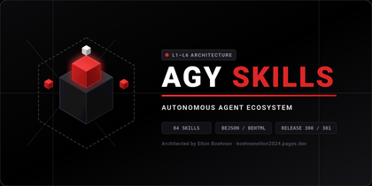
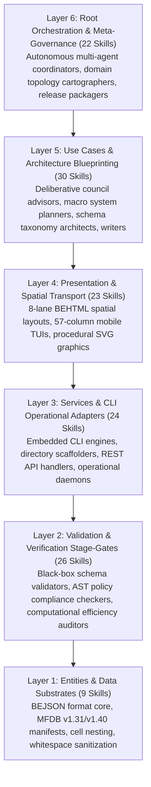

# AGYSKILLS: The Consolidated Autonomous Agent Capability Ecosystem

> **The Authoritative Capability Repository for Autonomous Coding Agents, Multi-Agent Orchestration, and Zero-SQL BEJSON Architectures**



## Executive Specification Matrix

| Dimension | Ecosystem Specification | Technical Standard |
| :--- | :--- | :--- |
| **Total Certified Skills** | 134 Modular Capability Packages | 100% Linter Passing (`Code 0`) |
| **Architectural Tiering** | 6-Tier Layered Skill Architecture | L1 Substrate $\rightarrow$ L6 Composition Root |
| **Underlying Formats** | BEJSON 104a (Foundational) & 105a (Integrity) | Strict Schema Registries |
| **Trigger Collision Rate** | Zero ($0.0\%$) Semantic Trigger Overlap | $J(T^+(S_a), T^+(S_b)) < 0.25$ or Reciprocal Exclusion |
| **Spatial Layout Engine** | BEHTML 8-Lane / Ry=32px Quantized Grids | 18-Field `BEHTMLElement` Datasets |
| **Ecosystem Write-Owner** | `skill-ecosystem-cartographer` (Layer 6) | `data/skill_registry_catalog.104a.bejson` |
| **Author & Maintainer** | Elton Boehnen | boehnenelton2024@gmail.com · boehnenelton2024.pages.dev |

---

## Table of Contents
1. [System Architecture & 6-Tier Hierarchy](#system-architecture--6-tier-hierarchy)
2. [Core Operating Directives & Policy Absolutes](#core-operating-directives--policy-absolutes)
3. [The Domain Cartography Subsystem](#the-domain-cartography-subsystem)
4. [Master Feature Catalog & Skills Directory](#master-feature-catalog--skills-directory)
   - [Layer 1: Entities & Data Substrates (9 Skills)](#layer-1-entities--data-substrates-9-skills)
   - [Layer 2: Validation & Verification Stage-Gates (26 Skills)](#layer-2-validation--verification-stage-gates-26-skills)
   - [Layer 3: Services & CLI Operational Adapters (24 Skills)](#layer-3-services--cli-operational-adapters-24-skills)
   - [Layer 4: Presentation & Spatial Transport (23 Skills)](#layer-4-presentation--spatial-transport-23-skills)
   - [Layer 5: Use Cases & Architecture Blueprinting (30 Skills)](#layer-5-use-cases--architecture-blueprinting-30-skills)
   - [Layer 6: Root Orchestration & Meta-Governance (22 Skills)](#layer-6-root-orchestration--meta-governance-22-skills)
5. [CLI Tooling & Developer Workflows](#cli-tooling--developer-workflows)
6. [Automated Verification, Quality Gates & Certification](#automated-verification-quality-gates--certification)
7. [Installation, Setup & Usage](#installation-setup--usage)
8. [Author, Maintenance & Licensing](#author-maintenance--licensing)

---

## System Architecture & 6-Tier Hierarchy

The AGYSKILLS repository is engineered upon Elton Boehnen's **6-Tier Layered Skill Architecture**. This decoupled structural model enforces unidirectional downward calls, strict layer boundary contracts, and modular isolation across every capability:



### Strict Architectural Invariants
- **Downward Dependency Law**: Any skill at Layer $L_i$ may only depend on skills at Layer $L_j$ where $j < i$. Upward calls trigger `Code 434 (E_COORDINATOR_UPWARD_DEPENDENCY)`.
- **Disjoint Activation Principle**: Every skill pair $(S_a, S_b)$ must satisfy $A(S_a) \cap A(S_b) = \emptyset$. Semantic positive trigger overlaps ($J \ge 0.25$) without mutual negative redirections trigger `Code 431`.
- **Single Write-Ownership**: Every persistent state file (e.g. `skill_registry_catalog.104a.bejson`, `definitions_registry.104a.bejson`) has exactly one authoritative Layer 6 Write-Owner skill.
- **Deterministic Exit Codes**: All CLI tools implement deterministic POSIX exit codes: `0` (Success), `20` (Path/IO Failure), `30` (Schema/Validation Failure).

---

## Core Operating Directives & Policy Absolutes

AGYSKILLS embodies strict adherence to Elton Boehnen's core system policies:

1. **Policy §6.2: O(1) Field Map Caching**: Hardcoded positional indexing (`row[i]`) is completely banned. All BEJSON operations dynamically extract the field index map (`bejson_core_get_field_map()`) and perform $O(1)$ key lookups.
2. **Policy §10.9: Boundary-Layer Whitespace Sanitization**: All incoming payload dictionaries, record rows, and cell strings undergo whitespace stripping before serialization or schema verification.
3. **Policy §4.5: Pointer-Only Environmental References**: Scripts never hardcode filesystem directories, absolute paths, or API credentials. Abstract pointers (`ENV:<var_name>`) resolve dynamically against `definitions.json`.
4. **Policy §8.1: Tri-Color Visual Standards**: Interfaces and terminal menus adhere to the Tri-Color palette (`#ffffff`, `#000000`, and `#DE2626` / ANSI Red accents).
5. **Policy §2.3: Global Structured Daily Logging**: Post-task execution telemetry routes directly into daily partitions (`$GLOBAL_LOGS/Log-<YYYY-MM-DD>.bejson`) via the Loaded Chamber logging pattern.

---

## The Domain Cartography Subsystem

A defining innovation of AGYSKILLS is the specialized **Domain Cartographer Suite**. Operating at Layer 6, these cartographers survey filesystem trees, extract live metadata, and compile authoritative BEJSON 104a registries:

| Cartographer Skill | Managed Domain | Canonical Registry Target | Primary Discovery Capabilities |
| :--- | :--- | :--- | :--- |
| [`skill-ecosystem-cartographer`](./skill-ecosystem-cartographer/SKILL.md) | Meta-Governance | `data/skill_registry_catalog.104a.bejson` | Scans all installed skills, enforces layer assignments, and audits pairwise trigger collision matrices. |
| [`behtml-domain-cartographer`](./behtml-domain-cartographer/SKILL.md) | Spatial Layouts | `data/behtml_spatial_registry.104a.bejson` | Traverses HTML documents, indexes 8-lane / 16-sublane coordinate bounds, and audits OptionSets. |
| [`mfdb-domain-cartographer`](./mfdb-domain-cartographer/SKILL.md) | Federated Databases | `data/mfdb_topology_registry.104a.bejson` | Discovers `104a.mfdb.bejson` and `105a.mfdb.bejson` manifests and maps cross-entity foreign keys. |
| [`bejson-cms-domain-cartographer`](./bejson-cms-domain-cartographer/SKILL.md) | Web Microservices | `data/cms_service_map.104a.bejson` | Catalogs Flask blueprints, HTTP endpoints, underlying content stores, and dynamic page skeletons. |
| [`definitions-cartographer`](./definitions-cartographer/SKILL.md) | Ecosystem Lexicon | `data/definitions_registry.104a.bejson` | Resolves canonical terminology, system contracts, acronyms, and speech-to-text semantic aliases. |

---

## Master Feature Catalog & Skills Directory

The 134 skills comprising the ecosystem are cataloged below across their assigned structural layers, detailing positive activation triggers, negative guardrails, and downward dependencies:

### Layer 1: Entities & Data Substrates (9 Skills)

> *Foundational data representations, format primitives, recursive cell nesting, and sanitization boundaries.*

- [`behtml-format-core`](./behtml-format-core/SKILL.md) (`L0_Substrate_L1_Entities` | `5b50a57b940f`): authoring, modifying, inspecting, or serializing BEHTML documents, defining OptionSets, calculating 8-lane/16-sublane (6.25% half-cell) and 32px dimensions, or implementing low-level BEHTML primitives
  - **Redirections**: `behtml-design-preferences,behtml-layout-builder,behtml-schema-validator`
- [`bejson-104-core`](./bejson-104-core/SKILL.md) (`L0_Substrate_L1_Entities` | `ca15ad8643b5`): manipulating .104.bejson entity tables, .104a.bejson ScriptConfig/tracker files (config/config.json, .bejson_project.json), or .104db.bejson multi-entity stores without Format 105 field_uuid/record_uuid columns
  - **Redirections**: `bejson-104-nesting-core,bejson-104-validator,bejson-105-core,bejson-105-upgrade-automator,bejson-105-validator,mfdb-104-core,template-104-template`
- [`bejson-104-nesting-core`](./bejson-104-nesting-core/SKILL.md) (`L0_Substrate_L1_Entities` | `6d053076c8f2`): working with Nested 104 hierarchical cell payloads or running lib_bejson_Core_bejson_core_nesting and lib_bejson_Core_bejson_nesting_query across Python, JS, TS, or Bash
  - **Redirections**: `bejson-104-core,bejson-104-validator,bejson-105-core,bejson-105-upgrade-automator,bejson-105-validator,mfdb-104-core`
- [`bejson-105-core`](./bejson-105-core/SKILL.md) (`L0_Substrate_L1_Entities` | `133df594ca98`): constructing or mutating Format 105, 105a, or 105db documents or calling libraries_105 runtime APIs
  - **Redirections**: `bejson-104-core,bejson-104-nesting-core,bejson-104-validator,bejson-105-upgrade-automator,bejson-105-validator`
- [`bejson-sanitization-core`](./bejson-sanitization-core/SKILL.md) (`L0_Substrate_L1_Entities` | `5f6513f061d6`): writing or refactoring BEJSON parsers, serializers, or ingestion pipelines, stripping whitespace from incoming dictionary keys and table cells, or embedding sanitization decorators and middleware
  - **Redirections**: `bejson-104-core,bejson-104-validator,bejson-105-core,policy-bejson-auditor`
- [`chunking-core`](./chunking-core/SKILL.md) (`L0_Substrate_L1_Entities` | `7524128e982f`): chunking directories, codebases, project repositories, and individual Admin Library families (104/105 Lib_JS, Lib_PY, Lib_SH, Lib_TS) into standardized single-file flat BEJSON archives (.104a.bejson.txt or .bejson.txt) using the Chunked-104 schema, and unchunk archives back to directory trees or zip files using Simple_Chunker_CLI. Suited for smaller pieces, library families, and unversioned folders without tracker overhead. Defaults to Is_Binary off (pure text files only), chunk-in-target disabled, and no project tracker required. For snapshotting entire libraries_104 or libraries_105 projects with version tracking, use project-chunker-archiver; for complete library orchestration, use library-chunker
  - **Redirections**: `bejson-chunker-engine,mfdb-104-chunker`
- [`gemini-interactions-core`](./gemini-interactions-core/SKILL.md) (`L0_Substrate_L1_Entities` | `6c16004ae16e`): building or refactoring applications to use the Gemini Interactions API lifecycle, managing stateful session IDs, consuming streaming deltas, or executing background model tasks
  - **Redirections**: `cli-ai-standardizer,gemini-tooling-manager`
- [`mfdb-104-core`](./mfdb-104-core/SKILL.md) (`L0_Substrate_L1_Entities` | `a7363ff99301`): managing 104a.mfdb.bejson manifests, registering 104 entity tables, or validating bidirectional manifest-to-entity paths
  - **Redirections**: `bejson-104-core,mfdb-104-chunker,mfdb-105-core,mfdb-105-validator`
- [`mfdb-105-core`](./mfdb-105-core/SKILL.md) (`L0_Substrate_L1_Entities` | `aec0cf81a743`): mutating 105a.mfdb.bejson manifests, inserting or querying Format 105 entity tables, managing encrypted AES-GCM cells, or updating 105 multi-plane clusters
  - **Redirections**: `bejson-105-core,mfdb-104-core,mfdb-105-upgrade-coordinator,mfdb-105-validator,mfdb-multi-architect`

### Layer 2: Validation & Verification Stage-Gates (26 Skills)

> *Deterministic black-box validators, computational efficiency auditors, and pre-release verification gates.*

- [`audit-adversarial-reviewer`](./audit-adversarial-reviewer/SKILL.md) (`L1_Validation_L2_Verification` | `e8533c813a1b`): evaluating Flask endpoints, auditing single-script web services, reviewing Python backend logic for edge-case vulnerabilities, or when an adversarial security and correctness audit is requested
  - **Redirections**: `audit-hostile-finalizer,playwright-debugger-auditor,policy-bejson-auditor`
- [`audit-constraint-auditor`](./audit-constraint-auditor/SKILL.md) (`L1_Validation_L2_Verification` | `f7b40ae4d8bd`): conducting negative boundary reviews, verifying policy compliance against off-limits files, auditing rules for defensive negative constraints, or preventing architectural violations
  - **Redirections**: `audit-deviation-auditor,audit-domain-coordinator,audit-readiness-auditor,goal-drift-auditor,policy-secrets-leak-auditor`
- [`audit-deviation-auditor`](./audit-deviation-auditor/SKILL.md) (`L1_Validation_L2_Verification` | `52e4c8dd43e0`): performing post-session or mid-project goal reconciliation, auditing system state against project specifications, verifying whether agent execution honored all constraints, or generating recovery plans
  - **Redirections**: `audit-efficiency-auditor,audit-gap-planner,audit-redundancy-planner,goal-drift-auditor`
- [`audit-efficiency-auditor`](./audit-efficiency-auditor/SKILL.md) (`L1_Validation_L2_Verification` | `0b83e782f6a7`): probing specified systems for performance bottlenecks, redundant logic, loop I/O churn, duplicate functions, dead code, or context bloat across multiple deliberate review passes
  - **Redirections**: `arch-layered-refactor,policy-bejson-auditor,skill-ecosystem-cartographer`
- [`audit-hostile-finalizer`](./audit-hostile-finalizer/SKILL.md) (`L1_Validation_L2_Verification` | `9f2db786286a`): finalizing coding tasks, conducting pre-delivery reviews, or wrapping up development sessions
  - **Redirections**: `goal-drift-auditor,playwright-debugger-auditor,policy-bejson-auditor`
- [`audit-readiness-auditor`](./audit-readiness-auditor/SKILL.md) (`L1_Validation_L2_Verification` | `532c62d121e9`): verifying environment readiness before executing roadmaps, auditing prerequisite toolchains and file dependencies, validating input data files prior to batch processing, or conducting pre-flight staging audits
  - **Redirections**: `audit-constraint-auditor,audit-deviation-auditor,audit-domain-coordinator,goal-drift-auditor,policy-secrets-leak-auditor`
- [`behtml-schema-validator`](./behtml-schema-validator/SKILL.md) (`L1_Validation_L2_Verification` | `d146702ca393`): auditing BEHTML documents, detecting schema drift, inspecting error codes (300-329), verifying collision boundaries, validating URL schemes, or checking cyclic parent hierarchies
  - **Redirections**: `behtml-format-core,behtml-layout-builder,bejson-104-validator`
- [`bejson-104-validator`](./bejson-104-validator/SKILL.md) (`L1_Validation_L2_Verification` | `32dd2ee308e4`): executing Layer 2 stage-gate validation on .104.bejson, .104a.bejson, or .104db.bejson files
  - **Redirections**: `bejson-104-core,bejson-104-nesting-core,bejson-105-core,bejson-105-upgrade-automator,bejson-105-validator,policy-bejson-auditor,template-104-template`
- [`bejson-105-validator`](./bejson-105-validator/SKILL.md) (`L1_Validation_L2_Verification` | `ac3b766e0cf2`): executing Layer 2 stage-gate verification on .105.bejson, .105a.bejson, or .105db.bejson files
  - **Redirections**: `bejson-104-core,bejson-104-nesting-core,bejson-104-validator,bejson-105-core,bejson-105-upgrade-automator,mfdb-105-validator`
- [`bejson-chunker-engine`](./bejson-chunker-engine/SKILL.md) (`L1_Validation_L2_Verification` | `bceafe6f6db7`): packaging codebases into single-file text archives, unchunking .bejson.txt files, creating prompt context snapshots, or archiving library families
  - **Redirections**: `bejson-104-core,bejson-schema-validator,chunking-core,library-chunker,mfdb-104-chunker,project-chunker-archiver,simple-chunker`
- [`bejson-codebase-auditor`](./bejson-codebase-auditor/SKILL.md) (`L1_Validation_L2_Verification` | `747300abb252`): auditing codebases for BEJSON data mismatches, detecting schema corruption, identifying raw positional row indexing, scanning for non-atomic writes or silent exceptions, sniffing out cryptic variable names violating the Hierarchy-Group-Purpose triad, or evaluating entity taxonomies without mutating any files
  - **Redirections**: `bejson-104-validator,bejson-105-validator,bejson-codebase-refactor,code-taxonomy-architect,policy-bejson-auditor`
- [`bejson-schema-validator`](./bejson-schema-validator/SKILL.md) (`L1_Validation_L2_Verification` | `f788ee87b3f6`): verifying BEJSON files of unknown, mixed, or evolving eras, executing Layer 2 stage gates on data stores, checking POL-002 primitive-only rules, or verifying E90-E95 UUID integrity
  - **Redirections**: `behtml-schema-validator,mfdb-105-validator,policy-bejson-auditor`
- [`env-pointer-validator`](./env-pointer-validator/SKILL.md) (`L1_Validation_L2_Verification` | `de9cdb2fc12b`): auditing codebases for hardcoded filesystem paths, validating environmental pointer references before deployment, or checking definitions.json key resolution
  - **Redirections**: `definitions-cartographer,env-definitions-manager,env-migration-automator,policy-secrets-leak-auditor`
- [`goal-drift-auditor`](./goal-drift-auditor/SKILL.md) (`L1_Validation_L2_Verification` | `6cd167bdda57`): auditing active agent execution against goal contracts, checking git diffs for scope creep, intercepting counter-productive file edits, or confirming user override requests
  - **Redirections**: `audit-hostile-finalizer,goal-contract-architect,goal-roadmap-composer,policy-bejson-auditor`
- [`job-conformance-validator`](./job-conformance-validator/SKILL.md) (`L1_Validation_L2_Verification` | `cb939bc50a19`): auditing job files in $JOBS_FOLDER, validating newly instantiated job templates before execution, verifying completion proofs before archiving, or diagnosing JobMaker 104a parse errors
  - **Redirections**: `bejson-104-validator,job-lifecycle-coordinator,job-template-composer,job-workflow-manager`
- [`library-chunker`](./library-chunker/SKILL.md) (`L1_Validation_L2_Verification` | `df0dfa1a6b9e`): chunking 104 or 105 libraries, refreshing Chunked_Libraries, or packaging cross-system library slices
  - **Redirections**: `bejson-chunker-engine,mfdb-104-chunker,project-chunker-archiver,simple-chunker`
- [`log-compliance-auditor`](./log-compliance-auditor/SKILL.md) (`L1_Validation_L2_Verification` | `58b912193d72`): verifying session logging compliance, auditing daily log sinks for missing task entries, validating logging tool invocation payloads, or running post-session telemetry audits
  - **Redirections**: `audit-deviation-auditor,log-analytics-decomposer,log-telemetry-coordinator,policy-secrets-leak-auditor`
- [`mfdb-104-chunker`](./mfdb-104-chunker/SKILL.md) (`L1_Validation_L2_Verification` | `1322682f443d`): collapsing an MFDB directory or codebase into a portable .mfdb132.bejson bundle or mounting a chunked container
  - **Redirections**: `bejson-104-core,mfdb-104-core,mfdb-105-validator`
- [`mfdb-105-validator`](./mfdb-105-validator/SKILL.md) (`L1_Validation_L2_Verification` | `66e027636ace`): auditing MFDB v1.40 databases containing Format 105 entities or cross-table foreign keys
  - **Redirections**: `bejson-105-validator,mfdb-104-chunker,mfdb-104-core`
- [`mfdb-schema-validator`](./mfdb-schema-validator/SKILL.md) (`L1_Validation_L2_Verification` | `4eb8bd33d001`): executing Layer 2 pre-flight or post-mutation verification gates on 104a.mfdb.bejson or 105a.mfdb.bejson manifests, detecting dangling foreign keys, checking circular parent-child links, or auditing multi-manifest cluster consistency
  - **Redirections**: `bejson-104-validator,bejson-105-validator,mfdb-104-core,mfdb-105-core,mfdb-105-upgrade-coordinator,mfdb-multi-architect`
- [`playwright-debugger-auditor`](./playwright-debugger-auditor/SKILL.md) (`L1_Validation_L2_Verification` | `15187d77fb46`): investigating web game load issues, verifying canvas rendering, auditing client-side crashes, or debugging files dropped into a target folder
  - **Redirections**: `playwright-stealth-agent,playwright-termux-automation,policy-bejson-auditor`
- [`playwright-visual-testing`](./playwright-visual-testing/SKILL.md) (`L1_Validation_L2_Verification` | `2ecc76712b25`): validating visual regressions, inspecting mobile/tablet/desktop responsive layouts (360px, 768px, 1280px), verifying color token adherence, or generating baseline visual regression reports
  - **Redirections**: `playwright-debugger-auditor,playwright-stealth-agent,playwright-termux-automation`
- [`policy-bejson-auditor`](./policy-bejson-auditor/SKILL.md) (`L1_Validation_L2_Verification` | `489cb90c17b5`): executing a Layer 2 verification gate after scaffolding or modifying any BEJSON code module
  - **Redirections**: `bejson-104-validator,bejson-105-validator,template-104-template`
- [`policy-conflict-auditor`](./policy-conflict-auditor/SKILL.md) (`L1_Validation_L2_Verification` | `4594f83ffab8`): auditing long policies, hunting contradictions or ambiguities, reviewing specifications, resolving competing rules, or establishing exception registries
  - **Redirections**: `arch-layered-refactor,behtml-schema-validator,bejson-104-validator,prompt-placeholder-composer,skill-architect`
- [`policy-secrets-leak-auditor`](./policy-secrets-leak-auditor/SKILL.md) (`L1_Validation_L2_Verification` | `812f6d44aeaf`): auditing repositories for exposed secrets, verifying zero-leakage credential compliance in BEJSON key caches, inspecting session logs prior to distribution, or validating pre-commit security gates
  - **Redirections**: `audit-adversarial-reviewer,policy-bejson-auditor,policy-conflict-auditor`
- [`simple-chunker`](./simple-chunker/SKILL.md) (`L1_Validation_L2_Verification` | `fa61cd5e18c7`): needing fast, lightweight, standalone in-place or scratch directory chunks without committing to persistent archive registries
  - **Redirections**: `bejson-chunker-engine,library-chunker,mfdb-104-chunker,project-chunker-archiver`

### Layer 3: Services & CLI Operational Adapters (24 Skills)

> *Standalone CLI file processors, directory scaffolders, REST API handlers, and operational daemons.*

- [`agy-prompt-automator`](./agy-prompt-automator/SKILL.md) (`L2_Adapters_L3_Services` | `8cbf5beb0606`): creating agy prompt templates, structuring targeted subfolder audits with explicit user approval, generating 25-50 point feature menus or schemas, and running sandboxed CLI workflows across projects in Termux, Linux, or macOS
  - **Redirections**: `bejson-scaffold-bash`
- [`auto-processing-standardizer`](./auto-processing-standardizer/SKILL.md) (`L2_Adapters_L3_Services` | `4fcd3da11033`): creating or modernizing non-file-processing CLI tools, utility scripts, or operational commands
  - **Redirections**: `auto-processing-toolbuilder`
- [`auto-processing-toolbuilder`](./auto-processing-toolbuilder/SKILL.md) (`L2_Adapters_L3_Services` | `dbb30d805a41`): creating or refactoring Python CLI tools specifically for file processing, batch media conversions, asset pipelines, or document transforms
  - **Redirections**: `auto-processing-standardizer`
- [`behtml-scaffold-automator`](./behtml-scaffold-automator/SKILL.md) (`L2_Adapters_L3_Services` | `f4ccb8d671fe`): compiling BEHTML layouts into static distribution builds, injecting Tri-Color CSS variables, auditing HTML documents for zero-filler compliance before shipping, or staging web assets into distribution directories
  - **Redirections**: `behtml-format-core,behtml-layout-builder,behtml-schema-validator`
- [`bejson-105-upgrade-automator`](./bejson-105-upgrade-automator/SKILL.md) (`L2_Adapters_L3_Services` | `4606b27ed308`): upgrading existing 104-series files to 105-series without triggering E95 (E_105_FAIL_ON_SWITCH)
  - **Redirections**: `bejson-104-core,bejson-104-nesting-core,bejson-104-validator,bejson-105-core,bejson-105-validator,mfdb-105-upgrade-coordinator`
- [`bejson-cms-publish-automator`](./bejson-cms-publish-automator/SKILL.md) (`L2_Adapters_L3_Services` | `a36d1cee84cc`): building static assets, launching preview servers, or taking responsive QA screenshots of published BEJSON CMS sites
  - **Redirections**: `bejson-cms-blog-writer,bejson-cms-canvas-illustrator`
- [`bejson-media-pipeline`](./bejson-media-pipeline/SKILL.md) (`L2_Adapters_L3_Services` | `3b12b4b8ebb1`): designing media processing tools, batch audio/video scripts, auto-slideshow generators, visualizers, watermarkers, transcoders, or clip chunkers where files in an assets folder are processed automatically with atomic I/O
  - **Redirections**: `chunking-core`
- [`bejson-migration-pipeline`](./bejson-migration-pipeline/SKILL.md) (`L2_Adapters_L3_Services` | `89f11fa03274`): importing external tabular data into BEJSON, migrating SQLite databases to MFDB, converting CSV tables to BEJSON, or modernizing flat storage
  - **Redirections**: `bejson-104-core,bejson-104-validator,bejson-105-upgrade-automator,bejson-codebase-refactor`
- [`bejson-scaffold-bash`](./bejson-scaffold-bash/SKILL.md) (`L2_Adapters_L3_Services` | `911d1dfe8ee4`): asking to create, scaffold, or start a new bash/shell script, Termux tool, or CLI touching BEJSON documents
  - **Redirections**: `bejson-scaffold-javascript,bejson-scaffold-python`
- [`bejson-scaffold-javascript`](./bejson-scaffold-javascript/SKILL.md) (`L2_Adapters_L3_Services` | `965c62306d15`): asking to create, scaffold, or start a new plain JS file, browser script, or Node script touching BEJSON documents
  - **Redirections**: `behtml-layout-builder,bejson-scaffold-bash,bejson-scaffold-python`
- [`bejson-scaffold-python`](./bejson-scaffold-python/SKILL.md) (`L2_Adapters_L3_Services` | `0a81281fe95e`): asking to create, scaffold, or start a new Python script, tool, CLI, or Component app that touches BEJSON documents
  - **Redirections**: `bejson-codebase-refactor,bejson-scaffold-bash,bejson-scaffold-javascript`
- [`cli-ai-standardizer`](./cli-ai-standardizer/SKILL.md) (`L2_Adapters_L3_Services` | `93decaf1d5ed`): building AI-powered CLI file processors, autoprompters, batch AI asset transformers, or refactoring CLI AI scripts to use zero-SDK REST endpoints
  - **Redirections**: `auto-processing-standardizer,auto-processing-toolbuilder`
- [`env-definitions-manager`](./env-definitions-manager/SKILL.md) (`L2_Adapters_L3_Services` | `adc35adcbb06`): adding new directory paths to definitions.json, querying ecosystem environment variables, updating canonical paths, or inspecting environment store integrity
  - **Redirections**: `definitions-cartographer,env-migration-automator,env-pointer-validator,policy-secrets-leak-auditor`
- [`env-migration-automator`](./env-migration-automator/SKILL.md) (`L2_Adapters_L3_Services` | `c3a92b01c218`): migrating legacy scripts to definitions.json, retiring deprecated paths.json references before the 2027 sunset deadline, or updating environment preambles
  - **Redirections**: `bejson-105-upgrade-automator,env-definitions-manager,env-pointer-validator,mfdb-105-upgrade-coordinator`
- [`file-subfolder-automator`](./file-subfolder-automator/SKILL.md) (`L2_Adapters_L3_Services` | `e568260adbe5`): scaffolding a new project directory, migrating legacy project tracking notes from docs/ to dev/, bootstrapping config/config.json defaults, or enforcing self-locating script path preambles
  - **Redirections**: `bejson-104-core,file-archive-coordinator,skill-architect`
- [`gemini-tooling-manager`](./gemini-tooling-manager/SKILL.md) (`L2_Adapters_L3_Services` | `5c66bc6011d2`): defining function tools, executing tool-calling loops, handling parallel or chained function steps, or configuring built-in tools in Gemini Interactions API workflows
  - **Redirections**: `gemini-interactions-core`
- [`job-workflow-manager`](./job-workflow-manager/SKILL.md) (`L2_Adapters_L3_Services` | `e95ec49ab490`): creating jobs or templates, instantiating templates into fresh job schemas, tracking job states, running jobs one task at a time, injecting contextualized plans or last-task outputs, or auditing task completion
  - **Redirections**: `arch-layered-refactor,bejson-scaffold-bash`
- [`litert-lm-server`](./litert-lm-server/SKILL.md) (`L2_Adapters_L3_Services` | `b7422a295c70`): deploying local LLM endpoints, building OpenAI-compatible LiteRT proxies, configuring on-device tool calling loops, or tuning edge inference budgets
  - **Redirections**: `gemini-interactions-core,skill-chain-coordinator`
- [`playwright-stealth-agent`](./playwright-stealth-agent/SKILL.md) (`L2_Adapters_L3_Services` | `2cc2633d36e2`): automating interactions on bot-protected pages, testing WAF challenge flows (Cloudflare/DataDome), or simulating realistic human navigation
  - **Redirections**: `playwright-debugger-auditor,playwright-termux-automation`
- [`playwright-termux-automation`](./playwright-termux-automation/SKILL.md) (`L2_Adapters_L3_Services` | `f2befbb3c462`): executing headless or headful browser sessions in Termux, capturing page screenshots, rendering dynamic SPAs, evaluating in-browser JavaScript, handling HTTP authentication, and managing browser process lifecycles
- [`project-bejson-cms-manage`](./project-bejson-cms-manage/SKILL.md) (`L2_Adapters_L3_Services` | `527a4299f755`): executing cms-manage or newagent-manage commands, authoring two-part pages (manifest + 104db content), drafting and promoting skeleton templates, running headless static site builds, converting media assets to WebP, linking canvas SVG featured banners, or staging database snapshots
  - **Redirections**: `bejson-104-core,project-bejson-cms-grounding,skill-architect`
- [`project-chunker-archiver`](./project-chunker-archiver/SKILL.md) (`L2_Adapters_L3_Services` | `c5f5421c6d76`): archiving whole projects, chunking codebases into portable BEJSON snapshots, scooping verified directories, or restoring project releases
  - **Redirections**: `bejson-104-core,mfdb-104-core`
- [`publication-tweet-automator`](./publication-tweet-automator/SKILL.md) (`L2_Adapters_L3_Services` | `ea6325b792e9`): generating Twitter-optimized images for promotional tweets, creating visual thread hero cards, seeking deterministic SVG canvas keyframes for social media, or registering social media captures into BEJSON manifests
  - **Redirections**: `playwright-termux-automation,playwright-visual-testing,publication-html-builder`
- [`skill-backup-manager`](./skill-backup-manager/SKILL.md) (`L2_Adapters_L3_Services` | `d249d4f52444`): the user asks to back up skills, archive skills, export skills to Drive, sync modified skills to the skill backup directory, or verify skill backup integrity
  - **Redirections**: `file-archive-coordinator,project-delivery-packager,skill-architect`

### Layer 4: Presentation & Spatial Transport (23 Skills)

> *Spatially locked BEHTML templates, 57-column mobile TUIs, procedural SVG graphics, and bare skeletons.*

- [`behtml-104-builder`](./behtml-104-builder/SKILL.md) (`L4_Presentation_Transport` | `0fc1a18535f1`): building UI/TUI components, CMS views, or diagrams backed by libraries_104 vertical families
  - **Redirections**: `behtml-design-preferences,behtml-templates,bejson-104-core,bejson-105-core,publication-html-builder,template-104-template`
- [`behtml-design-preferences`](./behtml-design-preferences/SKILL.md) (`L4_Presentation_Transport` | `63a29b2a478d`): establishing design rules, auditing layout geometry, configuring spatial coordinates, or styling BEHTML components
  - **Redirections**: `behtml-104-builder,behtml-templates,publication-html-builder`
- [`behtml-document-template`](./behtml-document-template/SKILL.md) (`L4_Presentation_Transport` | `f78f661b4c54`): creating formal web documents, specifications, or operational telemetry reports using the canonical BEHTML document templates: Document with Shelf (16-sublane stage, Row 1 32px title bar, Rows 2..18 544px canvas, Row 19 32px buffer, Rows 20..24 160px widget shelf with 150x150px slots), Document Widgetless Variant (full-canvas document for uninterrupted technical reading), and Declaration of Standardization (clean empty scaffold for standardization records with preset headers, 1-tab multi-file switcher, and word-wrapped blank input box). Use ONLY when creating formal web documents, specifications, or operational telemetry reports
  - **Redirections**: `behtml-104-builder,behtml-design-preferences,behtml-templates`
- [`behtml-layout-builder`](./behtml-layout-builder/SKILL.md) (`L4_Presentation_Transport` | `f23c84bf364e`): generating BEHTML layouts, designing spatial UI templates, constructing 18-field BEHTMLElement datasets, or rendering spatially locked web interfaces
  - **Redirections**: `behtml-format-core,behtml-schema-validator,ui-navigation-decomposer`
- [`behtml-templates`](./behtml-templates/SKILL.md) (`L4_Presentation_Transport` | `ce6d0629aeeb`): generating production HTML templates, web documents, or dashboards from canonical examples
  - **Redirections**: `behtml-104-builder,behtml-design-preferences,publication-html-builder`
- [`bejson-cms-canvas-illustrator`](./bejson-cms-canvas-illustrator/SKILL.md) (`L4_Presentation_Transport` | `8c40062dd160`): creating static featured post imagery, architecture schematics, or CMS headers
  - **Redirections**: `behtml-layout-builder,bejson-cms-blog-writer,canvas-animation-studio`
- [`bejson-diagram-component`](./bejson-diagram-component/SKILL.md) (`L4_Presentation_Transport` | `7e0e3d276dde`): asked to generate an embeddable diagram component, portable diagram widget, or embed an interactive diagram directly into an existing webpage
  - **Redirections**: `bejson-diagrammer-cli`
- [`bejson-diagrammer-cli`](./bejson-diagrammer-cli/SKILL.md) (`L4_Presentation_Transport` | `fc3334b33426`): asked to generate diagrams, architecture flowcharts, BEJSON MFDB diagram schemas, extend active board diagrams, or compile interactive diagram canvas HTML files
  - **Redirections**: `bejson-diagram-component`
- [`bejson-enforcement-suite-builder`](./bejson-enforcement-suite-builder/SKILL.md) (`L4_Presentation_Transport` | `8ef3b844061c`): generating enforcement tests, building Policy 10.6 test suites, validating schema registry tests, or scaffolding factory reset harnesses
  - **Redirections**: `bejson-104-validator,bejson-105-validator,policy-bejson-auditor`
- [`bejson-tui-menu-builder`](./bejson-tui-menu-builder/SKILL.md) (`L4_Presentation_Transport` | `4adfc7d38009`): designing, auditing, or refactoring interactive Bash terminal menus, CLI daemon dashboards, or Termux portrait-mode TUIs
  - **Redirections**: `behtml-104-builder,behtml-document-template,bejson-104-core,design-terminal-cli,design-terminal-menu`
- [`canvas-animation-studio`](./canvas-animation-studio/SKILL.md) (`L4_Presentation_Transport` | `ce43cb338f6d`): authoring multi-frame SVG animations, building procedural animated graphics, or capturing deterministic visual sequences
  - **Redirections**: `behtml-layout-builder,bejson-cms-canvas-illustrator,playwright-termux-automation,playwright-visual-testing`
- [`code-manual-builder`](./code-manual-builder/SKILL.md) (`L4_Presentation_Transport` | `b7b51677294e`): asked to document a codebase or library ecosystem as an e-book or manual, generate a documentation portal with mobile navigation drawers, structure root/language/feed.html and root/language/module/index.html layouts, or create production documentation websites with raw source delivery
  - **Redirections**: `publication-html-builder`
- [`design-terminal-cli`](./design-terminal-cli/SKILL.md) (`L4_Presentation_Transport` | `fbfb61a59731`): designing, auditing, or refactoring terminal CLI tools, subcommand trees, or headless automation scripts
  - **Redirections**: `auto-processing-standardizer,bejson-tui-menu-builder,design-terminal-menu,template-literal-skeleton`
- [`design-terminal-menu`](./design-terminal-menu/SKILL.md) (`L4_Presentation_Transport` | `0997c8c1a717`): designing, auditing, or refactoring interactive terminal menus, daemon dashboards, or stateful selection flows
  - **Redirections**: `behtml-104-builder,bejson-tui-menu-builder,design-terminal-cli,template-literal-skeleton`
- [`log-analytics-decomposer`](./log-analytics-decomposer/SKILL.md) (`L4_Presentation_Transport` | `0bac84982cb9`): analyzing system error rates, extracting development velocity trends over time, auditing subsystem execution distributions, or visualizing daily log trends
  - **Redirections**: `audit-efficiency-auditor,log-compliance-auditor,log-telemetry-coordinator,ui-navigation-decomposer`
- [`publication-book-builder`](./publication-book-builder/SKILL.md) (`L4_Presentation_Transport` | `f2e1a4c9f20c`): writing multi-chapter technical books, generating publications from BookTypes, executing chapter quality gates, or compiling standalone HTML manuals
  - **Redirections**: `job-workflow-manager,planning-schema-planner,publication-blog-post-writer,publication-html-builder`
- [`publication-html-builder`](./publication-html-builder/SKILL.md) (`L4_Presentation_Transport` | `fc19537d0a07`): formatting standalone HTML publications, editorial technical reports, or compiling structured prose and telemetry into production HTML documents
  - **Redirections**: `behtml-104-builder,behtml-design-preferences,behtml-templates`
- [`readme-visual-enhancer`](./readme-visual-enhancer/SKILL.md) (`L4_Presentation_Transport` | `68155d2506af`): writing, refactoring, or visually enhancing README.md files
  - **Redirections**: `code-manual-builder,publication-book-builder,publication-html-builder`
- [`template-104-template`](./template-104-template/SKILL.md) (`L4_Presentation_Transport` | `556ae223ccbd`): scaffolding new Release 300 .104.bejson entity stores, .104a.bejson ScriptConfig/tracker files, .104db.bejson databases, or 104 owning writers
  - **Redirections**: `bejson-104-core,bejson-104-validator,code-taxonomy-architect,template-105-template,template-literal-skeleton`
- [`template-105-template`](./template-105-template/SKILL.md) (`L4_Presentation_Transport` | `a6a3fe0339bb`): scaffolding new Format 105, 105a, or 105db stores and 105 owning writers
  - **Redirections**: `bejson-105-core,bejson-105-upgrade-automator,template-104-template,template-literal-skeleton`
- [`template-literal-skeleton`](./template-literal-skeleton/SKILL.md) (`L4_Presentation_Transport` | `2bb62012303d`): 
  - **Redirections**: `template-104-template,template-105-template`
- [`ui-navigation-decomposer`](./ui-navigation-decomposer/SKILL.md) (`L4_Presentation_Transport` | `f966ecf24ecc`): analyzing existing websites, extracting site maps, reverse-engineering navigation trees, app menus, sidebar hierarchies, or breadcrumbs before planning new architectures
  - **Redirections**: `web-domain-coordinator,web-framework-architect,web-taxonomy-planner`
- [`web-ui-component-mapper`](./web-ui-component-mapper/SKILL.md) (`L4_Presentation_Transport` | `ccf9a39d1781`): analyzing existing web apps, mapping UI component trees, auditing interface surfaces for feature parity, generating hierarchical ASCII component blueprints, or preparing frontend structural specs
  - **Redirections**: `web-domain-coordinator,web-framework-architect,web-taxonomy-planner`

### Layer 5: Use Cases & Architecture Blueprinting (30 Skills)

> *Deliberative council advisors, macro system planners, schema taxonomy designers, and multi-part technical writers.*

- [`audit-gap-planner`](./audit-gap-planner/SKILL.md) (`L3_Use_Cases_Cross_Layer_Blueprinting` | `24242b497c75`): conducting architectural gap audits, identifying missing error codes or schema fields, finding untyped contracts or missing language implementations, or planning technical roadmap additions
  - **Redirections**: `audit-deviation-auditor,audit-efficiency-auditor,audit-redundancy-planner,goal-drift-auditor`
- [`audit-redundancy-planner`](./audit-redundancy-planner/SKILL.md) (`L3_Use_Cases_Cross_Layer_Blueprinting` | `eb75eebf3bf6`): identifying duplicate routines, auditing skill suites for routing collisions and overlap, consolidating duplicate data stores, or refactoring copy-pasted implementations into unified shared libraries
  - **Redirections**: `audit-deviation-auditor,audit-efficiency-auditor,audit-gap-planner,goal-drift-auditor`
- [`bejson-cms-admin-scout`](./bejson-cms-admin-scout/SKILL.md) (`L3_Use_Cases_Cross_Layer_Blueprinting` | `89819d34fd41`): brainstorming topics from real Admin codebases or configuring blog drafting pipelines
  - **Redirections**: `bejson-cms-blog-writer,bejson-cms-canvas-illustrator,bejson-cms-publish-automator`
- [`bejson-cms-blog-writer`](./bejson-cms-blog-writer/SKILL.md) (`L3_Use_Cases_Cross_Layer_Blueprinting` | `3ba8f0f64efc`): authoring multi-part technical blog posts or publishing into BEJSON CMS
  - **Redirections**: `bejson-cms-admin-scout,bejson-cms-canvas-illustrator,bejson-cms-publish-automator`
- [`bejson-codebase-refactor`](./bejson-codebase-refactor/SKILL.md) (`L3_Use_Cases_Cross_Layer_Blueprinting` | `d4059b1e9952`): provided code, scripts, or repository components in Python, TypeScript, JavaScript, or Bash and asked to refactor, modernize, optimize, or migrate data structures, configuration layers, persistence models, logs, or local storage to BEJSON while maintaining functional equivalence
  - **Redirections**: `spark-skill-refactor`
- [`bejson-doc-rewriter`](./bejson-doc-rewriter/SKILL.md) (`L3_Use_Cases_Cross_Layer_Blueprinting` | `43c53adefe0b`): rewriting technical coding architectures, system design documents, tutorials, API specifications, and software guides by transposing standard data formats, database systems, and state architectures into equivalent, practical BEJSON (104, 104a, 104db, Nested 104, MFDB v1.31/v1.32) paradigms while maintaining the conceptual integrity, depth, and structural fidelity of the original document. Translates abstract cloud or web architectures into practical local-first systems grounded in current BEJSON runtime capabilities
  - **Redirections**: `bejson-codebase-refactor`
- [`code-taxonomy-architect`](./code-taxonomy-architect/SKILL.md) (`L3_Use_Cases_Cross_Layer_Blueprinting` | `1f7275d7b0ed`): defining field names, variable identifiers, or library module signatures for 104 or 105 projects prior to template rendering
  - **Redirections**: `component-taxonomy-architect,policy-bejson-auditor`
- [`component-taxonomy-architect`](./component-taxonomy-architect/SKILL.md) (`L3_Use_Cases_Cross_Layer_Blueprinting` | `47e22c56f0ef`): modeling relational entity graphs and write-ownership boundaries before scaffolding
  - **Redirections**: `code-taxonomy-architect,planning-schema-planner`
- [`concept-idea-pattern-extraction`](./concept-idea-pattern-extraction/SKILL.md) (`L3_Use_Cases_Cross_Layer_Blueprinting` | `d99617e1890a`): harvesting ideas, extracting concept patterns, identifying reusable architectural motifs, or turning raw brainstorming into structured pattern cards
  - **Redirections**: `code-taxonomy-architect,concept-nuance-pattern-analysis,planning-schema-planner,prompt-placeholder-composer`
- [`concept-nuance-pattern-analysis`](./concept-nuance-pattern-analysis/SKILL.md) (`L3_Use_Cases_Cross_Layer_Blueprinting` | `a2b4153af41f`): inspecting the deep nuances, hidden constraints, why-it-works mechanics, or micro-pattern interactions of a concept or design specification
  - **Redirections**: `behtml-design-preferences,code-taxonomy-architect,component-taxonomy-architect,concept-idea-pattern-extraction`
- [`council-advise`](./council-advise/SKILL.md) (`L3_Use_Cases_Cross_Layer_Blueprinting` | `363c0840bbcb`): seeking high-level architectural counsel, deliberating strategic directions, brainstorming contextual plans across Elton's domains, or iteratively refining project roadmaps
  - **Redirections**: `bejson-codebase-refactor,council-grounding,goal-contract-architect,goal-roadmap-composer,job-workflow-manager`
- [`council-grounding`](./council-grounding/SKILL.md) (`L3_Use_Cases_Cross_Layer_Blueprinting` | `e7cfee2fdac5`): grounding new tasks in active system state, surveying recent global log activities, resolving environment storage roots, or auditing active domain constraints
  - **Redirections**: `bejson-104-core,council-advise,goal-contract-architect,skill-ecosystem-cartographer`
- [`goal-contract-architect`](./goal-contract-architect/SKILL.md) (`L3_Use_Cases_Cross_Layer_Blueprinting` | `85418f13c5f8`): defining new operational goals, formalizing project requirements into testable acceptance criteria, specifying negative boundaries, or updating amended goal scopes
  - **Redirections**: `goal-drift-auditor,goal-roadmap-composer,mfdb-multi-architect,planning-schema-planner`
- [`goal-roadmap-composer`](./goal-roadmap-composer/SKILL.md) (`L3_Use_Cases_Cross_Layer_Blueprinting` | `a6114f58ce62`): structuring multi-step implementation roadmaps, decomposing complex goals into small achievable tasks, generating project execution checklists, or staging JobMaker workflow plans
  - **Redirections**: `goal-contract-architect,goal-drift-auditor,ideation-feature-composer,job-workflow-manager`
- [`ideation-blog-post-planner`](./ideation-blog-post-planner/SKILL.md) (`L3_Use_Cases_Cross_Layer_Blueprinting` | `e89366a5d4a4`): planning blog posts, scanning project trees for writing topics, brainstorming technical articles, or categorizing development narratives by complexity
  - **Redirections**: `concept-idea-pattern-extraction,publication-blog-post-writer,publication-html-builder`
- [`ideation-feature-composer`](./ideation-feature-composer/SKILL.md) (`L3_Use_Cases_Cross_Layer_Blueprinting` | `95540c986025`): brainstorming product feature menus, authoring comprehensive CLI command trees, or structuring feature roadmaps
  - **Redirections**: `ideation-interview-composer,ideation-macro-composer`
- [`ideation-interview-composer`](./ideation-interview-composer/SKILL.md) (`L3_Use_Cases_Cross_Layer_Blueprinting` | `092fc0874856`): the user asks to plan, spec, or iteratively interview for a project, build a tool or doc with an interactive questionnaire, or generate a tailored builder prompt from numbered feature choices
  - **Redirections**: `ideation-feature-composer,ideation-macro-composer`
- [`ideation-macro-composer`](./ideation-macro-composer/SKILL.md) (`L3_Use_Cases_Cross_Layer_Blueprinting` | `1e320a5daf76`): starting from an abstract vision and needing deep speculative expansion before feature cataloging
  - **Redirections**: `ideation-feature-composer,planning-schema-planner`
- [`job-template-composer`](./job-template-composer/SKILL.md) (`L3_Use_Cases_Cross_Layer_Blueprinting` | `9d505915be99`): generating new JobMaker job schemas, authoring reusable task templates in templates/*.bejson, breaking down complex development missions into structured task DAGs, or parameterizing multi-step workflows
  - **Redirections**: `ideation-feature-composer,job-conformance-validator,job-lifecycle-coordinator,job-workflow-manager`
- [`mfdb-multi-architect`](./mfdb-multi-architect/SKILL.md) (`L3_Use_Cases_Cross_Layer_Blueprinting` | `daef48c844ec`): designing multi-file databases, planning federated data topologies, structuring multi-manifest clusters, modeling cross-file relational entity graphs, or generating administrative MFDB schemas
  - **Redirections**: `bejson-104-core,mfdb-104-chunker,mfdb-104-core,mfdb-105-validator,planning-schema-planner`
- [`planning-schema-planner`](./planning-schema-planner/SKILL.md) (`L3_Use_Cases_Cross_Layer_Blueprinting` | `029423795ef5`): planning new BEJSON databases, deciding between 104, 104a, 104db, and 105 variants, or scheduling 104-to-105 migrations
  - **Redirections**: `bejson-105-upgrade-automator,skill-chain-coordinator,template-104-template,template-105-template`
- [`project-bejson-cms-grounding`](./project-bejson-cms-grounding/SKILL.md) (`L3_Use_Cases_Cross_Layer_Blueprinting` | `d1c41aac763a`): analyzing CMS architecture, navigating src/web microservices and Flask blueprints, inspecting 104a.mfdb.bejson manifests, auditing static publishing pipelines, or understanding library dependencies across NewAgent/lib and tools_lib/na-cms
  - **Redirections**: `bejson-104-core,mfdb-104-core,project-bejson-cms-manage,skill-architect`
- [`prompt-placeholder-composer`](./prompt-placeholder-composer/SKILL.md) (`L3_Use_Cases_Cross_Layer_Blueprinting` | `9909237e4187`): parameterizing reusable templates or prompt presets for 104 or 105 workflows
  - **Redirections**: `component-taxonomy-architect,template-104-template,template-105-template`
- [`publication-blog-post-writer`](./publication-blog-post-writer/SKILL.md) (`L3_Use_Cases_Cross_Layer_Blueprinting` | `62a73f8f4fc6`): writing multi-part blog posts, drafting comprehensive technical articles, expanding planned article sections, or compiling modular publications
  - **Redirections**: `behtml-design-preferences,concept-idea-pattern-extraction,ideation-blog-post-planner`
- [`publication-tweet-composer`](./publication-tweet-composer/SKILL.md) (`L3_Use_Cases_Cross_Layer_Blueprinting` | `f3b62b8bb80a`): drafting viral launch threads for software repositories, auditing tweet drafts for character overflow, mapping tweets to Twitter-optimized canvas media cards, or generating copy-pasteable social media release packs
  - **Redirections**: `code-manual-builder,publication-blog-post-writer,publication-tweet-automator`
- [`spark-skill-refactor`](./spark-skill-refactor/SKILL.md) (`L3_Use_Cases_Cross_Layer_Blueprinting` | `558536081239`): inspecting or refactoring SKILL.md files for context bloat, trigger overlap, asymmetric negative guardrails (Codes 430-433), phonetic alias drift, placeholder compliance, and BEJSON 104a data contracts
  - **Redirections**: `agy-skill-refactor,bejson-codebase-refactor,definitions-cartographer,policy-conflict-auditor,skill-architect,skill-ecosystem-cartographer`
- [`template-architect`](./template-architect/SKILL.md) (`L3_Use_Cases_Cross_Layer_Blueprinting` | `802748fd30b6`): scaffolding empty web app layouts, building structural component containers with literal spatial labels, or generating starter templates
  - **Redirections**: `ui-navigation-decomposer,web-domain-coordinator,web-framework-architect,web-taxonomy-planner`
- [`web-framework-architect`](./web-framework-architect/SKILL.md) (`L3_Use_Cases_Cross_Layer_Blueprinting` | `7330ffbb759e`): compiling website routing, binding templates across folder depths, synthesizing sidebar trees, or enforcing web routing laws
  - **Redirections**: `ui-navigation-decomposer,web-domain-coordinator,web-taxonomy-planner`
- [`web-large-architect`](./web-large-architect/SKILL.md) (`L3_Use_Cases_Cross_Layer_Blueprinting` | `8e8f4760561d`): building or scaffolding multi-page websites, portals, video feeds, image galleries, documentation hubs, or e-books
  - **Redirections**: `ui-navigation-decomposer,web-domain-coordinator,web-framework-architect,web-taxonomy-planner`
- [`web-taxonomy-planner`](./web-taxonomy-planner/SKILL.md) (`L3_Use_Cases_Cross_Layer_Blueprinting` | `ffe2b49ba4d2`): designing data models, planning website directory structures, structuring multi-tier categories, or creating domain entity schemas
  - **Redirections**: `ui-navigation-decomposer,web-domain-coordinator,web-framework-architect`

### Layer 6: Root Orchestration & Meta-Governance (22 Skills)

> *Autonomous multi-agent coordinators, specialized domain cartographers, and release delivery packagers.*

- [`agy-plugins`](./agy-plugins/SKILL.md) (`L5_Composition_Root` | `fc8f689617fd`): packaging multi-skill ecosystems, building team developer bundles, configuring plugin-scoped MCP servers, or preparing plugins for marketplace distribution
  - **Redirections**: `agy-prompt-automator,agy-rules,agy-subagents`
- [`agy-rules`](./agy-rules/SKILL.md) (`L5_Composition_Root` | `0e2c7a5b4941`): crafting project rules, establishing directory boundaries, auditing rule files for token bloat, or debugging rule precedence
  - **Redirections**: `agy-plugins,agy-prompt-automator,agy-subagents`
- [`agy-skill-refactor`](./agy-skill-refactor/SKILL.md) (`L5_Composition_Root` | `1255ad56bdb4`): auditing or refactoring agy skills, prompt templates, daemons, or CLI automation pipelines
  - **Redirections**: `bejson-codebase-refactor,spark-skill-refactor`
- [`agy-subagents`](./agy-subagents/SKILL.md) (`L5_Composition_Root` | `506cc972bbae`): designing parallel research workers, background debugging agents, worktree refactoring tasks, or multi-agent pipelines
  - **Redirections**: `agy-plugins,agy-prompt-automator,agy-rules`
- [`arch-layered-refactor`](./arch-layered-refactor/SKILL.md) (`L5_Composition_Root` | `c97560c5dcec`): planning system-wide refactoring, structuring layered codebases, untangling circular dependencies, designing clean layer boundaries, or coordinating multi-skill refactoring workflows
  - **Redirections**: `agy-prompt-automator,bejson-codebase-refactor,planning-schema-planner`
- [`audit-domain-coordinator`](./audit-domain-coordinator/SKILL.md) (`L5_Composition_Root` | `0452df7e1207`): planning end-to-end repository audits, dispatching multi-stage quality gates, conducting pre-release certification, or coordinating multi-auditor workflows
  - **Redirections**: `audit-constraint-auditor,audit-deviation-auditor,audit-readiness-auditor,domain-scoped-coordinators`
- [`behtml-domain-cartographer`](./behtml-domain-cartographer/SKILL.md) (`L5_Composition_Root` | `1cb0d70ed449`): discovering installed BEHTML templates, mapping spatial interface structures, cataloging OptionSets across projects, or generating holistic BEHTML spatial routing topologies
  - **Redirections**: `behtml-design-preferences,behtml-format-core,behtml-layout-builder,behtml-scaffold-automator,behtml-schema-validator,bejson-cms-domain-cartographer,mfdb-domain-cartographer`
- [`bejson-cms-domain-cartographer`](./bejson-cms-domain-cartographer/SKILL.md) (`L5_Composition_Root` | `871277416136`): discovering installed CMS microservices, mapping CMS route endpoints, cataloging CMS data stores (pages_db, posts_db, media_db), or generating holistic CMS architectural service topologies
  - **Redirections**: `behtml-domain-cartographer,bejson-cms-admin-scout,bejson-cms-blog-writer,bejson-cms-publish-automator,mfdb-domain-cartographer,project-bejson-cms-grounding,project-bejson-cms-manage`
- [`definitions-cartographer`](./definitions-cartographer/SKILL.md) (`L5_Composition_Root` | `6bcdd1a7922b`): resolving ambiguous terms, colloquialisms, speech-to-text mishears, or retrieving canonical definitions and policy contracts for concepts across BEHTML, BEJSON, and tooling
  - **Redirections**: `code-taxonomy-architect,component-taxonomy-architect,skill-ecosystem-cartographer,template-literal-skeleton`
- [`domain-cartography-coordinator`](./domain-cartography-coordinator/SKILL.md) (`L5_Composition_Root` | `a67a40bf2d53`): executing multi-domain architectural mapping, decomposing project visions into typed contracts, or orchestrating Python, BEHTML, and Bash domain typers
  - **Redirections**: `domain-scoped-coordinators,skill-chain-coordinator,skill-ecosystem-cartographer`
- [`domain-scoped-coordinators`](./domain-scoped-coordinators/SKILL.md) (`L5_Composition_Root` | `2e2d1117a57c`): executing multi-phase autonomous agent workflows, domain-specific implementation pipelines, or managing iterative rework cycles
  - **Redirections**: `skill-architect,skill-chain-coordinator,skill-ecosystem-cartographer`
- [`file-archive-coordinator`](./file-archive-coordinator/SKILL.md) (`L5_Composition_Root` | `6ff151590b3a`): running session initialization maintenance, sweeping download folders, compressing unzipped project drops, enforcing archive retention, or pruning duplicate builds
  - **Redirections**: `chunking-core,domain-scoped-coordinators,skill-chain-coordinator`
- [`job-lifecycle-coordinator`](./job-lifecycle-coordinator/SKILL.md) (`L5_Composition_Root` | `fd8224c20d43`): sweeping $JOBS_FOLDER for pending jobs, running autonomous multi-task job queues, managing post-job archiving and log retention, or orchestrating JobMaker pipelines
  - **Redirections**: `domain-scoped-coordinators,job-conformance-validator,job-template-composer,job-workflow-manager`
- [`log-telemetry-coordinator`](./log-telemetry-coordinator/SKILL.md) (`L5_Composition_Root` | `1657876bd8ac`): managing daily log partition lifecycle, routing sensitive operational tokens to secure sinks, enforcing log retention, or orchestrating ecosystem-wide telemetry pipelines
  - **Redirections**: `domain-scoped-coordinators,job-lifecycle-coordinator,log-analytics-decomposer,log-compliance-auditor`
- [`mfdb-105-upgrade-coordinator`](./mfdb-105-upgrade-coordinator/SKILL.md) (`L5_Composition_Root` | `a19fb233e45d`): migrating complete multi-file MFDB databases from v1.31 to v1.40
  - **Redirections**: `bejson-105-upgrade-automator,mfdb-104-chunker,mfdb-104-core,mfdb-105-core,mfdb-105-validator`
- [`mfdb-domain-cartographer`](./mfdb-domain-cartographer/SKILL.md) (`L5_Composition_Root` | `28fbc6d3c7f3`): discovering installed MFDB clusters, mapping parent-child database manifests, indexing multi-file databases across projects, or auditing federated entity graph topologies
  - **Redirections**: `behtml-domain-cartographer,bejson-cms-domain-cartographer,mfdb-104-chunker,mfdb-104-core,mfdb-105-core,mfdb-105-upgrade-coordinator,mfdb-105-validator`
- [`project-delivery-packager`](./project-delivery-packager/SKILL.md) (`L5_Composition_Root` | `6f316de1ddd4`): packaging release deliverables, preparing ZIP payloads, bumping package versions, or registering releases in projects_db.json
  - **Redirections**: `chunking-core,file-archive-coordinator`
- [`skill-architect`](./skill-architect/SKILL.md) (`L5_Composition_Root` | `5689dfeba274`): authoring new SKILL.md bundles, defining skill directory topologies, scaffolding layer-specific reference shards or black-box validator scripts, or auditing skill manifests for routing collisions
  - **Redirections**: `arch-layered-refactor,skill-chain-coordinator,skill-chain-recipe-composer,skill-ecosystem-cartographer`
- [`skill-chain-coordinator`](./skill-chain-coordinator/SKILL.md) (`L5_Composition_Root` | `0697b9ad9e6f`): executing multi-stage skill pipelines, coordinating cross-layer schema-to-code-to-UI workflows, or running verified Recipe Blueprints
  - **Redirections**: `job-workflow-manager,planning-schema-planner,skill-architect,skill-chain-recipe-composer,skill-ecosystem-cartographer`
- [`skill-chain-recipe-composer`](./skill-chain-recipe-composer/SKILL.md) (`L5_Composition_Root` | `beab764d9d72`): designing multi-skill workflows, creating skill chain recipes, ideating missing pipeline skills, or structuring end-to-end process blueprints
  - **Redirections**: `planning-schema-planner,skill-architect,skill-chain-coordinator`
- [`skill-ecosystem-cartographer`](./skill-ecosystem-cartographer/SKILL.md) (`L5_Composition_Root` | `dbfb33b0840c`): indexing installed skills, generating ecosystem routing maps, verifying mutual negative constraint symmetry, or detecting trigger overlaps across L1-L6 skills
  - **Redirections**: `definitions-cartographer,policy-conflict-auditor,skill-architect,skill-chain-coordinator,skill-chain-recipe-composer`
- [`web-domain-coordinator`](./web-domain-coordinator/SKILL.md) (`L5_Composition_Root` | `4dda9ff6a992`): executing end-to-end website creation pipelines, managing inter-domain handoffs, or validating architectural compliance across all three domains
  - **Redirections**: `web-framework-architect,web-large-architect,web-taxonomy-planner`

---

## CLI Tooling & Developer Workflows

AGYSKILLS embeds production-grade CLI tools designed for zero-dependency execution across Linux, macOS, and Android Termux:

### 1. Ecosystem Topology Indexer & Collision Auditor
Re-index all installed skills and generate an exhaustive Markdown collision matrix report:
```bash
python3 skill-ecosystem-cartographer/scripts/cartographer_index.py \
  --scan-root . \
  --catalog skill-ecosystem-cartographer/data/skill_registry_catalog.104a.bejson \
  --report skill-ecosystem-cartographer/reports/topology_collision_matrix.md
```

### 2. Black-Box Skill Architecture Linter
Verify structural compliance, frontmatter token budgets, line limits (<=500), and reciprocal guardrails:
```bash
python3 skill-architect/scripts/skill_architect_linter.py <path/to/skill>
```

### 3. Spatial Layout Discovery
Survey all HTML/BEHTML templates across a project tree for 8-lane quantization and OptionSets:
```bash
python3 behtml-domain-cartographer/scripts/behtml_spatial_cartographer.py \
  --scan-root /path/to/project \
  --catalog behtml-domain-cartographer/data/behtml_spatial_registry.104a.bejson \
  --report reports/behtml_spatial_topology.md
```

### 4. Federated MFDB Cluster Mapper
Discover all database manifests, verify parent-child hierarchies, and map foreign keys:
```bash
python3 mfdb-domain-cartographer/scripts/mfdb_topology_cartographer.py \
  --scan-root /storage/emulated/0/Admin \
  --catalog mfdb-domain-cartographer/data/mfdb_topology_registry.104a.bejson \
  --report reports/mfdb_cluster_topology.md
```

### 5. CMS Service & Route Map Engine
Index Flask blueprints, route controllers, and underlying BEJSON content stores:
```bash
python3 bejson-cms-domain-cartographer/scripts/bejson_cms_cartographer.py \
  --scan-root /storage/emulated/0/Admin \
  --catalog bejson-cms-domain-cartographer/data/cms_service_map.104a.bejson \
  --report reports/cms_service_topology.md
```

---

## Automated Verification, Quality Gates & Certification

Every commit to the AGYSKILLS repository must pass four mandatory verification stage-gates:

1. **Trigger Collision Gate (`Code 431`)**: Pairwise positive trigger sets are evaluated across all $134 \times 134$ combinations ($17,956$ evaluations). Any pairwise Jaccard overlap $J(T^+(S_a), T^+(S_b)) \ge 0.25$ lacking mutual negative redirection halts execution.
2. **Referential Integrity Gate (`Code 433`)**: Every sibling pointer declared in `(use <sibling>)` must resolve to a valid canonical skill directory indexed in `skill_registry_catalog.104a.bejson`.
3. **Document Budget Ceiling Gate**: `SKILL.md` body line count must not exceed 500 lines, and description strings must remain under 1,024 characters to preserve LLM context efficiency.
4. **AST Field Map Cache Gate**: All embedded tooling is audited via `policy-bejson-auditor` to guarantee zero raw row indexing (`row[i]`) across all BEJSON data mutations.

---

## Installation, Setup & Usage

### 1. Clone the Consolidated Repository
```bash
git clone https://github.com/boehnenelton/AGYSKILLS.git
cd AGYSKILLS
```

### 2. Link or Deploy to Antigravity CLI
To activate all 134 skills inside your local Antigravity CLI environment:
```bash
# Copy or link active skills into Antigravity skill directory
mkdir -p ~/.gemini/config/skills
cp -r */ ~/.gemini/config/skills/
```

### 3. Verify Local Integrity
Run the ecosystem indexer locally to ensure zero collisions:
```bash
python3 skill-ecosystem-cartographer/scripts/cartographer_index.py \
  --scan-root ~/.gemini/config/skills \
  --catalog ~/.gemini/config/skills/skill-ecosystem-cartographer/data/skill_registry_catalog.104a.bejson
```

---

## Author, Maintenance & Licensing

- **System Architect**: Elton Boehnen
- **Email**: boehnenelton2024@gmail.com
- **Technical Portfolio**: [boehnenelton2024.pages.dev](https://boehnenelton2024.pages.dev)
- **Canonical Git Source**: [github.com/boehnenelton/AGYSKILLS](https://github.com/boehnenelton/AGYSKILLS)

```
AGYSKILLS · Engineered for Autonomous Agent Determinism · Copyright (c) 2026 Elton Boehnen
```
