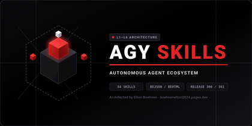

# AGYSKILLS: Autonomous Agent Capability Ecosystem

  
*_Figure 1: AGYSKILLS Modular Agent Capability Architecture_*

AGYSKILLS is a unified, production-grade repository of 84 modular capability packages designed for autonomous agent platforms, CLI automation engines, and structured data pipelines. Built on the 6-Tier Layered Skill Architecture, it provides strict separation of concerns from low-level data substrates up to autonomous multi-agent cartography and execution graphs.

---

## Table of Contents
- [Prerequisites & Setup](#prerequisites--setup)
- [Installation & Quick Start](#installation--quick-start)
- [Core Features & Usage](#core-features--usage)
- [Visual Interface Tour](#visual-interface-tour)
- [System Architecture (6-Tier Hierarchy)](#system-architecture-6-tier-hierarchy)
- [Technical Specifications & Schemas](#technical-specifications--schemas)
- [Master Skills Directory](#master-skills-directory)
  - [Layer 1: Entities & Data Substrates](#layer-1-entities--data-substrates)
  - [Layer 2: Validation & Verification](#layer-2-validation--verification)
  - [Layer 3: Services & CLI Adapters](#layer-3-services--cli-adapters)
  - [Layer 4: Presentation & Spatial Transport](#layer-4-presentation--spatial-transport)
  - [Layer 5: Use Cases & Architecture Blueprinting](#layer-5-use-cases--architecture-blueprinting)
  - [Layer 6: Root Orchestration & Composition](#layer-6-root-orchestration--composition)
- [CLI Reference & Tooling](#cli-reference--tooling)
- [Testing & Quality Verification](#testing--quality-verification)
- [Author & Maintenance](#author--maintenance)

---

## Prerequisites & Setup

### Environment Requirements
- **Python**: Version 3.10 or higher.
- **Node.js**: Version 18+ (required for JavaScript/TypeScript tooling and validation).
- **Bash / POSIX Shell**: For shell scaffolds and CLI menu wrappers.
- **Optional Native Tools**: `chromium` / `playwright-termux` (for headless browser testing and UI captures), `ffmpeg` / `ffprobe` (for media processing pipelines).

### Environment Configuration
Configure your local environment paths in your shell profile (`~/.bashrc`, `~/.zshrc`, or local environment store):

```bash
# Path to cloned skills repository
export SKILLS_ROOT="/path/to/AGYSKILLS"

# Optional master library fallbacks
export ADMIN_LIBRARIES="/path/to/libraries"
export ADMIN_LIBRARIES_104="/path/to/libraries/libraries_104"
export ADMIN_LIBRARIES_105="/path/to/libraries/libraries_105"
```

---

## Installation & Quick Start

### 1. Clone the Repository
```bash
git clone https://github.com/boehnenelton/AGYSKILLS.git
cd AGYSKILLS
```

### 2. Verify Ecosystem Topology
Execute the ecosystem cartographer to verify that all 84 skill manifests, downward dependencies, and mutual negative guardrails resolve cleanly:

```bash
python3 skill-ecosystem-cartographer/scripts/cartographer_index.py \
  --scan-root . \
  --catalog skill-ecosystem-cartographer/data/skill_registry_catalog.104a.bejson \
  --report skill-ecosystem-cartographer/docs/topology_collision_matrix.md
```

### 3. Run Quality Verification Harness
Execute a syntax and validation sweep across all Python modules:

```bash
python3 -c "
import py_compile, sys
from pathlib import Path
failed = [str(p) for p in Path('.').glob('**/*.py') if not py_compile.compile(str(p))]
if failed:
    sys.exit(1)
print('All Python tools compiled successfully.')
"
```

---

## Core Features & Usage

### 1. 6-Tier Layered Skill Architecture
Skills strictly declare their layer (`Layer 1` to `Layer 6`) and obey unidirectional downward-only dependencies. High-level orchestrators at Layer 6 never pollute foundational data schemas at Layer 1.

### 2. Dual-Era Parity (Foundational 104 & Integrity 105)
- **Foundational Era (104 / 104a / 104db)**: Dense tabular matrices, primitive-only records, and multi-record discriminators.
- **Integrity Era (105 / 105a / 105db)**: Cryptographic `field_uuid` column definitions, reserved `record_uuid` primary keys, and SHA-256 row checksums.
- **Atomic Migrations**: Supported through automated upgrade harnesses (`bejson-105-upgrade-automator`).

### 3. Complete Chunker & Persistence Suite
- **Directory Chunker** ([`chunking-core`](./chunking-core)): Standalone text-first directory packaging into portable `.bejson.txt` containers.
- **Document Chunker** ([`bejson-document-chunker`](./bejson-document-chunker)): Structured `104db` multi-record document authoring with category hierarchies, chunk lifecycle statuses, and Markdown compilation.
- **Database Chunker** ([`mfdb-104-chunker`](./mfdb-104-chunker)): Single-file container packaging (`.mfdb132.bejson` and `.mfdb140.bejson`) with cryptographic sticky mounts.

### 4. Zero-Filler Spatial Web Interfaces (BEHTML)
Deterministic 8-lane horizontal grids and 32px vertical row quantization. All layout templates enforce literal structural placeholders without fabricated filler content.

---

## Visual Interface Tour

The AGYSKILLS architecture emphasizes geometric precision, deterministic layouts, and high-density terminal and browser surfaces.

```
+-----------------------------------------------------------------------------------+
|                              AGYSKILLS ECOSYSTEM                                  |
|                                                                                   |
|  [L6] Root Composition & Cartography                                              |
|       └─ skill-ecosystem-cartographer · domain-cartography-coordinator            |
|                                                                                   |
|  [L5] Architecture Blueprinting & Ideation                                        |
|       └─ arch-layered-refactor · component-taxonomy-architect                     |
|                                                                                   |
|  [L4] Spatial Presentation & Transport                                            |
|       └─ behtml-templates · bejson-tui-menu-builder · publication-html-builder     |
|                                                                                   |
|  [L3] Adapters & CLI Utilities                                                    |
|       └─ cli-standardizer · agy-prompt-automator · adversarial-code-reviewer      |
|                                                                                   |
|  [L2] Verification & Validation Gates                                             |
|       └─ bejson-schema-validator · behtml-schema-validator · mfdb-105-validator   |
|                                                                                   |
|  [L1] Data Substrates & Entities                                                  |
|       └─ bejson-104-core · bejson-105-core · mfdb-104-core · chunking-core         |
+-----------------------------------------------------------------------------------+
```

---

## System Architecture (6-Tier Hierarchy)

The ecosystem is structured across 6 strict architectural layers:

| Layer | Tier Code | Role & Scope | Count |
| :---: | :--- | :--- | :---: |
| **L1** | `L0_Substrate_L1_Entities` | Low-level data formats, file primitives, and storage drivers | 9 |
| **L2** | `L1_Validation_L2_Verification` | Schema validators, coordinate inspectors, and stage-gate checkers | 12 |
| **L3** | `L2_Adapters_L3_Services` | Language scaffolding, standardizers, media runners, and daemons | 21 |
| **L4** | `L4_Presentation_Transport` | BEHTML layouts, TUI menus, zero-filler skeletons, and components | 12 |
| **L5** | `L3_Use_Cases_Cross_Layer_Blueprinting` | System architecture planners, taxonomy architects, and ideation engines | 17 |
| **L6** | `L5_Composition_Root` | DAG execution pipelines, skill cartographers, and global orchestrators | 13 |

---

## Technical Specifications & Schemas

### 1. BEJSON Tabular Discipline
All persistent records separate column schemas (`Fields`) from positional row arrays (`Values`). Access routines utilize pre-computed `field_map` caches to ensure $O(1)$ column resolution:

```python
def read_record_column(fields: list[dict], row: list, column_name: str):
    field_map = {field["name"]: index for index, field in enumerate(fields)}
    return row[field_map[column_name]]
```

### 2. BEHTML 8-Lane / 32px Grid Geometry
Web presentation layers map elements onto an 8-lane horizontal coordinate system ($x \in [0, 8]$) with 16-sublane half-cell increments ($0.5$), and quantized 32px vertical rows ($R_y = 32\text{px}$).

---

## Master Skills Directory

### Layer 1: Entities & Data Substrates

| Skill | Description |
| :--- | :--- |
| [`behtml-format-core`](./behtml-format-core) | Spatial format specification, coordinate math, and 18-field element schema. |
| [`bejson-104-core`](./bejson-104-core) | Foundational Era 104, 104a, and 104db CRUD operations and table management. |
| [`bejson-104-nesting-core`](./bejson-104-nesting-core) | Recursive document nesting inside parent table cells up to 16 levels deep. |
| [`bejson-105-core`](./bejson-105-core) | Integrity Era 105 UUID fingerprinting, reserved record identifiers, and checksums. |
| [`bejson-sanitization-core`](./bejson-sanitization-core) | Boundary whitespace stripping and input sanitization for dictionary keys and cells. |
| [`chunking-core`](./chunking-core) | Standalone flat directory chunking into portable text containers. |
| [`large-website-architect`](./large-website-architect) | Multi-page website scaffolding, taxonomy feeds, and documentation hubs. |
| [`mfdb-104-core`](./mfdb-104-core) | Multi-File Database manifests (`104a.mfdb.bejson`) and dense entity linking. |
| [`template-architect`](./template-architect) | Structural application wireframes and starter skeletons with literal labels. |

### Layer 2: Validation & Verification

| Skill | Description |
| :--- | :--- |
| [`audit-efficiency-auditor`](./audit-efficiency-auditor) | Performance auditing, redundant I/O detection, and subprocess analysis. |
| [`behtml-schema-validator`](./behtml-schema-validator) | 8-lane bounds checking, 32px quantization, 2D collision detection, and zero-filler enforcement. |
| [`bejson-104-validator`](./bejson-104-validator) | Structural integrity, primitive field verification, and discriminator audits for 104. |
| [`bejson-105-validator`](./bejson-105-validator) | Strict UUID integrity, reserved primary key offsets, and checksum validation for 105. |
| [`bejson-document-chunker`](./bejson-document-chunker) | Multi-record 104db document authoring, chunk status workflows, and Markdown compilation. |
| [`bejson-enforcement-suite-builder`](./bejson-enforcement-suite-builder) | Five-test runtime conformance suites and factory reset harnesses. |
| [`bejson-schema-validator`](./bejson-schema-validator) | Era-neutral dispatcher validating 104, 104a, 104db, 105, 105a, and 105db schemas. |
| [`mfdb-104-chunker`](./mfdb-104-chunker) | Multi-File Database container packaging (`.mfdb132.bejson` / `.mfdb140.bejson`) with sticky mounting. |
| [`mfdb-105-validator`](./mfdb-105-validator) | Cross-entity foreign key referential integrity and encryption tag auditing. |
| [`playwright-debugger-auditor`](./playwright-debugger-auditor) | Automated browser console error trapping, network failure logging, and Canvas audits. |
| [`policy-bejson-auditor`](./policy-bejson-auditor) | Static AST code auditing for field map cache compliance and boundary sanitization. |
| [`policy-conflict-auditor`](./policy-conflict-auditor) | Deterministic rule auditing, contradiction detection, and precedence matrices. |

### Layer 3: Services & CLI Adapters

| Skill | Description |
| :--- | :--- |
| [`adversarial-code-reviewer`](./adversarial-code-reviewer) | Logic-first security and edge-case review of single-file services. |
| [`agy-prompt-automator`](./agy-prompt-automator) | Command authoring, headless automation, and sandboxed task execution. |
| [`bejson-105-upgrade-automator`](./bejson-105-upgrade-automator) | Atomic migration of 104 data stores to 105 UUID structures with backup preservation. |
| [`bejson-diagrammer-cli`](./bejson-diagrammer-cli) | System architecture and workflow diagram generation in canvas and embed modes. |
| [`bejson-media-pipeline`](./bejson-media-pipeline) | Automated FFmpeg dropzone pipelines, batch transcoders, and video processors. |
| [`bejson-scaffold-bash`](./bejson-scaffold-bash) | Standalone Bash tool scaffolding with embedded error registries and jq parsers. |
| [`bejson-scaffold-javascript`](./bejson-scaffold-javascript) | Vanilla JavaScript and Node.js file scaffolding with embedded Web Crypto encryption. |
| [`bejson-scaffold-python`](./bejson-scaffold-python) | Standalone Python script scaffolding with self-contained validator engines. |
| [`cli-ai-standardizer`](./cli-ai-standardizer) | Zero-SDK REST API dispatch tools with round-robin key rotation and retry backoff. |
| [`cli-processing-standardizer`](./cli-processing-standardizer) | Batch media and asset pipeline CLI tools with self-bootstrapping configuration. |
| [`cli-standardizer`](./cli-standardizer) | Standalone Python operational commands with structured logging and standard CLI flags. |
| [`file-subfolder-automator`](./file-subfolder-automator) | Standardized directory architecture scaffolding and self-locating script preambles. |
| [`gemini-interactions-core`](./gemini-interactions-core) | Multi-turn streaming conversation management via Google GenAI Interactions API. |
| [`gemini-tooling-manager`](./gemini-tooling-manager) | Custom client function declaration, MCP server integration, and built-in tooling. |
| [`hostile-audit-finalizer`](./hostile-audit-finalizer) | Pre-delivery surgical quality audits, changelog synchronization, and validation. |
| [`job-workflow-manager`](./job-workflow-manager) | Sequential task-by-task job workflow execution and state tracking. |
| [`playwright-stealth-agent`](./playwright-stealth-agent) | Anti-bot challenge traversal with human behavioral physics and Canvas/WebGL masking. |
| [`playwright-termux-automation`](./playwright-termux-automation) | Native headless Chromium execution and browser automation in Linux/ARM64. |
| [`project-bejson-cms-manage`](./project-bejson-cms-manage) | Zero-SQL CMS operational management, publishing pipelines, and database snapshots. |
| [`readme-visual-enhancer`](./readme-visual-enhancer) | Professional README authoring, 420p visual scaling, and mathematical figure distribution. |
| [`skills-backup-manager`](./skills-backup-manager) | Skill synchronization, archive creation, and cloud storage backup automation. |

### Layer 4: Presentation & Spatial Transport

| Skill | Description |
| :--- | :--- |
| [`behtml-104-builder`](./behtml-104-builder) | Vertical domain tabular rendering, terminal menu markup, and headless layouts. |
| [`behtml-design-preferences`](./behtml-design-preferences) | Spatial grid tokens, Tri-Color palette standards, and responsive drawer navigation. |
| [`behtml-templates`](./behtml-templates) | Canonical production templates: Document with Shelf, Feed, and Multi-Layer Hubs. |
| [`bejson-tui-menu-builder`](./bejson-tui-menu-builder) | High-density 57-column terminal interfaces and daemon dashboards. |
| [`code-manual-builder`](./code-manual-builder) | Multi-page documentation portals with SEO hierarchies and hamburger drawers. |
| [`prompt-placeholder-composer`](./prompt-placeholder-composer) | Deterministic variable substitution schemas guaranteeing zero unresolved tokens. |
| [`publication-html-builder`](./publication-html-builder) | Editorial HTML publications and technical specifications with 16-sublane canvases. |
| [`template-104-template`](./template-104-template) | Zero-filler Foundational Era data stores, taxonomy registries, and owning writers. |
| [`template-105-template`](./template-105-template) | Zero-filler Integrity Era data files, UUID registries, and owning writers. |
| [`template-literal-skeleton`](./template-literal-skeleton) | Global zero-filler structural skeletons across HTML, CLI menus, and script layouts. |
| [`ui-navigation-decomposer`](./ui-navigation-decomposer) | Hierarchical navigation decomposition and site architecture tree extraction. |
| [`web-ui-component-mapper`](./web-ui-component-mapper) | Component-level ASCII interface maps from entry surfaces to atomic controls. |

### Layer 5: Use Cases & Architecture Blueprinting

| Skill | Description |
| :--- | :--- |
| [`agy-customizations`](./agy-customizations) | Customization reference for skills, rules, MCP servers, and hooks. |
| [`antigravity-guide`](./antigravity_guide) | Comprehensive guide and sitemap for agent CLI and IDE environments. |
| [`arch-layered-refactor`](./arch-layered-refactor) | Decoupled layered architecture refactoring and monolithic codebase decomposition. |
| [`bejson-codebase-refactor`](./bejson-codebase-refactor) | Modernizing persistence models and state architectures to tabular BEJSON stores. |
| [`bejson-doc-rewriter`](./bejson-doc-rewriter) | Transposing abstract database architectures into practical local-first specifications. |
| [`book-writer`](./book-writer) | Multi-turn chapter generation engine with SEO-ready publication compilation. |
| [`code-taxonomy-architect`](./code-taxonomy-architect) | Designing field prefixes, snake_case column identifiers, and module signatures. |
| [`component-taxonomy-architect`](./component-taxonomy-architect) | Relational entity graphs, UUID primary keys, and foreign key on_delete cascades. |
| [`concept-idea-pattern-extraction`](./concept-idea-pattern-extraction) | Extracting recurring architectural motifs and design archetypes from notes. |
| [`concept-nuance-pattern-analysis`](./concept-nuance-pattern-analysis) | Deep forensic analysis of latent constraints, edge cases, and architectural tradeoffs. |
| [`ideation-blog-post-planner`](./ideation-blog-post-planner) | Scanning codebases to extract technical motifs and structured blog concepts. |
| [`ideation-feature-composer`](./ideation-feature-composer) | Sequentially numbered 25–50 point feature menus and roadmap catalogs. |
| [`ideation-interview-composer`](./ideation-interview-composer) | Interactive technical interviews compiling tailored system build instructions. |
| [`ideation-macro-composer`](./ideation-macro-composer) | Expansive conceptual frameworks and macro architectures from seed ideas. |
| [`planning-schema-planner`](./planning-schema-planner) | Turn 1 data modeling and Era allocation between 104 and 105 data stores. |
| [`playwright-visual-testing`](./playwright-visual-testing) | Multi-viewport regression auditing and Tri-Color compliance checks. |
| [`project-bejson-cms-grounding`](./project-bejson-cms-grounding) | Architectural mapping and schema grounding for zero-SQL publishing systems. |

### Layer 6: Root Orchestration & Composition

| Skill | Description |
| :--- | :--- |
| [`agy-skill-refactor`](./agy-skill-refactor) | Skill modernization, container isolation, and two-phase plan/edit workflows. |
| [`definitions-cartographer`](./definitions-cartographer) | Canonical ecosystem terminology index, acronym resolution, and alias queries. |
| [`domain-cartography-coordinator`](./domain-cartography-coordinator) | Multi-domain typing pipelines and architectural cartography orchestration. |
| [`domain-scoped-coordinators`](./domain-scoped-coordinators) | Autonomous multi-agent pipelines routing across goal, execution, and delivery phases. |
| [`file-archive-coordinator`](./file-archive-coordinator) | Download directory sweeps, package version parsing, and archive cataloging. |
| [`project-delivery-packager`](./project-delivery-packager) | Release delivery packaging, Versioned UUID generation, and archive registration. |
| [`publication-blog-post-writer`](./publication-blog-post-writer) | Modular 4-stage drafting and publication compilation for technical articles. |
| [`skill-architect`](./skill-architect) | Scaffolding and registering multi-tier agent skills enforcing 6-tier layer boundaries. |
| [`skill-chain-coordinator`](./skill-chain-coordinator) | Directed Acyclic Graph (DAG) execution flows and cross-layer stage gates. |
| [`skill-ecosystem-cartographer`](./skill-ecosystem-cartographer) | Skill registry cataloging, routing topology mapping, and trigger collision checks. |
| [`spark-skill-refactor`](./spark-skill-refactor) | Auditing and refactoring skills for progressive disclosure and boundary integrity. |
| [`taxonomy-ui-component-architect`](./taxonomy-ui-component-architect) | Production UI blueprinting with standardized tokens and responsive layouts. |
| [`ui-component-taxonomy-architect`](./ui-component-taxonomy-architect) | Hierarchical component taxonomies and design token specifications. |

---

## CLI Reference & Tooling

Common command-line tools included in the ecosystem:

```bash
# Validate BEJSON data schemas (era-neutral dispatcher)
python3 bejson-schema-validator/scripts/validate_bejson_schema.py data/store.104.bejson

# Validate BEHTML spatial coordinates and 2D collision boundaries
python3 behtml-schema-validator/scripts/behtml_validate.py ui/layout.html

# Package an MFDB directory into a single-file container
python3 mfdb-104-chunker/scripts/mfdb_chunker_cli.py --package data/mfdb_store --era 104

# Sticky-mount an MFDB container into a workspace
python3 mfdb-104-chunker/scripts/mfdb_chunker_cli.py --mount store.mfdb132.bejson --workspace /tmp/workspace

# Chunk a project directory into a lightweight text container
python3 chunking-core/scripts/Simple_Chunker_CLI.py --chunk src/

# Author and compile a multi-record document project
python3 bejson-document-chunker/scripts/Doc_Chunker.py --doc-new "Project_Spec"
python3 bejson-document-chunker/scripts/Doc_Chunker.py --doc-compile
```

---

## Testing & Quality Verification

To verify ecosystem integrity, execute the automated verification test passes:

```bash
# 1. Cartographer topology validation (must report 0 dangling references)
python3 skill-ecosystem-cartographer/scripts/cartographer_index.py \
  --scan-root . \
  --catalog skill-ecosystem-cartographer/data/skill_registry_catalog.104a.bejson

# 2. Syntax compilation sweep
python3 -m py_compile **/*.py

# 3. Clean bytecode caches
find . -name "__pycache__" -type d -exec rm -rf {} +
```

---

## Author & Maintenance

- **Author**: Elton Boehnen
- **Contact**: [boehnenelton2024@gmail.com](mailto:boehnenelton2024@gmail.com)
- **Web**: [boehnenelton2024.pages.dev](https://boehnenelton2024.pages.dev)
- **GitHub**: [github.com/boehnenelton](https://github.com/boehnenelton)
- **Repository**: [github.com/boehnenelton/AGYSKILLS](https://github.com/boehnenelton/AGYSKILLS)
