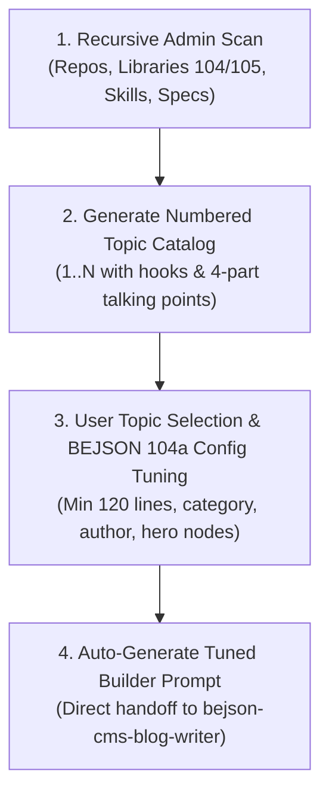

# Admin Recursive Topic Scout & Plan Configuration Guide

## Architecture Overview

The `bejson-cms-admin-scout` skill acts as the entrypoint for the BEJSON CMS publishing workflow. It performs deep, recursive scans across the user's `/storage/emulated/0/Admin` directories (`Dev/Repos`, `Libraries/libraries_104`, `Libraries/libraries_105`, `Dev/Skills`, `Dev/Templates`, `Dev/Policy`, `Core/Projects_Archive`, and `Resources`) to discover real codebases, frameworks, specs, and tooling systems.

It synthesizes these findings into sequentially numbered (1..N) structured blog topic proposals, allows the user to select and tune their preferences in a standardized **BEJSON 104a configuration file** (`config/plan_config.104a.bejson`), and generates the turnkey builder prompt for the 5-part pipeline (`bejson-cms-blog-writer`).



---

## Interactive & CLI Workflow

### Step 1: Scan and Review Numbered Topics
```bash
python3 ~/.gemini/config/skills/bejson-cms-admin-scout/scripts/admin_topic_scout.py \
  --scan-root "/storage/emulated/0/Admin" \
  --topics-output "suggested_topics.md"
```

### Step 2: Select Topic & Tune BEJSON 104a Plan Configuration
Select a topic by its numerical index (e.g. `1`), tune the minimum lines per section (default: `120`), and generate the builder prompt:
```bash
python3 ~/.gemini/config/skills/bejson-cms-admin-scout/scripts/admin_topic_scout.py \
  --select-topic 1 \
  --min-lines 120 \
  --tune-config "config/plan_config.104a.bejson" \
  --generate-plan-prompt
```

### Step 3: Seamless Hand-off to the 5-Part Pipeline
The generated configuration feeds directly into:
1. `cms_context_researcher.py` (Turn 0: Forensic AST and schema extraction)
2. `cms_canvas_illustrator.py` (Context-based 1280x640 SVG hero generation)
3. `bejson_cms_post_merger.py` (Validation gate: $\ge 120$ lines per section)
4. `bejson_cms_post_publisher.py` (Direct publication to `BEJSON_CMS`)
