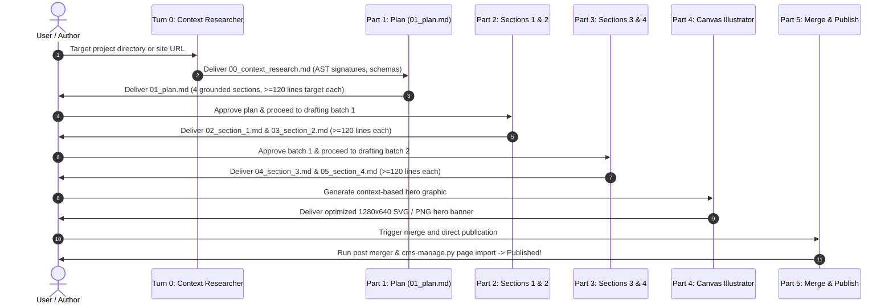

# bejson-cms-blog-writer (Layer 5 Use Cases & Publication Drafting)

## Summary

`bejson-cms-blog-writer` is the canonical Layer 5 skill for executing long-form, rigorous technical blog post authoring directly integrated with Elton Boehnen's zero-SQL BEJSON CMS and NewAgent CMS platforms. It combines automated **codebase/website context research** with a strict **5-part sequential pipeline**:

0. **Context Research (Target Files / URL)**: Analyzes local project trees (AST signatures, manifests, READMEs) or fetches live website URLs to generate `00_context_research.md`.
1. **Part 1 (Sectional Blueprint & Plan)**: Generates a planned 4-part blog post outline grounded in the researched context where each section has a strict target of **at least 120 lines** (`01_plan.md`).
2. **Part 2 (Drafting Sections 1 & 2)**: Writes Section 1 ($\ge 120$ lines) and Section 2 ($\ge 120$ lines) consecutively, completing and auditing both before moving forward.
3. **Part 3 (Drafting Sections 3 & 4)**: Writes Section 3 ($\ge 120$ lines) and Section 4 ($\ge 120$ lines) consecutively, completing and auditing both before moving forward.
4. **Part 4 (Audit Gate & Canvas Imagery)**: Verifies line counts ($\ge 480$ lines total), eliminates filler, and integrates context-optimized SVG hero imagery generated by [`bejson-cms-canvas-illustrator`](file:///data/data/com.termux/files/home/.gemini/config/skills/bejson-cms-canvas-illustrator/SKILL.md).
5. **Part 5 (Merging & Direct HTML Import)**: Merges all 4 sections into a unified post, renders semantic HTML, and imports directly to BEJSON CMS using `src/cms-manage.py page import`.

---

## When to Use

- Authoring comprehensive, long-form technical blog posts targeted for BEJSON CMS or NewAgent CMS.
- Grounding articles in deep technical research from local project codebases or live documentation URLs.
- Executing multi-turn drafting workflows requiring minimum 120-line depth per section.
- Drafting 2 sections at a time with verification gates before advancing.
- Generating and embedding context-based SVG canvas imagery and Playwright raster captures.
- Publishing verified markdown and BEHTML content directly into `pagerecord.bejson` and `storage/mfdb/pages_db/<uuid>.json`.

## When NOT to Use

- Do NOT use for multi-chapter standalone technical books or e-books (use [`book-writer`](file:///data/data/com.termux/files/home/.gemini/config/skills/book-writer/SKILL.md)).
- Do NOT use for initial topic discovery across general directories (use [`ideation-blog-post-planner`](file:///data/data/com.termux/files/home/.gemini/config/skills/blog-post-ideas/SKILL.md)).
- Do NOT use for standalone SVG canvas generation without post authoring (use [`bejson-cms-canvas-illustrator`](file:///data/data/com.termux/files/home/.gemini/config/skills/bejson-cms-canvas-illustrator/SKILL.md)).

---

## 1. Architectural Guardrails & 5-Part Protocol

- **Assigned Skill Tier**: Layer 5 (`L5`) Use Cases & Publication Drafting
- **Codebase Layer Mapping**: `L3_Use_Cases_Cross_Layer_Blueprinting`
- **Allowed Downward Dependencies**: Layers 1 through 4 (utilizes `bejson-cms-canvas-illustrator` at L4)
- **The Grounded 5-Part Pipeline**:
  - **Turn 0 (Context Research)**: Automated forensic AST and schema scan on target project codebase or website URL (`00_context_research.md`).
  - **Part 1 (Sectional Blueprint)**: Grounded outline (`01_plan.md`) with explicit $\ge 120$ lines per section target.
  - **Part 2 (Drafting Batch 1)**: Consecutively draft Section 1 ($\ge 120$ lines) and Section 2 ($\ge 120$ lines).
  - **Part 3 (Drafting Batch 2)**: Consecutively draft Section 3 ($\ge 120$ lines) and Section 4 ($\ge 120$ lines).
  - **Part 4 (Audit & Media Integration)**: Line audit gate ($\ge 480$ total lines), BEHTML styling, and context-based SVG imagery via `cms_canvas_illustrator.py`.
  - **Part 5 (Assembly & Publishing)**: Automated section merge, semantic HTML compilation, and direct CMS HTML import via `cms-manage.py page import`.
- **Author Crediting**: Elton Boehnen per Policy §9.2 (`boehnenelton2024`).
- **Color Standards**: Adheres to Policy §8.1 Tri-Color palette (`#FFFFFF`, `#000000`, `#DE2626`).

---

## 2. CLI Tooling & Execution

The skill is powered by three specialized scripts:

### A. Context Researcher: `cms_context_researcher.py`

```text
usage: cms_context_researcher.py [-h] [--target-path TARGET_PATH]
                                 [--target-url TARGET_URL] [--output OUTPUT]
                                 [--version] [--register] [--config] [--reset]

options:
  --target-path TARGET_PATH   Path to local codebase repository or file for AST extraction
  --target-url TARGET_URL     Target site URL to fetch and analyze via HTTP
  --output OUTPUT             Destination path for research brief (default: 00_context_research.md)
```

### B. Section Merger & Gate Validator: `bejson_cms_post_merger.py`

```text
usage: bejson_cms_post_merger.py [-h] [--sections-dir SECTIONS_DIR]
                                 [--min-lines MIN_LINES] [--title TITLE]
                                 [--category CATEGORY] [--author AUTHOR]
                                 [--featured-image FEATURED_IMAGE]
                                 [--output-md OUTPUT_MD]
                                 [--output-html OUTPUT_HTML]
                                 [--ignore-line-check] [--version]
```

### C. Direct CMS Publisher: `bejson_cms_post_publisher.py`

```text
usage: bejson_cms_post_publisher.py [-h] [--content-file CONTENT_FILE]
                                    [--cms-path CMS_PATH] [--title TITLE]
                                    [--category CATEGORY] [--author AUTHOR]
                                    [--type TYPE] [--featured-video VIDEO]
                                    [--dry-run] [--version]
```

---

## 3. Step-by-Step Workflow Execution



---

## 4. Deterministic Exit Codes

| Exit Code | Semantic Meaning | Recovery Action |
|:---:|---|---|
| `0` | **Success** &mdash; Operation completed successfully. | Proceed to next pipeline turn. |
| `10` | **Path Failure** &mdash; Draft directory, target path, or CMS repo not found. | Verify target file or URL paths. |
| `20` | **Environment Failure** &mdash; Python < 3.10 or missing dependencies. | Ensure execution under Python 3.10+. |
| `30` | **Validation Failure** &mdash; Section line count < 120 or forbidden filler detected. | Expand section content or fix AST errors. |
