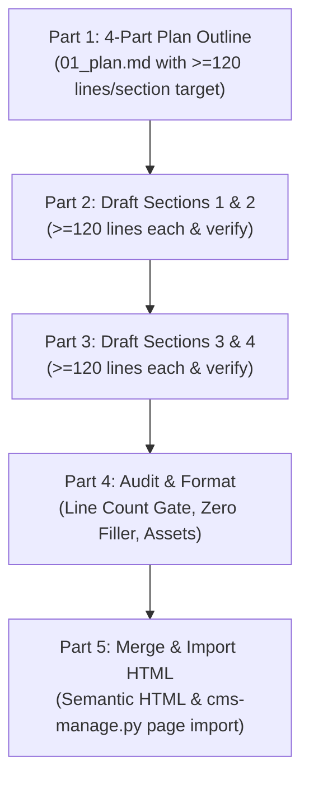

# Five-Part BEJSON CMS Blog Post Workflow Guide

## Architecture Overview

The `bejson-cms-blog-writer` skill governs a strict 5-part multi-turn drafting and publishing pipeline designed specifically for Elton Boehnen's zero-SQL BEJSON CMS architecture. It eliminates superficial content generation by requiring an upfront architectural outline in Part 1 where **every planned section has a strict minimum requirement of 120 lines** ($\ge 480$ lines total), followed by sequential drafting in 2-section increments (Sections 1 & 2 in Part 2, Sections 3 & 4 in Part 3), structural review and BEHTML formatting in Part 4, and automated assembly and direct publishing into BEJSON CMS in Part 5.



---

## Part 1: Sectional Blueprint & Plan Specification (`01_plan.md`)

- **Objective**: Establish the overarching article thesis, SEO keywords, target category, and detailed outlines for 4 substantial content sections.
- **Strict Requirement**: Explicitly define the subheadings, technical walkthroughs, and code examples for each of the 4 sections, with an upfront target of **at least 120 lines per section**.
- **Deliverable**: `01_plan.md` in the article draft folder.
- **Template Specification**:
  ```markdown
  # [Title of Blog Post]
  
  **Category**: BEJSON
  **Author**: boehnenelton2024
  **Featured Image**: [Path or Canvas SVG Capture URL]
  **Target Length**: >= 480 total lines (minimum 120 lines per section)
  
  ## Section 1: [Core Thesis, Problem Statement & Historical Context]
  - Target: >= 120 lines
  - Key Subtopics: [3-5 detailed points]
  - Code Snippets / Tables planned: [Specific signatures and tables]
  
  ## Section 2: [Architectural Anatomy & Schema Grounding]
  - Target: >= 120 lines
  - Key Subtopics: [3-5 detailed points]
  - Code Snippets / Tables planned: [BEJSON schemas, field definitions, memory layout]
  
  ## Section 3: [Implementation Mechanics, Runtime Flow & Walkthrough]
  - Target: >= 120 lines
  - Key Subtopics: [3-5 detailed points]
  - Code Snippets / Tables planned: [Step-by-step CLI commands, runtime algorithms]
  
  ## Section 4: [Production Hardening, Benchmarks & Future Horizons]
  - Target: >= 120 lines
  - Key Subtopics: [3-5 detailed points]
  - Code Snippets / Tables planned: [Benchmark matrices, recovery protocols]
  ```

---

## Part 2: Drafting Sections 1 & 2 (2 at a time)

- **Objective**: Execute the first drafting turn by writing Section 1 and Section 2 consecutively.
- **Strict Requirements**:
  - Section 1 must strictly meet or exceed **120 lines** (`02_section_1.md`).
  - Section 2 must strictly meet or exceed **120 lines** (`03_section_2.md`).
  - Both sections must be completed, audited, and line-verified before advancing to Part 3.
  - Zero lorem ipsum, zero filler phrases, zero fabricated claims. Real code blocks, CLI commands, and structural explanations only.
- **Deliverables**:
  - `02_section_1.md` ($\ge 120$ lines)
  - `03_section_2.md` ($\ge 120$ lines)

---

## Part 3: Drafting Sections 3 & 4 (2 at a time)

- **Objective**: Execute the second drafting turn by writing Section 3 and Section 4 consecutively.
- **Strict Requirements**:
  - Section 3 must strictly meet or exceed **120 lines** (`04_section_3.md`).
  - Section 4 must strictly meet or exceed **120 lines** (`05_section_4.md`).
  - Both sections must be completed, audited, and line-verified before advancing to Part 4.
  - Section 4 must conclude with actionable production best practices and author credit to Elton Boehnen per Policy §9.2.
- **Deliverables**:
  - `04_section_3.md` ($\ge 120$ lines)
  - `05_section_4.md` ($\ge 120$ lines)

---

## Part 4: BEHTML Formatting, Asset Integration & Gate Audit

- **Objective**: Validate line thresholds across all 4 sections, link visual media assets, and format content for BEJSON CMS / BEHTML layout standards.
- **Verification Gates**:
  - Section 1: $\ge 120$ lines
  - Section 2: $\ge 120$ lines
  - Section 3: $\ge 120$ lines
  - Section 4: $\ge 120$ lines
  - Total publication: $\ge 480$ lines
  - Asset Linking: Integrate featured hero image / animated SVG capture from `Canvas_SVG_Capture_Templates/captures/` or `storage/mfdb/assets/`.
  - Color Tokens: Respect Policy §8.1 Tri-Color standards (`#FFFFFF`, `#000000`, `#DE2626`).

---

## Part 5: Merging, Semantic HTML Rendering & CMS HTML Import

- **Objective**: Merge the 4 validated sections, compile raw markdown into semantic HTML (`<h2>`, `<h3>`, `<p>`, `<code>`, `<pre>`), and ingest directly into BEJSON CMS using the native CMS HTML import function (`cms-manage.py page import`).
- **HTML Ingestion Requirement**: Because BEJSON CMS injects `html_body` directly into page templates (`<div class="article-body">{{article_body}}</div>`) without a runtime markdown parser, all article content MUST be pre-compiled into semantic HTML before import.
- **CLI Commands**:
  ```bash
  # Step 1: Validate line counts, merge sections, and compile semantic HTML
  python3 ~/.gemini/config/skills/bejson-cms-blog-writer/scripts/bejson_cms_post_merger.py \
    --sections-dir "<draft_dir>" \
    --min-lines 120 \
    --output-md "<draft_dir>/merged_post.md" \
    --output-html "<draft_dir>/final_post.html" \
    --featured-image "hero.svg"

  # Step 2: Import compiled HTML into BEJSON CMS via the CMS HTML import function
  python3 ~/.gemini/config/skills/bejson-cms-blog-writer/scripts/bejson_cms_post_publisher.py \
    --content-file "<draft_dir>/final_post.html" \
    --cms-path "/storage/emulated/0/Admin/Dev/Repos/BEJSON_CMS" \
    --category "BEJSON" \
    --author "boehnenelton2024" \
    --type "blog" \
    --featured-img "hero.svg"

  # Direct CLI equivalent:
  python3 /storage/emulated/0/Admin/Dev/Repos/BEJSON_CMS/src/cms-manage.py page import \
    --html "<draft_dir>/final_post.html" \
    --title "<Article Title>" \
    --category "BEJSON" \
    --author "boehnenelton2024" \
    --type "blog" \
    --featured-img "hero.svg"
  ```
