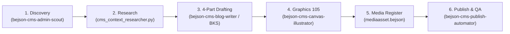

# bejson-cms-domain-cartographer (Layer 6 CMS Architecture & Service Cartographer)

- **Target Architecture**: Android Termux (aarch64 / ARM 64-bit, Android Bionic libc) & POSIX Linux
- **Architectural Tier**: Layer 6 (L6) Root Orchestration & Meta-Governance
- **Author Credit**: Elton Boehnen · boehnenelton2024@gmail.com · boehnenelton2024.pages.dev · github.com/boehnenelton
- **RELATIONAL_ID**: `1a2b3c4d-5e6f-7a8b-9c0d-1e2f3a4b5c6d`
- **Version**: `1.3.0`
- **Domain**: CMS Architecture & Service Cartography (`BEJSON_CMS` & `NewAgent CMS`)

## Summary

`bejson-cms-domain-cartographer` is the authoritative Layer 6 platform discovery and topological mapping engine for the zero-SQL BEJSON CMS ecosystem. It surveys both the standalone application (`BEJSON_CMS`, mirrored in `Development/BEJSON_CMS`) and the embedded platform (`tools/NA-CMS`) to catalog microservice blueprints, HTTP route controllers, dynamic HTML layout skeletons, underlying BEJSON/MFDB stores (`pages_db`, `mediaasset.bejson`, `bks_jobs`), Graphics 105 visual engines, and static publication export targets into `data/cms_service_map.104a.bejson`.

---

## When to Use

- Discovering installed CMS installations, extensions, and microservice components across repositories.
- Mapping the full CMS execution DAG across Discovery, Drafting, Graphics 105 Generation, Media Registration, Publishing, and Playwright QA.
- Constructing or refreshing the canonical `data/cms_service_map.104a.bejson` ledger.
- Mapping Flask blueprint endpoints, REST routes, BKS Blog Job Studio handlers, and static export targets.
- Cataloging CMS database stores, tracking entity counts, and verifying schema alignment.
- Preparing comprehensive system dependency inventories before CMS migrations or major releases.

## When NOT to Use

- Do NOT use for grounding, code inspection, or structural navigation of the CMS codebase (use `project-bejson-cms-grounding`).
- Do NOT use for active operational runtime commands like starting daemons or adding users (use `project-bejson-cms-manage`).
- Do NOT use for authoring, editing, or combining 4-part blog publication content (use `bejson-cms-blog-writer`).
- Do NOT use for scanning Admin repositories to discover active development topics (use `bejson-cms-admin-scout`).
- Do NOT use for automating static site builds, preview server binding, or screenshot capture (use `bejson-cms-publish-automator`).

---

## 1. CMS Domain Execution DAG & Stage Gates

The canonical operational pipeline for BEJSON CMS is orchestrated across 6 sequential stages:



1. **Stage 1: Discovery**: Recursive scan of `/storage/emulated/0/Admin` (`admin_topic_scout.py`) generating structured topic choices and visual briefing nodes (4 peripheral components + subtitle).
2. **Stage 2: Context Research**: Deep AST scan on local codebases or live documentation URLs generating `00_context_research.md`.
3. **Stage 3: Drafting**: 4-part deep dive ($\ge 120$ lines per section, $\ge 480$ total lines) via BKS Blog Job Studio or `bejson_cms_post_merger.py`.
4. **Stage 4: Graphics 105 Generation**: Authoring 1280x640 Policy §8.1 Tri-Color hero banner and 1280x720 3-pillar architecture diagram via `cms_canvas_illustrator.py`. High-DPI Playwright PNG and WebP compiled.
5. **Stage 5: Media Registration**: Atomic entry added to `mediaasset.bejson` with SHA-256 hash, byte size, and MIME type; `pagerecord.bejson` updated with `page_featured_img`.
6. **Stage 6: Publish & QA**: Static build via `BEJSON_CMS_Publisher._execute()`, pre-flight asset staging, check for zero `default_page_image.webp` placeholders, and Playwright responsive overflow verification (`scrollWidth <= clientWidth`).

---

## 2. Cartographer Invocations

```bash
# Full CMS Platform Discovery Sweep
python3 scripts/bejson_cms_cartographer.py \
  --scan-root "/storage/emulated/0/Admin" \
  --catalog "data/cms_service_map.104a.bejson" \
  --report "reports/cms_service_topology.md"
```
