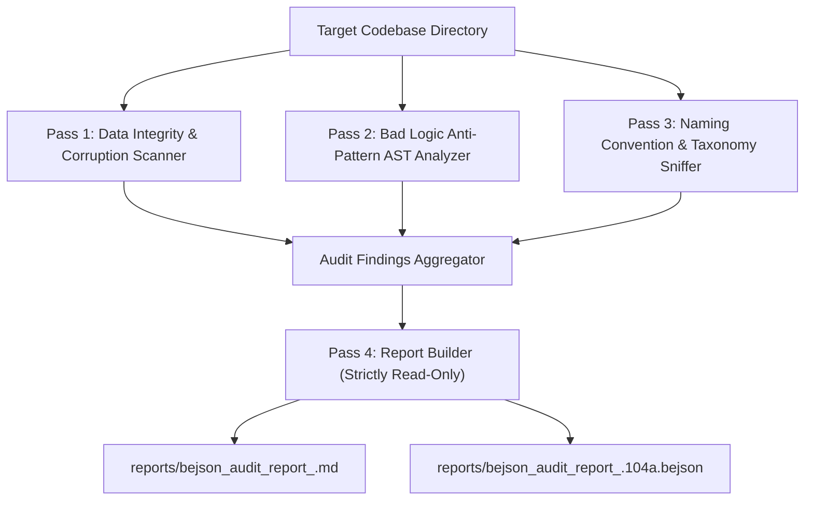

# bejson-codebase-auditor (Layer 2 - Domain Engines & Auditing)

## Summary

`bejson-codebase-auditor` operates at **Layer 2** of the 6-Tier Layered Skill Architecture. It provides a comprehensive, non-destructive, read-only audit engine across projects, codebases, and data stores. It detects BEJSON data corruption, row-width and type mismatches, bad logic anti-patterns (such as direct `row[i]` indexing without `field_map`, non-atomic writes, hardcoded host paths, and silent exceptions), sniffs out variable naming violations against Policy §6.1, and identifies taxonomy modeling improvements. It strictly builds diagnostic reports (in Markdown and BEJSON 104a formats) and **never modifies or mutates any files**.

## When to Use

- Auditing a project, repository, or directory for BEJSON data integrity, corruption, or schema divergence.
- Detecting row-width mismatches, missing headers, unescaped cells, or malformed field objects in `.bejson` and `.json` stores.
- Scanning Python, Bash, JS, or TS source code for dangerous logic flaws such as raw numeric row indexing (`row[0]`), hardcoded column offset constants, or missing boundary sanitization.
- Sniffing out single-letter variables (`i`, `j`, `x`) or cryptic identifiers (`tmp`, `val`, `res`, `data`) violating Policy §6.1.
- Identifying missing entity prefixes in schemas or unmodeled entities that warrant registration in `schema_registry.104a.bejson`.
- Generating structured, read-only audit reports without altering application code or persistent storage.

## When NOT to Use

- Do NOT use for modifying or refactoring code files or applying automated fixes (use `bejson-codebase-refactor`).
- Do NOT use for isolated single-file 104 data validation (use `bejson-104-validator`).
- Do NOT use for isolated single-file 105 UUID and checksum validation (use `bejson-105-validator`).
- Do NOT use for executing Policy §10.6 five-test suites (use `policy-bejson-auditor`).
- Do NOT use for designing new taxonomy schemas or entity relational graphs from scratch (use `code-taxonomy-architect`).
- Do NOT use for measuring computational complexity, duplicate loops, or I/O thrashing (use `audit-efficiency-auditor`).

---

## 1. Architectural Guardrails & Layer Boundary Laws

- **Assigned Skill Tier**: Layer 2 (`L2` Domain Engines & Verification)
- **Codebase Layer Mapping**: `L1_Validation_L2_Verification`
- **Execution Mode**: **Strictly Read-Only**. Opens files in read mode (`r`) only. Never mutates, deletes, or modifies application source or data.
- **Allowed Downward Dependencies**: Layer 1 only (`bejson-104-core`, `bejson-sanitization-core`).
- **Sandbox Requirement**: All headless `agy` CLI invocations must supply the `--sandbox` parameter.
- **Deterministic Exit Codes**:
  - `0`: Successful audit execution (findings reported cleanly).
  - `10`: Path failure (target directory does not exist or output directory cannot be created).
  - `20`: Environment or configuration failure.
  - `30`: Schema validation or reporting failure.

---

## 2. Multi-Pass Audit Engine Architecture

The auditor executes a four-pass diagnostic scan:



### 2.1 Pass 1: BEJSON Data Integrity & Corruption Scanner
Inspects all `.bejson`, `.json`, and `bejson_project.json` stores for:
- JSON parsing corruption and syntax truncation (`E_DATA_CORRUPT_JSON`).
- Mandatory root header presence (`Format`, `Format_Version`, `Fields`, `Values`) (`E_DATA_MISSING_HEADER`).
- Tabular row-width matching: `len(row) == len(Fields)` (`E_DATA_WIDTH_MISMATCH`).
- Cell type consistency against declared field types (`E_DATA_TYPE_MISMATCH`).
- Leading/trailing whitespace in field names or text cells per Policy §10.9 (`E_DATA_WHITESPACE_IN_FIELD_NAME`).
- Duplicate field names causing hash collisions (`E_DATA_DUPLICATE_FIELD`).
- Format 105 UUID fingerprinting and project GUID governance (`E_DATA_105_MISSING_FIELD_UUID`, `E_DATA_UNRESOLVED_GUID`).

### 2.2 Pass 2: Bad Logic Flaw Scanner
Audits source code across Python (`.py`), Bash (`.sh`), and JS/TS (`.js`, `.ts`) for:
- Raw positional row indexing (e.g., `row[0]`, `record[1]`) without dynamic `field_map` resolution (`E_LOGIC_RAW_INDEXING`, `E_LOGIC_JS_RAW_INDEXING`).
- Hardcoded column index constants (`COL_NAME = 0`) (`E_LOGIC_HARDCODED_COL_OFFSET`).
- Non-atomic file writes on BEJSON stores (`E_LOGIC_NON_ATOMIC_WRITE`).
- Silent exception suppression (`except: pass`) without logging (`E_LOGIC_SILENT_EXCEPTION`).
- Hardcoded absolute host paths (`/storage/...`, `/data/...`) in runtime logic (`E_LOGIC_HARDCODED_HOST_PATH`).
- Positional stream cutting in shell scripts (`cut -d','`, `awk`) (`E_LOGIC_BASH_RAW_OFFSET`).
- Use of `print()` instead of standard structured logging (`E_LOGIC_PRINT_CALL`).

### 2.3 Pass 3: Naming Convention & Taxonomy Sniffer
Evaluates codebases against Policy §6.1 Long Self-Describing Variable Standard:
- Hierarchy-Group-Purpose Triad formula: `<scope>_<domain>_<role>`.
- Prohibits single-letter variables (`i`, `j`, `x`, `p`) (`E_NAMING_SINGLE_LETTER`).
- Prohibits cryptic or ambiguous identifiers (`tmp`, `val`, `res`, `data`) (`E_NAMING_CRYPTIC`).
- Flags vague function identifiers (`process()`, `handle()`, `do_stuff()`) (`E_NAMING_VAGUE_FUNCTION`).
- Sniffs out entity schemas for missing entity prefixes (`E_TAXONOMY_UNPREFIXED_FIELD`) and detects candidates for BEJSON 104a compaction (`E_TAXONOMY_UNSTRUCTURED_DATA`).

### 2.4 Pass 4: Zero-Mutation Report Compilation
Generates synchronized Markdown and BEJSON 104a reports in the designated output folder (`reports/`):
- **Markdown Report**: Includes executive telemetry, health score (0-100), severity breakdown table, and detailed diagnostic cards with code snippets and remediation steps.
- **BEJSON 104a Report**: Machine-readable format with pre-computed `field_map`, suitable for programmatic consumption or CI pipelines.

---

## 3. CLI Invocation and Arguments

The standalone audit script is located at `scripts/bejson_codebase_auditor.py`.

```bash
# Basic scan over current directory (outputs to ./reports/)
python3 scripts/bejson_codebase_auditor.py

# Targeted audit over a specific project directory
python3 scripts/bejson_codebase_auditor.py /path/to/project --output-dir /path/to/project/reports

# Filter by minimum severity threshold (CRITICAL, HIGH, MEDIUM, LOW, INFO)
python3 scripts/bejson_codebase_auditor.py /path/to/project --min-severity HIGH

# Output only Markdown or only BEJSON 104a
python3 scripts/bejson_codebase_auditor.py /path/to/project --format markdown
python3 scripts/bejson_codebase_auditor.py /path/to/project --format bejson
```

### CLI Flag Reference
- `target`: Positional target directory to audit (default: `.`).
- `--output-dir`: Output folder for reports (default: `reports`).
- `--format`: `both`, `markdown`, or `bejson` (default: `both`).
- `--min-severity`: Minimum severity threshold to report (default: `INFO`).
- `--version`: Displays script version, release version, and relational ID.
- `--config`: Emits active auditor configuration in JSON.
- `--reset`: Resets temporary audit state.

---

## 4. Subagent Containment Contract (Level 3 Guardrail)

When invoking `bejson-codebase-auditor` in headless automation or subagent pipelines, enforce `--sandbox` and strict read-only execution:

```bash
agy --sandbox -p "Execute bejson_codebase_auditor over target directory. Generate read-only report in reports/. Do NOT modify source files. Return deterministic exit code."
```

---

## 5. Reference Documentation

- [`references/audit_rule_matrix.md`](./references/audit_rule_matrix.md): Complete catalog of diagnostic codes, severity tiers, and remediation examples.
- [`references/bejson_corruption_patterns.md`](./references/bejson_corruption_patterns.md): In-depth guide to BEJSON data corruption modes and format divergence.
- [`references/naming_and_taxonomy_heuristics.md`](./references/naming_and_taxonomy_heuristics.md): Policy §6.1 Triad naming rules and entity prefix heuristics.

---

## Credits & Attribution

Elton Boehnen · boehnenelton2024@gmail.com · boehnenelton2024.pages.dev · github.com/boehnenelton
