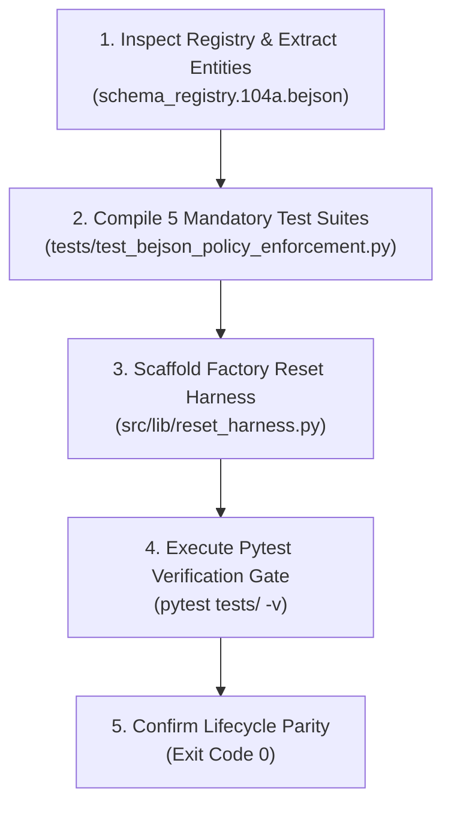

# bejson-enforcement-suite-builder (Layer 2 Verification Gate & Testing)

## Summary

`bejson-enforcement-suite-builder` is the canonical Layer 2 skill for generating, verifying, and executing the five mandatory runtime tests mandated by Policy §10.6 (Enforcement Tests) and scaffolding the unified factory reset harness required by Policy §10.7 (Lifecycle Parity). While static AST linters verify code syntax, this skill ensures runtime behavioral conformance: rejecting non-registry field names, asserting immutable UUID primary keys, performing write-read round trips, running lifecycle smoke tests, and proving zero null rows or duplicate hashes post-reset.

## When to Use

- Generating the mandatory 5-test compliance suite for any project declaring a schema registry (`schema_registry.104a.bejson` or `lib_<Family>_taxonomy.py`).
- Creating `tests/test_bejson_policy_enforcement.py` bound directly to the project's entity schemas.
- Scaffolding the unified factory reset harness (`lib/reset_harness.py`) to guarantee identical teardown/seed behavior across UI, CLI, and launcher.
- Executing pre-delivery test suites via `pytest` to guarantee zero regressions.

## When NOT to Use

- Do NOT use for static AST code auditing of O(1) `field_map` caching or naming conventions (use `policy-bejson-auditor`).
- Do NOT use for black-box Layer 1 structural file validation (use `bejson-104-validator`).
- Do NOT use for Format 105 UUID integrity verification (use `bejson-105-validator`).
- Do NOT use for packaging or delivering release ZIP archives (use `project-delivery-packager`).

---

## 1. Architectural Guardrails & Layer Boundary Laws

- **Assigned Skill Tier**: Layer 2 (`L2`) Verification Gate
- **Codebase Layer Mapping**: `L1_Validation_L2_Verification`
- **Allowed Downward Dependencies**: Layer 1 only (`bejson-104-core`, `bejson-105-core`, `bejson-sanitization-core`)
- **Five Mandatory Test Suites (Policy §10.6)**:
  1. **Conformance Test**: System fails/rejects unregistered field names.
  2. **Manifest Integrity Test**: Verifies immutable UUID PKs and valid data types.
  3. **Round-Trip Test**: Write &rarr; Read Back &rarr; Verify with dynamic `field_map`.
  4. **Lifecycle Smoke Test**: Reset &rarr; Create &rarr; Verify presence across list pickers.
  5. **Post-Reset Test**: Zero null rows, zero duplicate primary key hashes, exact seed counts.
- **Lifecycle Parity Mandate (Policy §10.7)**: Single factory-reset routine invoked across UI, CLI, and test harnesses.

---

## 2. CLI Tooling & Execution

The skill is powered by the black-box test builder [`scripts/generate_enforcement_tests.py`](./scripts/generate_enforcement_tests.py).

### Command-Line Arguments

```text
usage: generate_enforcement_tests [-h] [--project-dir PROJECT_DIR]
                                  [--registry-path REGISTRY_PATH]
                                  [--output-test-path OUTPUT_TEST_PATH]
                                  [--run-tests] [--version] [--register]
                                  [--config] [--reset]

options:
  --project-dir PROJECT_DIR           Path to project root (default: current directory)
  --registry-path REGISTRY_PATH       Custom path to schema_registry.104a.bejson
  --output-test-path OUTPUT_TEST_PATH Custom destination path for test suite file
  --run-tests                         Immediately execute pytest on generated tests
  --version                           Show version number and exit
  --register                          Self-register builder utility
  --config                            Display configuration
  --reset                             Verify generator layout
```

### Standard Invocation Examples

1. **Generate Test Suite & Harness**:
   ```bash
   python3 ~/.gemini/config/skills/bejson-enforcement-suite-builder/scripts/generate_enforcement_tests.py \
     --project-dir "/storage/emulated/0/Admin/Dev/Python/Development/Cloud_Switchyard"
   ```

2. **Generate and Immediately Run Tests**:
   ```bash
   python3 ~/.gemini/config/skills/bejson-enforcement-suite-builder/scripts/generate_enforcement_tests.py \
     --project-dir "." --run-tests
   ```

3. **Global Launcher Command**:
   ```bash
   bejson-enforcement-suite-builder --project-dir "/path/to/project" --run-tests
   ```

---

## 3. Step-by-Step Testing & Scaffolding Workflow



### Stage 1: Schema Ingestion
- Locates `schema_registry.104a.bejson` (or `bejson_project.json`).
- Sanitizes dictionary boundary layers per Policy §10.9.
- Extracts entity names, primary keys, fields, and owning writers.

### Stage 2: Test Suite Generation
- Compiles `tests/test_bejson_policy_enforcement.py` implementing all 5 mandatory tests.
- Binds tests to the project's exact entity and field definitions.

### Stage 3: Factory Reset Scaffolding
- Creates `lib/reset_harness.py` exposing `execute_factory_reset()`.
- Guarantees that CLI `--reset`, UI buttons, and tests invoke the same reset logic.

### Stage 4: Execution Gate
- Runs `pytest` against the generated test file.
- Validates that zero tests fail or error before marking the build ready for release.

---

## 4. Deterministic Exit Codes

| Exit Code | Semantic Meaning | Recovery Action |
|:---:|---|---|
| `0` | **Success** &mdash; Test suite and reset harness generated; all tests pass. | Proceed to release packaging or runtime deployment. |
| `10` | **Path / Disk Failure** &mdash; Target project or tests directory unwritable. | Verify directory write permissions. |
| `20` | **Environment / Pytest Failure** &mdash; Test suite failed or pytest missing. | Inspect test failure output and fix schema/writer mismatch. |
| `30` | **Schema / Registry Error** &mdash; Registry file missing or invalid JSON. | Restore registry or define entities via taxonomy builder. |

---

## 5. Companion References & Assets

- Reference Specification: [`references/enforcement_testing_standards.md`](./references/enforcement_testing_standards.md)
- Executable Tool: [`scripts/generate_enforcement_tests.py`](./scripts/generate_enforcement_tests.py)

---

*Author: Elton Boehnen · boehnenelton2024@gmail.com · boehnenelton2024.pages.dev · github.com/boehnenelton*
