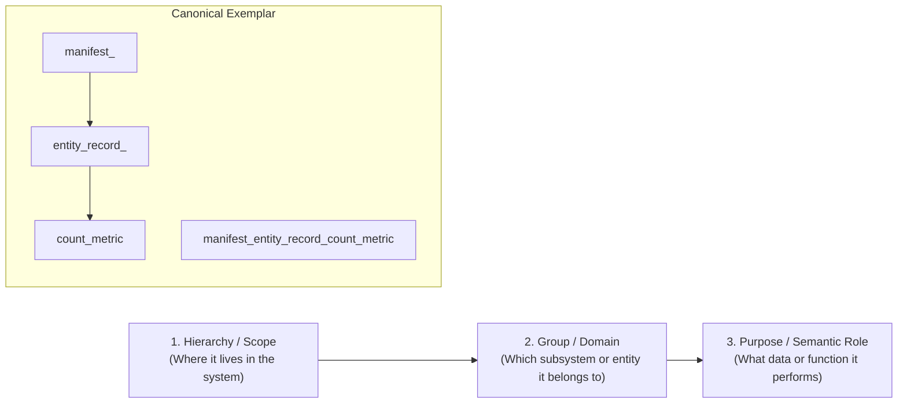

# Specification: Long Self-Describing Variable Standard (Hierarchy-Group-Purpose Triad)

> **Parent Skill:** `code-taxonomy-architect` (Layer 5)  
> **Policy Binding:** Policy §6.1 & §10.2 (GEMINI.md)  
> **Author:** Elton Boehnen · boehnenelton2024@gmail.com · boehnenelton2024.pages.dev · github.com/boehnenelton  
> **Effective Date:** October 2026  
> **RELATIONAL_ID:** `3c9d7e1a-8f2b-4560-b7a4-0e1d9c8f2a5b`

---

## 1. Executive Summary & Principles

In high-reliability systems, agentic automation, and complex relational architectures, ambiguous or abbreviated variable names (`d`, `tmp`, `val`, `res`, `arr`, `obj`, `data`, `item`) introduce cognitive drag, conceal architectural boundaries, and cause downstream logic bugs.

The **Long Self-Describing Variable Standard** enforces that every variable identifier in new code, templates, and scripts must explicitly communicate its architectural position via the **Hierarchy-Group-Purpose (HGP) Triad**:

$$\text{Identifier} = \langle\text{Hierarchy/Scope}\rangle\_\langle\text{Group/Domain}\rangle\_\langle\text{Purpose/Role}\rangle$$



---

## 2. The Hierarchy-Group-Purpose (HGP) Triad

### 2.1 Hierarchy / Scope Token
Identifies the architectural layer, structural container, or lifetime scope of the variable:
- `manifest_`: Within an MFDB root manifest.
- `database_`: System-wide database or multi-file store.
- `entity_`: A specific tabular entity or data model.
- `table_row_`: Inside a row iteration or tabular record.
- `canvas_`: Within a BEHTML presentation stage.
- `session_`: Bound to an active agent or runtime session.
- `request_`: HTTP or API payload scope.

### 2.2 Group / Family / Subsystem Token
Identifies the component, domain entity, or library module:
- `field_map_`: BEJSON $O(1)$ indexing cache.
- `sublane_gutter_`: Spatial layout column.
- `user_account_`: User domain entity.
- `article_content_`: Content domain entity.
- `pid_lock_`: File concurrency lock.
- `ast_node_`: Syntax tree visitor component.

### 2.3 Purpose / Semantic Suffix Token
Identifies the specific payload type, mathematical unit, or operational role:
- `_count_metric`: Quantitative integer counter.
- `_total_amount`: Continuous or currency metric.
- `_is_active_flag`: Boolean operational flag.
- `_has_permission_flag`: Boolean authorization state.
- `_lookup_cache`: Dictionary or index map for $O(1)$ queries.
- `_items_list`: Array or sequence of objects.
- `_target_file_path`: Absolute or relative path reference.
- `_callback_fn`: Callable routine or event handler.
- `_sanitized_str`: Boundary-cleaned string payload.
- `_iso_timestamp`: ISO-8601 UTC date string.
- `_sha256_hash`: Cryptographic hex digest.

---

## 3. Comparison Directory: Ambiguous vs. Self-Describing

| Ambiguous / Prohibited | Self-Describing Standard (HGP) | Communicated Meaning |
| :--- | :--- | :--- |
| `d` or `doc` | `parsed_bejson_manifest_document` | Validated top-level manifest dictionary |
| `fmap` or `fm` | `bejson_parser_field_map_cache` | $O(1)$ dictionary mapping column names to indices |
| `r` or `row` | `entity_table_record_row` | Positional array of cell values |
| `c` or `cnt` | `manifest_entity_record_count_metric` | Number of rows registered in manifest |
| `w` or `width` | `canvas_sublane_gutter_width_px` | Fixed pixel width of lateral gutter |
| `fn` or `f` | `schema_validation_callback_fn` | Verification handler |
| `tmp` or `t` | `pid_atomic_temporary_file_path` | `.bejson_<pid>_<rand>.tmp` scratch path |
| `hash` or `h` | `container_payload_sha256_hash` | Checksum digest string |
| `flag` or `act` | `session_user_is_active_flag` | Boolean account status |

---

## 4. Multi-Language Exemplars

### 4.1 Python
```python
# PROHIBITED (Ambiguous):
for r in doc["Values"]:
    val = r[fmap["user_id"]]
    if val:
        res.append(val)

# REQUIRED (Self-Describing HGP):
for entity_table_record_row in parsed_bejson_document["Values"]:
    entity_user_id_value = entity_table_record_row[bejson_parser_field_map_cache["user_id"]]
    if entity_user_id_value is not None:
        sanitized_user_ids_list.append(entity_user_id_value)
```

### 4.2 TypeScript / JavaScript
```typescript
// PROHIBITED (Ambiguous):
const el = document.querySelector("#c");
let w = el.offsetWidth;

// REQUIRED (Self-Describing HGP):
const behtml_stage_canvas_element = document.querySelector<HTMLElement>("#stage_canvas");
const canvas_viewport_width_px: number = behtml_stage_canvas_element.offsetWidth;
```

### 4.3 Bash
```bash
# PROHIBITED (Ambiguous):
f="$1"
t=$(date +%s)

# REQUIRED (Self-Describing HGP):
target_manifest_file_path="$1"
session_execution_start_epoch_seconds=$(date +%s)
```

---

## 5. Prohibited Tokens Directory

The following tokens are strictly prohibited as standalone variable identifiers in application logic:
- `a`, `b`, `c`, `d`, `e`, `f`, `i`, `j`, `k`, `p`, `r`, `s`, `t`, `v`, `w`, `x`, `y`, `z`
- `tmp`, `temp`, `val`, `value`, `res`, `result`, `arr`, `array`, `obj`, `object`, `item`, `data`, `record`, `row`, `col`, `str`, `num`

*(Loop indices `idx` or `i` are permitted only in simple mathematical generator expressions under 1 line).*

---

## 6. Real-World Case Study: BEJSON_CMS Taxonomy & Naming Standards

The production codebase at `/storage/emulated/0/Admin/Dev/Python/Development/BEJSON_CMS` serves as the authoritative, living master exemplar of these taxonomy and naming standards.

### 6.1 Canonical Prefix & Synthetic UUID Registry (`lib_bejson_CMS_taxonomy.py`)
Every entity in BEJSON_CMS possesses a strict 3–5 character prefix and a synthetic UUIDv4 primary key:

| Entity Name | Prefix | Synthetic UUID PK | Domain Role |
| :--- | :--- | :--- | :--- |
| `PageRecord` | `page_` | `page_uuid` | Page content records (articles, links, app-embeds) |
| `AuthorProfile` | `author_` | `author_uuid` | Author persona / profile records |
| `MediaAsset` | `asset_` | `asset_uuid` | Locally uploaded binary media files |
| `ExternalMedia` | `extmedia_` | `extmedia_uuid` | Externally hosted media embeds (YouTube, etc.) |
| `AdUnit` | `ad_` | `ad_uuid` | Advertisement placements and banners |
| `Category` | `cat_` | `cat_uuid` | Taxonomy category records |
| `NavLink` | `nav_` | `nav_uuid` | Navigation link records |
| `SiteConfig` | `sys_` | `sys_uuid` | Site-wide configuration key-value records |
| `SocialLink` | `social_` | `social_uuid` | Social media profile link records |
| `StandaloneApp` | `app_` | `app_uuid` | Standalone HTML/JS mini-app records |
| `AI_Profile` | `persona_` | `persona_uuid` | AI persona / profile records for Gemini-backed generation |

### 6.2 Semantic Field Suffix Normalization (`TAXONOMY_FIELD_ALIAS_MAP`)
Ambiguous or abbreviated legacy field names migrate to explicit, semantic suffixes:
- `auth_img` $\rightarrow$ `author_avatar_url` (explicit: URL to avatar image)
- `auth_name` $\rightarrow$ `author_display_name` (explicit: visible UI name)
- `ad_image` $\rightarrow$ `ad_banner_url` (explicit: display banner asset)
- `ad_link` $\rightarrow$ `ad_target_url` (explicit: destination hyperlink)
- `nav_label` $\rightarrow$ `nav_display_label` (explicit: navigation text)
- `uploaded_at` $\rightarrow$ `asset_uploaded_at` (explicit: ISO-8601 upload timestamp)
- `created_at` $\rightarrow$ `page_created_at` (explicit: ISO-8601 creation timestamp)

### 6.3 Self-Describing Application Variables (`BEJSON_CMS_Admin.py`)
In application logic and web route guards, variable names adhere to the Hierarchy-Group-Purpose triad:
- `Request_Basic_Auth_Header = request.authorization` (Hierarchy: `Request`, Group: `Basic_Auth`, Purpose: `Header`)
- `TAXONOMY_PREFIX_REGISTRY` (Hierarchy: `Taxonomy`, Group: `Prefix`, Purpose: `Registry`)
- `TAXONOMY_FIELD_ALIAS_MAP` (Hierarchy: `Taxonomy`, Group: `Field_Alias`, Purpose: `Map`)
- `total_uuid_injections` (Hierarchy: Global Audit, Group: `UUID`, Purpose: `Injections_Count`)

### 6.4 Library Family Heritage Naming (Policy §6.1)
- Extension libraries: `lib_bejson_CMS_taxonomy.py`, `lib_bejson_CMS_cms_core.py`, `lib_bejson_CMS_cms_ports.py`
- Core engine libraries: `lib_bejson_Core_bejson_core.py`, `lib_bejson_Core_mfdb_core.py`, `lib_bejson_Core_mfdb_validator.py`

---

Elton Boehnen · boehnenelton2024@gmail.com · boehnenelton2024.pages.dev · github.com/boehnenelton

