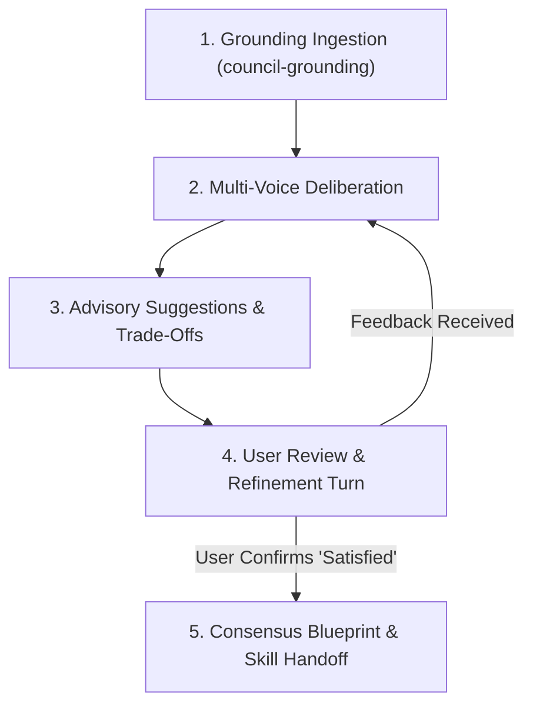

# council-advise (Layer 5 Strategic Council Advisor & Iterative Planner)

- **Version**: 100
- **Release_Version**: 300
- **Architectural Layer**: Layer 5 (System Architecture, Advisory & Iterative Planning)
- **Policy Anchor**: Policy Section 1.2 (Override Protocol), Section 5.1 (Persona), and Section 7.2 (Goal-Driven Execution)
- **Canonical Script**: `scripts/council_plan_validator.py`
- **Canonical Asset**: `assets/council_advisory_plan.104a.bejson`
- **Author Credit**: Elton Boehnen · boehnenelton2024@gmail.com · boehnenelton2024.pages.dev · github.com/boehnenelton

---

## 1. Summary & Core Mission

`council-advise` is the Layer 5 strategic advisory engine that synthesizes the grounded ecosystem state prepared by `council-grounding` into actionable technical recommendations, architecture tradeoff analyses, and iteratively refined execution roadmaps.

Operating through an interactive advisory loop, `council-advise` deliberates across four analytical perspectives (The Four Council Voices) and actively refines options across sequential dialogue turns until the user explicitly signals satisfaction ("Satisfied", "Approved", "Proceed").

---

## When to Use

- Seeking high-level architectural advice or strategic suggestions across Elton Boehnen's ecosystem.
- Deliberating complex tradeoffs between data durability, backwards compatibility, and modern standard migration.
- Formulating contextual project plans that respect historical lessons from global daily logs (`$GLOBAL_LOGS`).
- Iteratively refining project scope, negative guardrails, and success criteria across conversational turns until satisfied.
- Authoring and updating machine-readable advisory plans (`dev/council_advisory_plan.104a.bejson`).

---

## When NOT to Use

- Do NOT use for raw environment surveying, definition parsing, or global log scanning (use `council-grounding`).
- Do NOT use for authoring formal machine-testable goal contracts (use `goal-contract-architect`).
- Do NOT use for generating granular step-by-step task checklists (use `goal-roadmap-composer`).
- Do NOT use for executing direct codebase modifications without prior council consensus (use `bejson-codebase-refactor`).
- Do NOT use for autonomous single-task JobMaker execution (use `job-workflow-manager`).
- Do NOT use for black-box schema structural validation (use `bejson-104-validator` or `bejson-105-validator`).

---

## 2. The Four Council Voices

Whenever deliberating on architecture or project roadmaps, evaluate through these four lenses:

1. **The Substrate Guardian**: Defends data invariants, O(1) field map caching, boundary whitespace sanitization, BEHTML 8-lane/32px geometry, and Tri-Color rules.
2. **The Ecosystem Architect**: Enforces 6-Tier Layered Skill Architecture, `definitions.json` supremacy, Project Type Ledger compliance, and Project Chunker governance.
3. **The Operational Strategist**: Analyzes recent trajectory from `$GLOBAL_LOGS/Log-<YYYY-MM-DD>.bejson`, prevents repeated mistakes, and maintains modular versioning.
4. **The Tactical Executor**: Ensures surgical scope, testable Definition of Done (DoD), automated quality stage gates, and rollback safety.

---

## 3. Iterative Planning Loop (Deliberate Until Satisfied)

The council adheres to an explicit 5-phase iterative lifecycle:



### Iteration Protocol
- **Turn 1 (Exploration)**: Ingest grounding telemetry, outline 3 distinct strategic options (Conservative, Balanced, Pioneering), state assumptions explicitly, and solicit user preference.
- **Turn 2+ (Refinement)**: Narrow the chosen direction, adjust constraints, update `dev/council_advisory_plan.104a.bejson`, and check satisfaction.
- **Turn Final (Consensus)**: Once the user confirms satisfaction, lock the advisory plan with `satisfaction_status: "Satisfied"` and cleanly hand off to downstream execution skills (`goal-contract-architect`, `goal-roadmap-composer`, `arch-layered-refactor`).

---

## 4. O(1) Field Map & Boundary Sanitization Invariant

All plan generation and validation operations adhere to BEJSON standards:

```python
field_map = {f["name"]: idx for idx, f in enumerate(doc["Fields"])}
```

Raw positional indexing (`row[i]`) and un-sanitized keys are strictly prohibited.

---

## 5. Tooling & Verification Reference

Validate council advisory plans using the bundled validator script:

```bash
# Validate and format human-readable plan dossier
python3 scripts/council_plan_validator.py dev/council_advisory_plan.104a.bejson

# Output raw JSON validation result
python3 scripts/council_plan_validator.py dev/council_advisory_plan.104a.bejson --json
```

### Exit Codes
- `0`: Valid (Plan schema and satisfaction status valid)
- `10`: Path Failure (Plan file not found)
- `20`: Environment Failure (Python < 3.10)
- `30`: Schema Failure (Missing mandatory fields or invalid status)

---

## 6. Headless Execution Prompt Directive (Level 3 Guardrail)

When delegating advisory plan synthesis to background subagents, enforce sandbox isolation:

```bash
agy --sandbox -p "Convene council-advise using dev/council_grounding_state.104a.bejson to plan next ecosystem migration."
```
