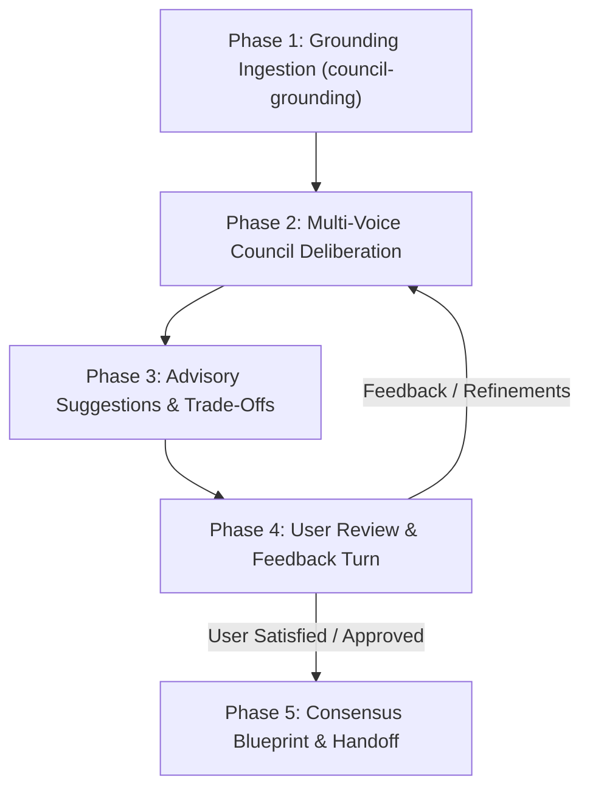

# Iterative Planning Protocol (Deliberate Until Satisfied)

> **Skill**: `council-advise` (Layer 5 Council Advisor & Iterative Planner)  
> **Author**: Elton Boehnen · boehnenelton2024@gmail.com · boehnenelton2024.pages.dev · github.com/boehnenelton  
> **Release_Version**: 300 | **Schema**: BEJSON 104a

---

## 1. The Five Phases of the Iterative Advisory Loop

The user explicitly mandates that `council-advise` must "iteratively plan until satisfied". The advisory loop continues across sequential turns until the user explicitly signals approval.

### Phase 1: Grounding Ingestion
- Ingest operational state dossier generated by `council-grounding` (`dev/council_grounding_state.104a.bejson` or stdout).
- Identify current branch, modified files, recent log events, and active negative constraints.

### Phase 2: Multi-Voice Council Deliberation
- Convene the 4 Council Voices (Substrate Guardian, Ecosystem Architect, Operational Strategist, Tactical Executor).
- Surface hidden trade-offs, potential policy violations, and architecture boundaries.

### Phase 3: Advisory Suggestions & Trade-Offs
- Present concise, high-signal advisory options.
- State assumptions explicitly.
- Provide concrete recommendations with rationale.

### Phase 4: User Review & Feedback Turn
- Record user feedback, scope tweaks, or alternative preferences.
- Increment `iteration_cycle` counter.
- Update `satisfaction_status`:
  - `Iterating`: Initial formulation or exploratory options.
  - `Refining`: Incorporating user feedback or narrowing choices.
  - `Approved` / `Satisfied`: Explicit user confirmation received ("Satisfied", "Approved", "Looks good", "Proceed").

### Phase 5: Consensus Blueprint & Handoff
- Upon reaching satisfaction, lock the plan in `dev/council_advisory_plan.104a.bejson`.
- Hand off cleanly to execution skills:
  - `goal-contract-architect`: To lock machine-testable goal boundaries.
  - `goal-roadmap-composer`: To generate step-by-step sequential checklists.
  - `arch-layered-refactor`: For multi-layer structural refactoring.
  - `job-workflow-manager`: For single-task JobMaker execution.
