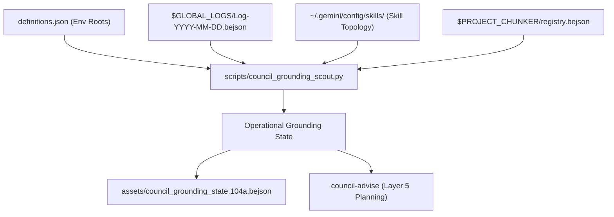

# council-grounding (Layer 5 Ecosystem Grounding & Domain Cartographer)

- **Version**: 100
- **Release_Version**: 300
- **Architectural Layer**: Layer 5 (System Architecture & Environmental Grounding)
- **Policy Anchor**: Policy Section 1.1, Section 2.3, Section 4.5, and October 31, 2026 Directives
- **Canonical Script**: `scripts/council_grounding_scout.py`
- **Canonical Asset**: `assets/council_grounding_state.104a.bejson`
- **Author Credit**: Elton Boehnen · boehnenelton2024@gmail.com · boehnenelton2024.pages.dev · github.com/boehnenelton

---

## 1. Summary & Core Mission

`council-grounding` operates at Layer 5 to provide deep operational grounding across Elton Boehnen's software domains before any advisory council convenes or execution planning begins. It synthesizes a high-density, factually verified telemetry state dossier by evaluating four primary data streams:

1. **Canonical Environment Definitions**: Ingests `/storage/emulated/0/.env/user/definitions.json` (the single source of truth replacing deprecated `paths.json`), dynamically resolving storage roots, library paths, and job management directories without hardcoding host paths.
2. **Global Daily Logs Sink**: Reads and parses the latest daily log files under `$GLOBAL_LOGS/Log-<YYYY-MM-DD>.bejson` using O(1) Field Map Caching, extracting recently executed tasks, modified file paths, active subsystems, and error codes.
3. **Domain Landscape & Library Tiers**: Validates active domain boundaries, keeping `libraries_104` (stable, frozen core) strictly decoupled from `libraries_105` (development, loaded only when instructed).
4. **Installed Skill Topology & Project Trackers**: Surveys installed skills in `~/.gemini/config/skills/` and registered projects in `$PROJECT_CHUNKER`, providing factual situational awareness.

---

## When to Use

- Grounding the AI assistant in current system state, active projects, and environmental variables.
- Reading and analyzing recent daily global logs (`Log-<YYYY-MM-DD>.bejson`) to understand cross-session context, past failures, or ongoing initiatives.
- Querying storage roots, canonical type ledgers, and project chunker registries.
- Generating a machine-readable `dev/council_grounding_state.104a.bejson` container before handing off to `council-advise`.
- Auditing active negative constraints (e.g. library edit prohibitions, O(1) field map requirements).

---

## When NOT to Use

- Do NOT use for iterative conversational planning, multi-perspective debate, or user satisfaction loops (use `council-advise`).
- Do NOT use for authoring formal machine-testable goal contracts (use `goal-contract-architect`).
- Do NOT use for creating task checklists or roadmaps (use `goal-roadmap-composer`).
- Do NOT use for raw single-table BEJSON 104 CRUD operations (use `bejson-104-core`).
- Do NOT use for detecting pairwise skill routing collisions across manifests (use `skill-ecosystem-cartographer`).
- Do NOT use for static AST code auditing of field map caches (use `policy-bejson-auditor`).

---

## 4. Architectural Invariants & Data Flow



### 4.1 O(1) Field Map Cache Mandate
Every BEJSON query executed by this skill or its companion scout tool must compile an O(1) lookup dictionary:

```python
field_map = {f["name"]: idx for idx, f in enumerate(doc["Fields"])}
```

Raw positional row indexing (such as `row[0]` or `row[2]`) is strictly prohibited.

### 4.2 Boundary Sanitization Mandate
All dictionary keys, field definitions, and table cells are sanitized upon ingestion per Policy Section 10.9 before processing.

---

## 5. CLI Execution & Tooling Reference

To survey the environment and generate an operational state dossier, invoke the bundled scout script:

```bash
# Print formatted human-readable telemetry summary
python3 scripts/council_grounding_scout.py --summary

# Generate raw JSON dossier
python3 scripts/council_grounding_scout.py --json

# Export canonical BEJSON 104a state container to dev/ directory
python3 scripts/council_grounding_scout.py --bejson-output dev/council_grounding_state.104a.bejson
```

### Exit Codes
- `0`: Success (Clean environment survey and log extraction)
- `10`: Path Failure (Missing definitions.json or inaccessible directories)
- `20`: Environment Failure (Unsupported Python version < 3.10)
- `30`: Schema Failure (Corrupted BEJSON document or field map mismatch)

---

## 6. Headless Execution Prompt Directive (Level 3 Guardrail)

When invoking subagents to run council grounding tasks, enforce sandbox containment:

```bash
agy --sandbox -p "Execute council-grounding scout and export state to dev/council_grounding_state.104a.bejson."
```
