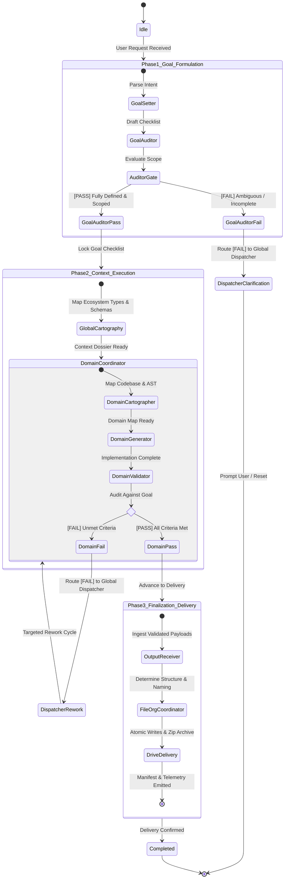

# Domain-Scoped Coordinators & Global Dispatcher Architecture Specification

**Author**: Elton Boehnen · boehnenelton2024@gmail.com · boehnenelton2024.pages.dev · github.com/boehnenelton  
**Effective Date**: October 20, 2026  
**Relational ID**: `c4a1792e-336e-49fd-9b88-1f19672808c1`  
**Architecture Layer**: Layer 6 (Root Orchestration & Meta-Governance)

---

## 1. System Topology Overview

The system establishes an autonomous, verified multi-phase execution pipeline governed by `global_dispatcher` as the central state manager and router.

```
global_dispatcher (The central router and state manager)
|
| ----- [Phase 1: Goal Formulation & Gatekeeping]
| --------- goal_setter (Parses user intent into a strict, verifiable checklist)
| --------- goal_auditor (Checks: Is the goal fully defined, actionable, and scoped?)
|               ├── [FAIL] -> Returns to global_dispatcher (Prompts user for clarification or resets)
|               └── [PASS] -> Locks the goal checklist and proceeds
|
| ----- [Phase 2: Context & Execution]
| --------- global_cartography (Maps existing types and definitions based on the locked goal)
|
| --------- (domain)_coordinator (Manages specific workflow)
|               ├── (domain)_cartographer (Maps the specific project/codebase)
|               ├── (domain)_generator (Executes the actual work)
|               └── (domain)_validator (Checks output against the locked goal checklist)
|                               ├── [FAIL] -> Returns to global_dispatcher for a rework cycle
|                               └── [PASS] -> Proceeds to delivery
|
| ----- [Phase 3: Finalization & Delivery]
| --------- output_receiver (Formats the validated output)
|               ├── file_organization-coordinator (Determines folder structure/names)
|               └── drive_delivery (Handles final file system/cloud write)
```

---

## 2. Phase Breakdown & Subagent Responsibilities

### Phase 1: Goal Formulation & Gatekeeping

1. **`goal_setter`**:
   - Ingests raw user intent, specifications, and conversational requests.
   - Deconstructs intent into an atomic, deterministic Goal Checklist.
   - Formulates explicit, binary acceptance criteria for every single goal item.
   - Identifies implicit constraints, negative constraints (Policy §7.3), and required target schemas.

2. **`goal_auditor`**:
   - Evaluates the Goal Checklist for actionability, completeness, and scope containment.
   - Verifies that zero ambiguous assumptions or forbidden operations are present.
   - Branching Decisions:
     - `[FAIL]`: Returns state to `global_dispatcher` with explicit missing elements or conflict reasons. Prompts user for clarification or resets state.
     - `[PASS]`: Formally freezes and locks the Goal Checklist (`locked_goal_checklist`), advancing state to Phase 2.

### Phase 2: Context & Execution

1. **`global_cartography`**:
   - Maps existing ecosystem types, canonical definitions (`definitions_registry.104a.bejson`), and installed skill topologies based on the locked goal checklist.
   - Resolves schemas, library paths (`$ADMIN_LIBRARIES_104`, `$ADMIN_LIBRARIES_105`), and active negative constraints into a structured Context Dossier.

2. **`(domain)_coordinator`**:
   - Orchestrates domain-specific workflows for a target domain (`bejson`, `behtml`, `taxonomy`, `skills`, `publications`, etc.).
   - Sequentially manages the domain execution triad:
     - **`(domain)_cartographer`**: Scans the target project/codebase, mapping existing files, directory trees, AST symbols, class hierarchies, and dependencies.
     - **`(domain)_generator`**: Executes implementation, code generation, refactoring, or template instantiation adhering to the locked goal checklist and Policy mandates (e.g., Policy §6.1 Long Self-Describing Variables, §6.2 O(1) Field Map Cache, §8.1 Tri-Color Palette, §9.1 Headers).
     - **`(domain)_validator`**: Executes deterministic domain verification suites (Layer 2 validators, AST checks, Policy §10.6 five-test suite).
   - Validation Branching:
     - `[FAIL]`: Captures error diagnostics, increments rework iteration counter, and reports failure back to `global_dispatcher` to initiate a targeted rework cycle.
     - `[PASS]`: Confirms all acceptance criteria are satisfied with zero errors, transitioning state to Phase 3.

### Phase 3: Finalization & Delivery

1. **`output_receiver`**:
   - Central receiver for verified Phase 2 payloads.
   - Formats, sanitizes, and organizes validated artifacts into release manifests.

2. **`file_organization_coordinator`**:
   - Enforces standardized relative subfolder architecture (`lib/`, `config/`, `data/`, `exports/`, `backups/`, `dev/`, `docs/`) per Policy §1.1.
   - Determines solid integer versioning and package naming (`Name_Case-V#-PKG#`) per Policy §3.1 and §9.
   - Enforces packaging exclusions (`.beignore`).
   - Ensures each script has self-locating path logic (§4.1/§4.2) and headers (§9.1) with fresh `RELATIONAL_ID`.

3. **`drive_delivery`**:
   - Executes atomic filesystem writes (`.tmp` -> `fsync` -> `replace`) to prevent corruption.
   - Generates release ZIP archives and places backups in `$PROJECTS_ARCHIVE_ROOT` (`/storage/emulated/0/Admin/Core/Projects_Archive/<ProjectName>/<PackageName>.zip`).
   - Executes project registration via master catalog tooling (`$PROJECT_INDEX_ROOT/cli_project_register.py`).
   - Emits byte counts, SHA-256 checksums, and completion telemetry.

---

## 3. State Machine & Transition Rules



---

## 4. Domain Coordinator Matrix

| Domain Key | Coordinator Name | Specialized Scope | Primary Validation Tools |
| :--- | :--- | :--- | :--- |
| `bejson` | `bejson_coordinator` | BEJSON 104, 104a, 104db, Format 105, MFDB | `bejson-104-validator`, `bejson-105-validator`, `policy-bejson-auditor` |
| `behtml` | `behtml_coordinator` | BEHTML layouts, 8-lane / 16-sublane grids, Tri-Color | `behtml-design-preferences`, `verify_behtml_preferences.py` |
| `taxonomy` | `taxonomy_coordinator` | Entity prefixes, schemas, UI component trees, variables | `code-taxonomy-architect`, `component-taxonomy-architect`, `verify_variable_naming.py` |
| `skills` | `skills_coordinator` | Multi-tier Antigravity CLI skills (L1-L6), SKILL.md | `skill-architect`, `skill_architect_linter.py`, `skill-ecosystem-cartographer` |
| `publication` | `publication_coordinator` | Multi-chapter books, technical docs, HTML specs | `publication-html-builder`, `behtml-templates` |
| `general` | `domain_coordinator` | Fallback coordinator for generic script and tool tasks | `domain_validator`, Python `compileall`, pytest |

---

## 5. Error Recovery & Rework Governance

1. **Rework Iteration Ceiling**: A single domain workflow is permitted a maximum of 3 automated rework cycles. If `domain_validator` fails 3 times sequentially, `global_dispatcher` halts execution, serializes all failure logs, and escalates to the user with a structured conflict report.
2. **Deterministic Stage Gate Isolation**: Upper phases cannot mutate artifacts of lower phases without resetting that phase's gate. If Phase 3 detects a missing file or schema flaw, it must not monkey-patch files; it notifies `global_dispatcher` to re-enter Phase 2.
3. **Audit Trail**: Every state transition, PASS/FAIL gate decision, and rework cycle is recorded in the session ledger with UTC timestamps.
