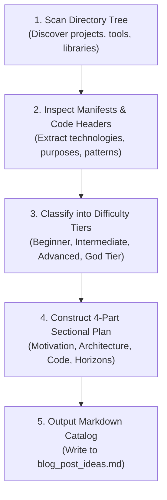

# ideation-blog-post-planner (Layer 5 Use Cases & Ideation Planning)

## Summary

`ideation-blog-post-planner` is the canonical Layer 5 skill for inspecting live codebases, projects, and system configurations to discover compelling technical narratives and generate structured blog post concepts. Grounded in actual engineering artifacts, it categorizes proposals into four distinct difficulty tiers: **Beginner**, **Intermediate**, **Advanced**, and **God Tier**, structuring every topic into a standardized 4-part sectional outline ready for immediate authoring.

## When to Use

- Scanning project repositories (`/storage/emulated/0/Admin`, `~/generate`, etc.) for unique development topics.
- Formulating structured blog post proposals categorized by difficulty level (Beginner to God Tier).
- Synthesizing 4-part sectional outlines for technical articles.
- Generating idea catalogs in markdown format (`blog_post_ideas.md`).

## When NOT to Use

- Do NOT use for authoring the actual multi-part prose or assembling final publication markdown (use `publication-blog-post-writer`).
- Do NOT use for extracting raw granular micro-patterns from unstructured transcripts (use `concept-idea-pattern-extraction`).
- Do NOT use for compiling prose into styled BEHTML editorial pages (use `publication-html-builder`).

---

## 1. Architectural Guardrails & Difficulty Tiers

- **Assigned Skill Tier**: Layer 5 (`L5`) Use Cases & Ideation Planning
- **Codebase Layer Mapping**: `L3_Use_Cases_Cross_Layer_Blueprinting`
- **Allowed Downward Dependencies**: Layers 1 through 4
- **The Four Difficulty Tiers**:
  1. **Beginner**: Applied usage guides, introductory formats, tooling setup.
  2. **Intermediate**: UI design systems, background daemons, automated pipelines.
  3. **Advanced**: Database federation, cryptographic integrity, runtime test gates.
  4. **God Tier**: Persistent cognition, mobile LLM sandboxes, single-file text containers.

---

## 2. CLI Tooling & Execution

The skill is powered by [`scripts/scan_blog_ideas.py`](./scripts/scan_blog_ideas.py).

### Command-Line Arguments

```text
usage: scan_blog_ideas [-h] [--target-dir TARGET_DIR]
                       [--output-file OUTPUT_FILE] [--count COUNT]
                       [--version] [--register] [--config] [--reset]

options:
  --target-dir TARGET_DIR   Directory to scan (default: /storage/emulated/0/Admin)
  --output-file OUTPUT_FILE Destination markdown file path
  --count COUNT             Number of proposals to generate (default: 10)
  --version                 Show program version and exit
  --register                Self-register utility
  --config                  Display configuration
  --reset                   Verify scanner layout
```

### Invocation Examples

1. **Scan Admin Folder and Save to Markdown**:
   ```bash
   python3 ~/.gemini/config/skills/ideation-blog-post-planner/scripts/scan_blog_ideas.py \
     --target-dir "/storage/emulated/0/Admin" \
     --output-file "~/generate/blog_post_ideas/blog_post_ideas.md" \
     --count 10
   ```

2. **Global Launcher Command**:
   ```bash
   ideation-blog-post-planner --target-dir "/path/to/code" --count 5
   ```

---

## 3. Step-by-Step Ideation Workflow



---

## 4. Deterministic Exit Codes

| Exit Code | Semantic Meaning | Recovery Action |
|:---:|---|---|
| `0` | **Success** &mdash; Projects discovered, blog ideas generated and cataloged. | Hand off to `publication-blog-post-writer`. |
| `10` | **Path Failure** &mdash; Target scan directory missing or empty. | Check path existence and permissions. |
| `20` | **Environment Failure** &mdash; Runtime environment error or Python < 3.10. | Verify Python runtime. |
| `30` | **Schema Failure** &mdash; Parse error in inspected project manifests. | Review manifest JSON syntax. |

---

## 5. Companion References & Assets

- Reference Specification: [`references/blog_ideation_taxonomy.md`](./references/blog_ideation_taxonomy.md)
- Executable Tool: [`scripts/scan_blog_ideas.py`](./scripts/scan_blog_ideas.py)

---

*Author: Elton Boehnen · boehnenelton2024@gmail.com · boehnenelton2024.pages.dev · github.com/boehnenelton*
