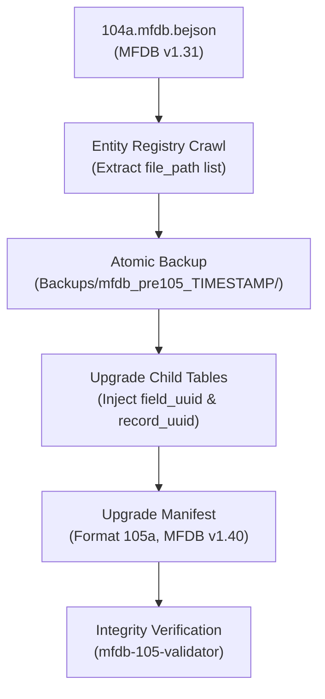

# MFDB 105 Whole-Database Upgrade Workflow Guide

## Architecture Overview

Foundational Era Multi-File Databases (`MFDB v1.31` / `v1.39`) decouple large data collections across individual files referenced by a central `104a.mfdb.bejson` manifest. Integrity Era `MFDB v1.40` upgrades this topology to require:
1. `Format_Version: "105a"` for the master manifest.
2. `MFDB_Version: "1.40"`.
3. `Format_Version: "105"` for single-parent entity files (or `105db` for multi-parent files).
4. `field_uuid` on every declared field object in `Fields`.
5. `record_uuid` on every value row in `Values`.
6. `Parent_Hierarchy` pointing to `../105a.mfdb.bejson`.

## Step-by-Step Procedure

1. **Dry-Run Analysis**: Run with `--dry-run` to inspect entity tables and confirm all paths exist.
2. **Snapshot Creation**: The coordinator creates a full mirror under `Backups/`.
3. **Child Table Atomic Swap**: Each child table is transformed in memory, written to `.105tmp`, and replaced.
4. **Manifest Promotion**: The manifest is rewritten with Format 105a and MFDB v1.40 contracts.
