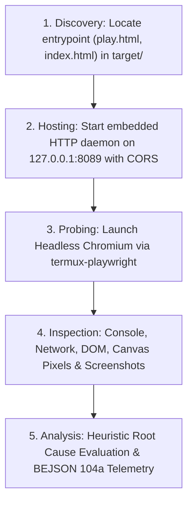

# `playwright-debugger-auditor` (Layer 2 Diagnostic Gatekeeper & Web/Game Auditor)

- **Target Architecture**: Android Termux (aarch64 / ARM 64-bit, Android Bionic libc)
- **Architectural Tier**: Layer 2 (L2) Verification & Diagnostic Gatekeeper
- **Author Credit**: Elton Boehnen · boehnenelton2024@gmail.com · boehnenelton2024.pages.dev · github.com/boehnenelton
- **RELATIONAL_ID**: `c69e25b3-0c62-4bb1-a94f-730737b810d5`
- **Version**: `1.0.0`

---

## Summary

`playwright-debugger-auditor` is the canonical Layer 2 black-box diagnostic skill for auditing, debugging, and diagnosing web applications, dynamic Single Page Applications (SPAs), HTML5 canvas interfaces, and JavaScript games running on Termux. It launches headless Chromium via `termux_playwright`, hosts the target under an embedded CORS-enabled HTTP server daemon, hooks into the browser DevTools protocol to intercept console streams and network failures, samples canvas buffers for rendering activity, and outputs structured root-cause diagnostic reports with visual evidence.

---

## When to Use

- Debugging why an HTML/JS game, web app, or canvas interface fails to load or displays a black/blank screen.
- Investigating client-side JavaScript crashes (`ReferenceError`, `TypeError`, unhandled promise rejections).
- Detecting missing assets, broken relative links, or HTTP 404 responses during application bootstrapping.
- Diagnosing browser security blocks caused by loading ES6 modules or Fetch API calls from the `file://` protocol.
- Capturing multi-stage visual lifecycle screenshots (`01_initial_mount`, `02_network_settled`, `03_post_interaction`).
- Verifying whether canvas elements are actively drawing frames or remaining unrendered/black.
- Auditing projects dropped into a local `target/` directory prior to deployment or release packaging.

---

## When NOT to Use

- Low-level Chromium process reaping, Bionic environment patching, or managing Termux memory budgets (use `playwright-termux-automation`).
- Evading anti-bot WAFs, injecting Bézier mouse trajectories, or applying Canvas/Audio noise (use `playwright-stealth-agent`).
- Scraping static HTML websites where JavaScript execution is not required (use `curl`, `httpx`, or `BeautifulSoup`).
- Executing long-form multi-step user journey scenarios or test automation suites (use `playwright-debugger-auditor` test suites).

---

## 1. Diagnostic Architecture & Workflow

The skill executes an automated 4-stage diagnostic pipeline:



### Telemetry Captured
1. **Console Stream**: All `console.log`, `console.warn`, `console.error`, and `console.debug` calls with line numbers.
2. **Page Exceptions**: Uncaught errors and stack traces emitted by the V8 runtime.
3. **Network Audit**: Every HTTP request and response status code, flagging non-200 responses.
4. **Canvas Geometry & Pixel Sampling**: Checks whether canvas exists, dimensions are non-zero, and samples center/corner pixels to determine if blank, black, or active.
5. **Window Globals & Engines**: Scans for engine signatures (`SwordSlasher`, `VanillaGame`, `Phaser`, `PIXI`, `THREE`, `MFDB_DATA`).
6. **Multi-Stage Screenshots**:
   - `01_initial_mount.png`: Immediately upon `DOMContentLoaded`.
   - `02_network_settled.png`: After network idle and asset settling.
   - `03_post_interaction.png`: After simulated click and keyboard inputs (`Space`, `Enter`, `Arrow` keys).
   - `error_state.png`: Captured if a runtime exception halts execution.

---

## 2. CLI Execution Reference

The skill includes a standalone executable script at `scripts/run_audit.py`:

```bash
# Audit any project or directory (auto-discovers play.html / index.html)
python3 ~/.gemini/config/skills/playwright-debugger-auditor/scripts/run_audit.py /path/to/target_directory

# Audit with an explicit fixture or query parameter (e.g. MFDB game databases)
python3 ~/.gemini/config/skills/playwright-debugger-auditor/scripts/run_audit.py \
  /path/to/target_directory \
  --query "mfdb=/path/to/fixture.json"

# Test direct file:// protocol compatibility (detects CORS/module restrictions)
python3 ~/.gemini/config/skills/playwright-debugger-auditor/scripts/run_audit.py \
  /path/to/target_directory \
  --direct-file

# Audit an explicit HTML entrypoint file
python3 ~/.gemini/config/skills/playwright-debugger-auditor/scripts/run_audit.py \
  /path/to/target_directory \
  --file "custom_play.html"
```

---

## 3. Diagnostic Codes & Remediation Ledger

See [`references/diagnostic_codes_and_remediations.md`](./references/diagnostic_codes_and_remediations.md) for full error profiles.

| Verdict Code | Severity | Root Cause Trigger |
|---|---|---|
| `LOAD_ISSUE_MISSING_FIXTURE_PAYLOAD` | CRITICAL | Game engine loaded but waiting for external DB/fixture (`window.MFDB_DATA`, `?mfdb=`, postMessage). |
| `LOAD_ISSUE_FILE_PROTOCOL_RESTRICTION` | CRITICAL | Loaded via `file://`; browser blocked ES modules or Fetch API due to CORS. |
| `LOAD_ISSUE_MISSING_ASSET_404` | CRITICAL | HTTP 404 response on required script, style, texture, or JSON store. |
| `LOAD_ISSUE_UNCAUGHT_JS_EXCEPTION` | CRITICAL | Unhandled runtime exception interrupted execution on main thread. |
| `LOAD_ISSUE_BLANK_CANVAS` | WARNING | Canvas mounted, but rendered pixels are entirely blank or pitch black. |
| `LOAD_ISSUE_AUDIO_AUTOPLAY_SUSPENDED` | WARNING | AudioContext is suspended pending user interaction gesture. |
| `STATUS_HEALTHY_EXECUTION` | INFO | App loaded cleanly; canvas active and non-blank; zero unhandled errors. |

---

## 4. Deterministic Exit Codes

- **`0`**: Clean completion and healthy execution (`STATUS_HEALTHY_EXECUTION`).
- **`10`**: Warning encountered (e.g., blank canvas or suspended AudioContext).
- **`20`**: Critical load issue diagnosed (missing payload, file protocol restriction, 404 asset, uncaught JS error).
- **`30`**: System or path error (target path not found, HTML entrypoint missing, browser launch failure).
