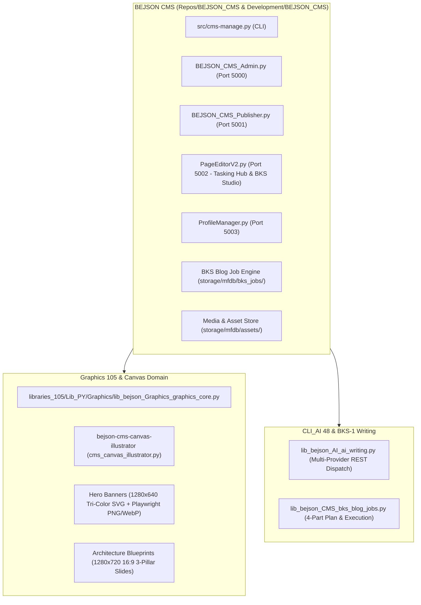

# `project-bejson-cms-grounding` (Layer 5 Project Domain Grounding & Architectural Mapper)

- **Target Architecture**: Android Termux (aarch64 / ARM 64-bit, Android Bionic libc) & POSIX Linux
- **Architectural Tier**: Layer 5 (L5) Project Domain Grounding & Architectural Mapper
- **Author Credit**: Elton Boehnen · boehnenelton2024@gmail.com · boehnenelton2024.pages.dev · github.com/boehnenelton
- **RELATIONAL_ID**: `4a5b6c7d-8901-4ef2-bc34-56789abcdef1`
- **Version**: `1.3.0`
- **Domain**: Project Domain Grounding (`BEJSON_CMS` & `NewAgent CMS`)

## Summary

`project-bejson-cms-grounding` provides architectural blueprints, schema specifications, repository topologies, and operational navigation across both the standalone **BEJSON CMS** (`/storage/emulated/0/Admin/Dev/Repos/BEJSON_CMS` and mirror `/storage/emulated/0/Admin/Dev/Python/Development/BEJSON_CMS`) and the integrated **NewAgent CMS** (`/storage/emulated/0/Admin/Dev/Repos/NewAgent/tools/NA-CMS`). It maps the modern production architecture including the **BKS Blog Job Studio**, **CLI_AI 48 Multi-Provider Engine**, **Graphics 105 Architecture**, and Playwright responsive QA gates.

---

## When to Use

- Analyzing or modifying the CMS codebase, its Flask services, or its static export publisher.
- Navigating the dual architecture: the 4-microservice standalone suite vs. the streamlined NewAgent CMS fork.
- Inspecting MFDB manifest structures (`104a.mfdb.bejson`), entity schemas, media assets (`mediaasset.bejson`), and two-part page storage (`pages_db/<uuid>.json`).
- Understanding library boundaries: shared frozen Core libraries (`NewAgent/lib/`), Graphics 105 (`libraries_105/Lib_PY/Graphics` & `Canvas`), and AI writing engines (`lib_bejson_AI_*`).
- Auditing responsive layouts and mobile viewports (`scrollWidth <= clientWidth`).

## When NOT to Use

- Running active CLI management commands, entity CRUD mutations, or database backups (use `project-bejson-cms-manage`).
- Direct low-level CRUD mutations on standalone `.104.bejson` tables without CMS domain rules (use `bejson-104-core`).
- Validating general MFDB manifest schemas outside the CMS domain (use `mfdb-104-core`).
- Authoring or scaffolding new agent skills or auditing skill topologies (use `skill-architect`).

---

## 1. Dual Repository Architecture & Ecosystem Map



---

## 2. Directory Architecture & Storage Contracts

```text
BEJSON_CMS/
|-- bejson_project.json        # Canonical project tracker (Schema v1.8.0, Versioned UUID)
|-- dev/
|   |-- change-log.md          # Comprehensive per-package release notes
|   `-- UIPref.md              # User interface preferences and mobile styling rules
|-- resources/
|   |-- styles/ (dark.css, light.css)
|   `-- templates/ (canonical HTML skeleton templates)
|-- src/
|   |-- cms-manage.py          # Unified CLI management toolkit
|   |-- lib/                   # Local Core, AI, and BKS libraries
|   `-- web/                   # Flask microservices & Static Publisher
`-- storage/
    |-- builds/                # Static export root (HTML pages, assets, feeds)
    `-- mfdb/
        |-- site_master/data/
        |   |-- pagerecord.bejson     # Page manifest & page_featured_img links
        |   `-- mediaasset.bejson     # Registered media assets (hash, size, mime)
        |-- pages_db/                 # Two-part page content files (<uuid>.json)
        |-- bks_jobs/                 # BKS-1 Blog Job templates & registries
        `-- assets/                   # High-res SVG banners, PNGs, and WebPs
```

---

## 3. Media Asset & Graphics 105 Standard

Every article record in `pagerecord.bejson` must maintain visual integrity:
1. **Featured Image Rule**: Must point to an authored 1280x640 Policy §8.1 Tri-Color SVG hero banner in `storage/mfdb/assets/` (never `default_page_image.webp`).
2. **Architecture Blueprint Rule**: Section 2 of long-form articles must embed an authored 1280x720 3-pillar blueprint diagram.
3. **Format Triad**: Every visual asset is produced and registered in 3 formats:
   - Vector: `.svg` (crisp infinite scaling)
   - High-DPI Raster: `.png` (2x device scale via Playwright `render_still_frame`)
   - Compressed Web: `.webp` (quality=90 via PIL)
4. **Referential Integrity**: Every file in `storage/mfdb/assets/` must have a corresponding row in `mediaasset.bejson`.
