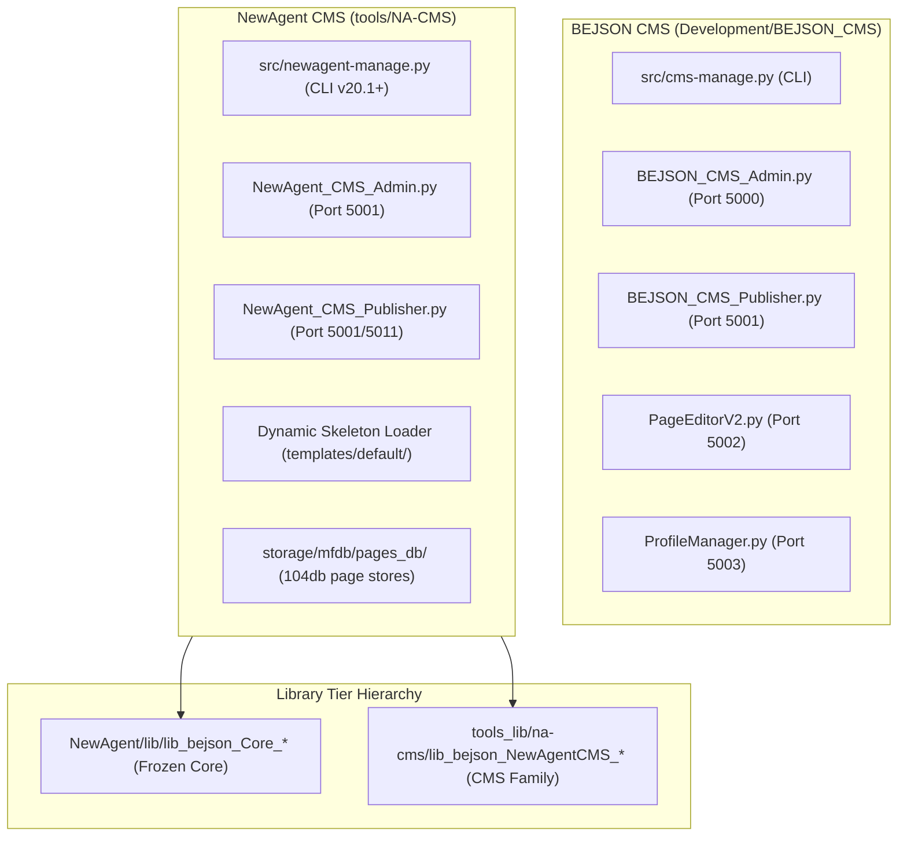

# `project-bejson-cms-grounding` (Layer 5 Project Domain Grounding & Architectural Mapper)

## Summary

`project-bejson-cms-grounding` provides architectural blueprints, schema specifications, repository topologies, and operational navigation across both the standalone **BEJSON CMS** (`/storage/emulated/0/Admin/Dev/Repos/BEJSON_CMS` and mirror `/storage/emulated/0/Admin/Dev/Python/Development/BEJSON_CMS`) and the integrated **NewAgent CMS** (`/storage/emulated/0/Admin/Dev/Repos/NewAgent/tools/NA-CMS`).

---

## When to Use

- Analyzing or modifying the CMS codebase, its Flask services, or its static export publisher.
- Navigating the dual architecture: the 4-microservice standalone suite vs. the streamlined NewAgent CMS fork.
- Inspecting MFDB manifest structures (`104a.mfdb.bejson`), entity schemas, and two-part page storage (`pages_db/<uuid>.json`).
- Understanding library boundaries: shared frozen Core libraries (`NewAgent/lib/`) vs. tool-specific libraries (`tools_lib/na-cms/`).
- Inspecting the Dynamic Skeleton Loader registry (`resources/skeleton_registry.json`) and BEHTML layout standards.

## When NOT to Use

- Running active CLI management commands, entity CRUD mutations, or database backups (use `project-bejson-cms-manage`).
- Direct low-level CRUD mutations on standalone `.104.bejson` tables without CMS domain rules (use `bejson-104-core`).
- Validating general MFDB manifest schemas outside the CMS domain (use `mfdb-104-core`).
- Authoring or scaffolding new agent skills or auditing skill topologies (use `skill-architect`).

---

## 1. Dual Repository Architecture & Ecosystem Map



---

## 2. NewAgent CMS Architectural Topology (`tools/NA-CMS`)

Located at `/storage/emulated/0/Admin/Dev/Repos/NewAgent/tools/NA-CMS`:

```text
tools/NA-CMS/
|-- AGENTS.md                  # Developer operational rules and quick reference
|-- README.md                  # System overview and feature list
|-- advanced_launcher.py       # Multi-service daemon manager
|-- cms_launcher.sh            # Interactive shell runner
|-- config.json                # Bootstrap 104a configuration
|-- src/
|   |-- newagent-manage.py     # Unified CLI Toolkit (v20.1+)
|   `-- web/
|       |-- NewAgent_CMS_Admin.py       # Thin entrypoint registering the 4 Blueprints
|       |-- NewAgent_CMS_Shared.py      # Auth, paths, R() renderer
|       |-- NewAgent_CMS_System.py      # System Blueprint: Dashboard, config, reset
|       |-- NewAgent_CMS_Content.py     # Content Blueprint: Pages, categories, apps, authors
|       |-- NewAgent_CMS_Media.py       # Media Blueprint: Low-memory gallery & uploads
|       |-- NewAgent_CMS_Interface.py   # Interface Blueprint: Nav, ads, publish trigger
|       |-- NewAgent_CMS_Publisher.py   # Static site compiler & preview server
|       `-- NewAgent_CMS_Renderers.py   # Polymorphic page-type strategy renderers
|-- resources/
|   |-- skeleton_registry.json # BEJSON 104a registry tracking all HTML templates & {{tags}}
|   |-- templates/
|   |   |-- default/           # Canonical live skeleton HTML files (7 templates)
|   |   `-- _factory/default/  # Frozen baseline for factory reset
|   `-- styles/
|       |-- behtml.css         # Canonical BEHTML quantized theme (Ry=32px, 8-lane X-axis)
|       |-- dark.css           # Classic dark theme
|       `-- light.css          # Classic light theme
`-- storage/
    |-- mfdb/site_master/      # Manifest + tabular entity records (the database)
    |   |-- 104a.mfdb.bejson   # Central master manifest
    |   `-- data/*.bejson      # Tabular entity tables
    |-- mfdb/pages_db/         # Standalone 104db content files keyed by page_uuid
    |-- mfdb/assets/           # Optimized local media assets (WebP format)
    `-- builds/                # Ephemeral static export output directory
```

---

## 3. Storage Architecture: Two-Part Page Persistence

In NewAgent CMS, pages are decoupled into index metadata and body content:

1. **`PageRecord` (in `storage/mfdb/site_master/data/pagerecord.bejson`)**:
   - Fields: `page_uuid`, `page_title`, `page_slug`, `page_cat_name`, `page_type`, `page_created_at`, `page_external_url`, `page_author_name`, `page_featured_img`.
   - Category references resolve via **Category Name** (`page_cat_name`), not slug.
   - Author references resolve via **Author Display Name** (`page_author_name`).
2. **Page Content File (in `storage/mfdb/pages_db/<page_uuid>.json`)**:
   - Multi-record BEJSON `104db` format:
     - `PageMeta` row: `Record_Type_Parent`, `meta_title`.
     - `Content` row: `Record_Type_Parent`, `html_body`, `markdown_body`, `source_code`.
   - Both halves are required; creating a manifest row without the content file results in empty or broken pages.

---

## 4. Dynamic Skeleton Loader Architecture (v20.0+)

The legacy practice of embedding skeleton HTML as Python string literals in `NewAgent_CMS_Publisher.py` was replaced by the `SkeletonLoader` (`tools_lib/na-cms/lib_bejson_NewAgentCMS_cms_skeletons.py`).

### Structural Principles:
1. **Disk-Only Markup**: Skeletons reside only on disk in `resources/templates/default/`.
2. **Registry-Gated Validation**: `resources/skeleton_registry.json` tracks required `{{tags}}` per template.
3. **Pre-Publish Gate**: The static publisher checks all wired-up skeletons via `validate_all()` before touching `storage/builds/`. If any tag is missing, the build halts with a clear error report.
4. **Draft/Promote Safety**: Editing a template stages a draft copy, allows visual diffing (`skeleton diff`), verifies tags (`skeleton validate`), and creates an archival backup in `resources/templates/_history/` upon promotion (`skeleton promote`).

---

## 5. BEHTML & Featured Media Visual Standards

1. **BEHTML Quantized Grid (`behtml.css`)**:
   - X-axis partitioned into 8 octal lanes (`X0`..`X7` at 12.5% intervals).
   - Y-axis quantized to `Ry = 32px` row increments.
   - Tri-Color system: Pitch Black (`#000000`), Pure White (`#FFFFFF`), Accent Red (`#DE2626`).
2. **Optimal Featured Image Geometry**:
   - Standard 2:1 widescreen aspect ratio: **1280 × 640 px** (or 16:9 **1280 × 720 px**).
   - `.article-featured-image` CSS rule locks `aspect-ratio: 2 / 1; object-fit: cover; margin-bottom: calc(var(--behtml-ry) * 1.5); border: 1px solid var(--behtml-ethereal-line);`.
   - Image assets generated via `canvas-animation-studio` and compressed via `asset optimize` (WebP).
