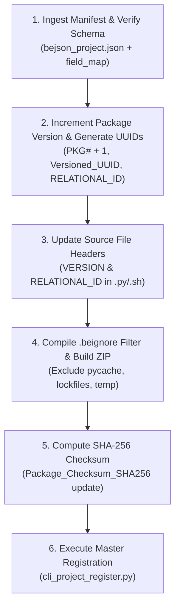

# project-delivery-packager (Layer 6 Composition Root & Delivery Packaging)

## Summary

`project-delivery-packager` is the canonical Layer 6 skill for bundling, versioning, and finalizing deliverable software packages. It operationalizes Policy §3 (Versioning, Packaging & Delivery Protocols), §4.6 (Base Project Schema v1.7.0 & GUID Governance), §4.7 (Master Index Registration), and §9 (File Delivery & Author Crediting). It automates package version increments (`PKG#` +1), generates release-scoped `Versioned_UUID` and script header `RELATIONAL_ID` fingerprints, updates `bejson_project.json`, strictly enforces `.beignore` archive exclusions, calculates SHA-256 checksums, and coordinates registration with the central master index.

## When to Use

- Packaging a project repository or tool for distribution as a compliant ZIP archive.
- Bumping package version numbers (`Package_Version` +1) before delivering payload modifications.
- Generating new `Versioned_UUID` and updating script-level `RELATIONAL_ID` headers.
- Enforcing Policy §3.4 `.beignore` exclusion filters (omitting bytecode, caches, locks, and temporary files).
- Calculating release package SHA-256 checksums (`Package_Checksum_SHA256`) and stamping them in `bejson_project.json`.
- Automatically triggering project registration via `$PROJECT_INDEX_ROOT/cli_project_register.py`.

## When NOT to Use

- Do NOT use for sweeping and organizing incoming downloads during session initialization (use `file-archive-coordinator`).
- Do NOT use for packaging codebases into single-file flat BEJSON text containers (`.104a.bejson.txt`) (use `chunking-core`).
- Do NOT use for synchronizing Git branch names, commit hashes, or Git release tags (use `git-release-automator`).
- Do NOT use for scaffolding directory structures or migrating tracking notes (use `file-subfolder-automator`).

---

## 1. Architectural Guardrails & Layer Boundary Laws

- **Assigned Skill Tier**: Layer 6 (`L6`) Composition Root
- **Codebase Layer Mapping**: `L5_Composition_Root`
- **Allowed Downward Dependencies**: Layers 1 through 5 (Coordinates entire ecosystem lifecycles)
- **GUID Governance Law (Policy §4.6 & §7.3)**: Never auto-generate or assign a global `Project_GUID`. Retain `"GUID_PLACEHOLDER"` until assigned by dedicated registration tooling.
- **Relational ID Scope**: Generate `Versioned_UUID` and update file-level `RELATIONAL_ID` only when modifying deliverable payloads or bumping package versions.
- **BEJSON Dynamic Field Map**: All `bejson_project.json` reads and writes resolve column indices dynamically via `field_map`. Positional indexing is strictly prohibited.

---

## 2. CLI Tooling & Execution

The skill is powered by the black-box packaging tool [`scripts/bejson_delivery_packager.py`](./scripts/bejson_delivery_packager.py).

### Command-Line Arguments

```text
usage: bejson_delivery_packager [-h] [--project-dir PROJECT_DIR]
                                [--output-dir OUTPUT_DIR]
                                [--change-log CHANGE_LOG] [--dry-run]
                                [--skip-register] [--version] [--register]
                                [--config] [--reset]

options:
  --project-dir PROJECT_DIR   Path to project root containing bejson_project.json (default: cwd)
  --output-dir OUTPUT_DIR     Custom output directory for ZIP archive
  --change-log CHANGE_LOG     Changelog message to append to Change_Log
  --dry-run                   Simulate packaging without modifying disk
  --skip-register             Skip executing master index registration
  --version                   Show program version and exit
  --register                  Self-register packager utility in master index
  --config                    Display environment and path configuration
  --reset                     Verify and reset default packaging directories
```

### Standard Invocation Examples

1. **Standard Delivery Package**:
   ```bash
   python3 ~/.gemini/config/skills/project-delivery-packager/scripts/bejson_delivery_packager.py \
     --project-dir "/storage/emulated/0/Admin/Dev/Python/Development/Cloud_Switchyard" \
     --change-log "Added multi-account routing support and background queue processing."
   ```

2. **Dry Run Simulation**:
   ```bash
   python3 ~/.gemini/config/skills/project-delivery-packager/scripts/bejson_delivery_packager.py \
     --project-dir "." --dry-run
   ```

3. **Global Launcher Command**:
   ```bash
   project-delivery-packager --project-dir "/path/to/project" --change-log "Release notes"
   ```

---

## 3. Step-by-Step Delivery Packaging Workflow



### Stage 1: Manifest Inspection & Field Mapping
- Locates `bejson_project.json` (or `.bejson_project.json`) in the project root.
- Strips boundary-layer whitespace from keys and values per Policy §10.9.
- Dynamically compiles the `field_map` dictionary for $O(1)$ column resolution.

### Stage 2: Version Increment & Fingerprinting
- Reads current `Package_Version`, converts to integer, and increments by `+1` (e.g. `100` &rarr; `101`).
- Generates a fresh UUIDv4 for `Versioned_UUID`.
- Updates `Package_Date` and `Project_Modified_Date` with current UTC timestamp (`YYYY-MM-DD`).
- Appends the new entry to `Change_Log`: `<Project_Version> | <YYYY-MM-DD> | <Message>`.

### Stage 3: Source Code Header Synchronization
- Walks project files (`.py`, `.sh`, `.bash`, `.js`, `.ts`).
- Detects standard header variables (`VERSION`, `RELATIONAL_ID`) and updates them in-place with the current release values.

### Stage 4: Archive Construction & Exclusion Filtering
- Evaluates exclusion patterns from `.beignore` (or canonical defaults).
- Packages all source code, `lib/`, `config/`, `dev/`, `docs/`, and manifest into a ZIP named:
  `Name_Case-V(Version)-PKG(Package_Version).zip`

### Stage 5: Cryptographic Integrity Hashing
- Computes SHA-256 checksum over the newly generated ZIP archive.
- Atomically writes `Package_Checksum_SHA256` back into `bejson_project.json`.

### Stage 6: Central Master Registration
- Locates `$PROJECT_INDEX_ROOT/cli_project_register.py`.
- Invokes registration: `python3 $PROJECT_INDEX_ROOT/cli_project_register.py --register "$PROJECT_DIR"`.
- Records `Is_Registered: true` upon successful confirmation.

---

## 4. Deterministic Exit Codes

| Exit Code | Semantic Meaning | Recovery Action |
|:---:|---|---|
| `0` | **Success** &mdash; Package bundled, checksum verified, registered. | Proceed with deployment or archive distribution. |
| `10` | **Path / Disk Failure** &mdash; Project root or target export directory missing or unwritable. | Check filesystem permissions and directory existence. |
| `20` | **Environment Failure** &mdash; Sourcing error or Python < 3.10 runtime detected. | Verify Python runtime and `paths.json` store. |
| `30` | **Schema / Manifest Failure** &mdash; `bejson_project.json` missing or corrupt. | Restore manifest or run schema validator. |

---

## 5. Companion References & Assets

- Reference Specification: [`references/packaging_and_delivery_standards.md`](./references/packaging_and_delivery_standards.md)
- Template: [`assets/beignore_template`](./assets/beignore_template)
- Executable Tool: [`scripts/bejson_delivery_packager.py`](./scripts/bejson_delivery_packager.py)

---

*Author: Elton Boehnen · boehnenelton2024@gmail.com · boehnenelton2024.pages.dev · github.com/boehnenelton*
