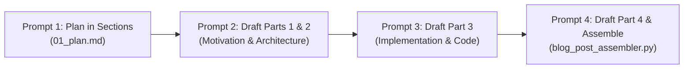

# publication-blog-post-writer (Layer 5 Use Cases & Publication Drafting)

## Summary

`publication-blog-post-writer` is the canonical Layer 5 skill for executing long-form, rigorous technical blog post authoring. Following the mandate from [`AGENTS.MD`](file:///data/data/com.termux/files/home/generate/blog_post_ideas/AGENTS.MD), it enforces a strict **4-prompt sequential pipeline**: Prompt 1 creates a detailed architectural plan in sections, Prompts 2 and 3 draft dedicated content sections with real codebase snippets, and Prompt 4 drafts the hardening conclusion and combines all sections into a polished, unified publication.

## When to Use

- Authoring comprehensive technical blog posts planned by `ideation-blog-post-planner`.
- Executing the 4-prompt writing workflow (Plan &rarr; Parts 1 & 2 &rarr; Part 3 &rarr; Part 4 & Assembly).
- Assembling modular sectional markdown files into a single publication file.
- Embedding verified code walkthroughs, CLI invocation tables, and architecture diagrams into blog drafts.

## When NOT to Use

- Do NOT use for initial topic discovery or scanning disk drives for ideas (use `ideation-blog-post-planner`).
- Do NOT use for extracting fine-grained conceptual patterns from chat notes (use `concept-idea-pattern-extraction`).
- Do NOT use for rendering raw BEHTML CSS token rules (use `behtml-design-preferences`).

---

## 1. Architectural Guardrails & 4-Stage Protocol

- **Assigned Skill Tier**: Layer 5 (`L5`) Use Cases & Publication Drafting
- **Codebase Layer Mapping**: `L3_Use_Cases_Cross_Layer_Blueprinting`
- **Allowed Downward Dependencies**: Layers 1 through 4
- **The 4-Prompt Pipeline**:
  - **Prompt 1**: Sectional Blueprint & Plan (`01_plan.md`).
  - **Prompt 2**: Draft Part 1 (Motivation) & Part 2 (Architecture).
  - **Prompt 3**: Draft Part 3 (Implementation Details & Verified Code).
  - **Prompt 4**: Draft Part 4 (Production Hardening & Horizons) + Automated Assembly.
- **Author Crediting**: Every completed article must credit author Elton Boehnen in the header and footer per Policy §9.2.

---

## 2. CLI Tooling & Execution

The skill is powered by [`scripts/blog_post_assembler.py`](./scripts/blog_post_assembler.py).

### Command-Line Arguments

```text
usage: blog_post_assembler [-h] [--sections-dir SECTIONS_DIR]
                           [--title TITLE] [--output-file OUTPUT_FILE]
                           [--version] [--register] [--config] [--reset]

options:
  --sections-dir SECTIONS_DIR Directory containing sectional draft markdown files
  --title TITLE               Article title for header
  --output-file OUTPUT_FILE   Destination path for assembled markdown file
  --version                   Show program version and exit
  --register                  Self-register utility in master index
  --config                    Display configuration
  --reset                     Verify assembler layout
```

### Standard Invocation

```bash
python3 ~/.gemini/config/skills/publication-blog-post-writer/scripts/blog_post_assembler.py \
  --sections-dir "~/generate/blog_post_ideas/drafts/zero_sql" \
  --title "Zero-SQL on Android: Building Portable Data Stores with BEJSON 104" \
  --output-file "~/generate/blog_post_ideas/drafts/zero_sql/assembled_article.md"
```

---

## 3. Step-by-Step 4-Prompt Workflow



---

## 4. Deterministic Exit Codes

| Exit Code | Semantic Meaning | Recovery Action |
|:---:|---|---|
| `0` | **Success** &mdash; Draft sections assembled into clean publication. | Proceed to publication or BEHTML rendering. |
| `10` | **Path Failure** &mdash; Sections directory or draft file not found. | Verify section file paths. |
| `20` | **Environment Failure** &mdash; Environment error or Python < 3.10. | Verify Python runtime. |
| `30` | **Validation Failure** &mdash; Corrupt content or incomplete sections. | Inspect sectional markdown files. |

---

## 5. Companion References & Assets

- Reference Specification: [`references/four_part_article_structure.md`](./references/four_part_article_structure.md)
- Executable Tool: [`scripts/blog_post_assembler.py`](./scripts/blog_post_assembler.py)

---

*Author: Elton Boehnen · boehnenelton2024@gmail.com · boehnenelton2024.pages.dev · github.com/boehnenelton*
