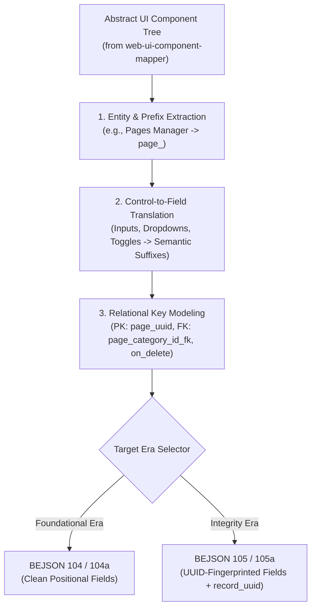

# Skill: `taxonomy-template-taxonomy` (Layer 5 - UI Template to Backend Taxonomy Synthesis)

- **Version**: `101`
- **Release_Version**: `300`
- **Architectural Layer**: `Layer 5 (L3_Use_Cases_Cross_Layer_Blueprinting)`
- **Era & Library Binding**: `Dual-Era (Foundational 104 & Integrity 105 Synthesis)`
- **Reference Specification**: `references/ui_to_schema_architecture_spec.md`
- **Synthesis Tool**: `scripts/derive_schema_from_ui.py`
- **Example Assets**:
  - `assets/derived_schema_example.104.bejson` (Foundational Era)
  - `assets/derived_schema_example.105.bejson` (Integrity Era)
- **Date Created**: `2026-10-19` (Updated `2026-10-24`)
- **RELATIONAL_ID**: `9e3b4a20-5c1d-48e7-b6a9-0f2c8d7e1a3b`
- **Author Credit**: Elton Boehnen · boehnenelton2024@gmail.com · boehnenelton2024.pages.dev · github.com/boehnenelton

---

## 1. Summary & Architectural Scope

`taxonomy-template-taxonomy` operates at **Layer 5** as the deterministic compiler that translates abstract UI templates, wireframes, and component tree maps (produced by `web-ui-component-mapper`) into comprehensive, optimized backend data taxonomies, entity schemas, and identifier specifications.

It is the symmetrical reverse counterpart to `template-taxonomy-template`:
- **`template-taxonomy-template`** goes **Taxonomy ──> Template** (marrying data definitions into BEHTML views and forms).
- **`taxonomy-template-taxonomy`** goes **Template ──> Taxonomy** (deriving backend schemas and entity prefixes from UI templates).

It applies `code-taxonomy-architect` standards to derive canonical entity prefixes (`<prefix>_`), synthetic UUID keys, declarative foreign keys (`_fk`, `fk_target_entity`, `fk_on_delete`), and self-describing field names with semantic suffixes (`_title`, `_desc`, `_metric`, `_timestamp`, `_url`, `_flag`).

### Dual-Era Support:
- **Foundational Era**: Emits clean BEJSON 104 entity tables or 104a metadata/config schemas.
- **Integrity Era**: Emits BEJSON 105/105a documents with pre-compiled `field_uuid` definitions, reserved `record_uuid` tracking, and declarative foreign key contracts.

---

## 2. Ingestion & Mapping Architecture



---

## 3. Semantic Extraction Rules

| UI Control in Template | Derived Schema Field Type | Inferred Suffix & Semantic Role |
|---|---|---|
| Single-line Text Input | `string` | `<prefix>_<name>_title` or `<prefix>_<name>_name` |
| Textarea / Markdown Editor | `string` | `<prefix>_<name>_desc` or `<prefix>_<name>_content` |
| Number Input / Metric Readout | `integer` or `number` | `<prefix>_<name>_metric` or `<prefix>_<name>_count` |
| Checkbox / Toggle Switch | `boolean` | `<prefix>_is_<state>_flag` |
| Dropdown Selector / Picker Modal | `string` | `<prefix>_<target>_id_fk` (Foreign Key) |
| URL Input / Hyperlink Action | `string` | `<prefix>_<name>_url` |
| Date / Time Picker | `string` | `<prefix>_<name>_timestamp` |

---

## 4. Bundled CLI Tooling

Synthesize data taxonomies from UI tree maps using [`scripts/derive_schema_from_ui.py`](./scripts/derive_schema_from_ui.py):

```bash
# Derive Foundational Era (104) schema
python3 scripts/derive_schema_from_ui.py component_map.txt --era 104 --output schema.104.bejson

# Derive Integrity Era (105) schema with UUID fingerprinting
python3 scripts/derive_schema_from_ui.py component_map.txt --era 105 --output schema.105.bejson
```

---

## 5. When to Use & When NOT to Use

### Use When:
- Translating frontend templates, wireframe maps, or UI component trees into backend data schemas.
- Defining canonical entity prefixes and snake_case identifier hierarchies from interface controls.
- Modeling relational graphs, primary keys, and foreign keys (`_fk`) from UI picker selectors.
- Emitting 104 or 105 BEJSON schemas directly matched to user interface specifications.

### Do NOT Use For:
- Materializing or scaffolding concrete BEHTML templates from schemas $\rightarrow$ Use [`template-taxonomy-template`](../template-taxonomy-template/SKILL.md).
- Planning multi-page site suites or blueprinting required template suites $\rightarrow$ Use [`template-tax-composer`](../template-tax-composer/SKILL.md).
- Raw UI component mapping without backend schema goals $\rightarrow$ Use [`web-ui-component-mapper`](../web-ui-component-mapper/SKILL.md).
- Quantizing elements into 8-lane Ry=32px spatial coordinate grids $\rightarrow$ Use [`behtml-design-preferences`](../behtml-design-preferences/SKILL.md).

---

Elton Boehnen · boehnenelton2024@gmail.com · boehnenelton2024.pages.dev · github.com/boehnenelton
