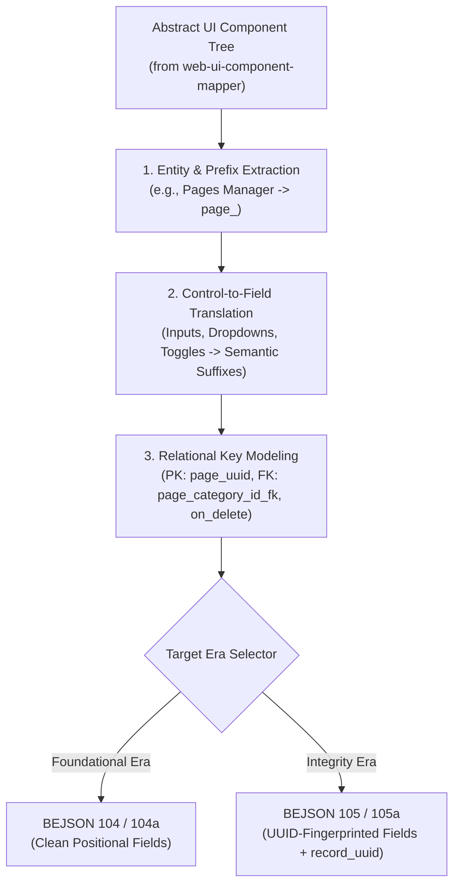

# Specification: UI-to-Schema Taxonomy Architecture

> **Parent Skill:** `ui-component-taxonomy-architect` (Layer 5)  
> **Architectural Layer:** `Layer 5 (L3_Use_Cases_Cross_Layer_Blueprinting)`  
> **Author:** Elton Boehnen · boehnenelton2024@gmail.com · boehnenelton2024.pages.dev · github.com/boehnenelton  
> **Effective Date:** October 2026  
> **RELATIONAL_ID:** `1e4f9b2c-6d5a-48e7-a3b1-8c0d9e7f5a2b`

---

## 1. Executive Summary

`ui-component-taxonomy-architect` provides the deterministic compilation engine to translate abstract, database-agnostic UI component trees (from `web-ui-component-mapper`) into fully formed, optimized backend data taxonomies, entity schemas, and identifier specifications.

It bridges front-end user interfaces and backend storage architectures across both:
- **Foundational Era (Release 300)**: BEJSON 104, 104a, 104db.
- **Integrity Era (Release 301 / v3.5.3+)**: BEJSON 105, 105a, 105db with mandatory `field_uuid` fingerprinting and reserved `record_uuid` tracking.



---

## 2. Entity & Prefix Allocation Rules

1. **Prefix Standard (Policy §10.2)**:
   - Exactly one snake_case prefix per entity (3–6 letters).
   - All fields belonging to the entity must share this exact prefix.
   - Never mix prefixed and unprefixed fields in the same entity.
2. **Entity Naming**:
   - PascalCase for entity names (`Page`, `MediaAsset`, `UserAccount`).
3. **Primary Key Standard (Policy §10.3)**:
   - Immutable UUIDv4 string.
   - Format: `<prefix>_uuid` or `<prefix>_id`.

---

## 3. UI Control to Semantic Field Translation Matrix

| UI Component in Tree Map | Inferred Field Name Pattern | Data Type | Semantic Role |
| :--- | :--- | :--- | :--- |
| `Title Input Box` / `Header Input` | `<prefix>_title` | `string` | Human-readable primary label |
| `Name Input Box` | `<prefix>_name` | `string` | Unique identifier name |
| `Body Textarea Editor` / `Canvas` | `<prefix>_content_body` | `string` | Long-form narrative or HTML/Markdown |
| `Summary Input` / `Snippet` | `<prefix>_summary` | `string` | Short description or excerpt |
| `<Target> Dropdown Selector` | `<prefix>_<target>_id_fk` | `string` | Foreign key referencing target entity PK |
| `Asset Picker Modal Overlay` | `<prefix>_asset_id_fk` | `string` | Heavy relational foreign key |
| `Active Checkbox Toggle` | `<prefix>_is_active` | `boolean` | Binary operational state |
| `Visibility Switch` | `<prefix>_is_visible` | `boolean` | Display flag |
| `Status Dropdown Selector` | `<prefix>_status` | `string` | Workflow lifecycle state |
| `Priority Radio Group` | `<prefix>_priority` | `string` | Discrete ordinal category |
| `Metric Readout Display` | `<prefix>_metric_count` | `integer` | Quantitative counter |
| `Price / Total Input Box` | `<prefix>_amount_total` | `number` | Financial or continuous metric |
| `URL Input Box` | `<prefix>_url` | `string` | Absolute or relative web address |
| `Timestamp / Date Readout` | `<prefix>_created_at` | `string` | UTC ISO-8601 creation timestamp |
| `Tag Input Box` | `<prefix>_tags` | `array` | Scalar list of keyword labels |
| `Config Dialog Window` | `<prefix>_config_settings` | `object` | Structured configuration map |

---

## 4. Dual-Era Emission Standards

### 4.1 Foundational Era (104 / 104a)
- Manifest / Tracker: BEJSON 104a.
- Dense Entity: BEJSON 104 with `Parent_Hierarchy`.
- `Fields`: Array of objects: `{"name": string, "type": string}`.
- Positional row alignment with zero UUID column overhead.

### 4.2 Integrity Era (105 / 105a / 105db)
- `Fields`: Each field object contains pre-compiled `field_uuid` (UUIDv4) and explicit foreign-key declarations:
  ```json
  {
    "name": "page_category_id_fk",
    "type": "string",
    "field_uuid": "f8a1e2b3-...",
    "fk_target_entity": "Category",
    "fk_on_delete": "cascade"
  }
  ```
- Reserved `record_uuid` column at index 0 for 105/105a (index 1 for 105db).

---

## 5. Write Ownership Contract (Policy §10.4)

Each generated schema specification designates exactly one Write-Owner module derived from Tier 1 of the UI component tree (e.g., `App_Admin.py` $\rightarrow$ `src/lib/lib_page_writer.py`). All UI forms and modal actions call this writer exclusively.

---

## 6. Real-World Architectural Case Study: BEJSON CMS & 13 Scaffolds

The canonical architecture reference (`/storage/emulated/0/Admin/Resources/Templates/Taxonomies/Architecture`) provides the definitive gold standard for projecting complex multi-module CMS applications into BEJSON 104/104db schemas and 13 canonical template archetypes.

### 6.1 Component-to-Schema Mapping Roster

| CMS Management Panel | Ingested UI Components | Synthesized Entity Schema | Primary Key | Key Relational Foreign Keys | Bound Template Scaffold |
| :--- | :--- | :--- | :--- | :--- | :--- |
| **Pages & Articles** | Title Input, Slug Field, Category Dropdown, Author Select, Excerpt Box | `PageRecord` (`page_`) | `page_uuid` | `page_cat_uuid_fk` (Category), `page_author_uuid_fk` (AuthorProfile) | `scaffold_content_page.html`, `scaffold_blog_post.html` |
| **Deep Content Body** | Markdown / HTML Canvas, Code Inspector, Pros/Cons Editor, Score Slider | `PageContent` (`104db`) | `page_uuid` | Detached two-tier file in `pages_db/<page_uuid>.json` | Embedded in page templates via `{{page_body_html}}` |
| **Category Manager** | Name Input, Slug Box, Feed Type Selector, Parent Category Dropdown | `Category` (`cat_`) | `cat_uuid` | `cat_parent_uuid` (Self-referencing hierarchy) | `scaffold_category_feed.html` |
| **Author Profiles** | Display Name Box, Biography Textarea, Avatar Asset Picker Modal | `AuthorProfile` (`author_`) | `author_uuid` | Referenced by `PageRecord.page_author_uuid_fk` | Inlined in `scaffold_blog_post.html` |
| **Media Asset Vault** | Drag-and-Drop Uploader, File Hash Display, MIME Badge, Dimensions | `MediaAsset` (`asset_`) | `asset_uuid` | Cryptographic SHA-256 deduplication (`asset_file_hash`) | `scaffold_image_feed.html`, `scaffold_image_lightbox.html` |
| **Video Stream Hub** | Stream Name Box, Provider Dropdown, Embed URL Input Box | `ExternalMedia` (`extmedia_`) | `extmedia_uuid`| Linked to `PageRecord` via `page_featured_video_url` | `scaffold_video_player.html`, `scaffold_video_feed.html` |
| **Document Library** | Spec Version Box, File Size Readout, PDF Asset Selector, License Select | `PageDocumentMetadata` (`doc_meta_`)| `doc_meta_uuid`| `doc_asset_uuid` (MediaAsset), `page_uuid` (PageRecord) | `scaffold_document.html`, `scaffold_consolidated_ebook.html` |
| **Project Showcase** | Project Title Box, Tech Stack Tag Input, Technical Spec JSON Editor | `ProjectShowcase` (`project_`) | `project_uuid` | `project_cat_uuid_fk` (Category) | `scaffold_project_showcase.html` |
| **Site Governance** | Key-Value Inputs, Brand Logo Picker, Base URL Box, Navigation Drawer | `SiteConfig` (`sys_`) & `NavLink` (`nav_`) | `sys_uuid`, `nav_uuid` | Global singleton reference across all page headers | `scaffold_master_index.html` & All Headers |

### 6.2 The Five Portable Widget Contracts
In addition to the 13 full-page scaffolds, five self-contained atomic widgets embed into `pages_db` content bodies under the Portable Widget Contract:
1. `widget_code_box.html`: Syntax-highlighted code block with language pill and copy-to-clipboard trigger.
2. `widget_cta_card.html`: Conversion callout card with headline, narrative body, and red accent (`#DE2626`) action link.
3. `widget_evaluation_card.html`: Structured benchmark card displaying pros/cons bullet grids and a 0.0–10.0 verdict score badge.
4. `widget_social_bar.html`: Horizontal inline social share trigger bar with self-contained inline SVGs.
5. `widget_video_player.html`: 16:9 responsive embed iframe with scoped CSS wrapper and lazy-load container.

---

Elton Boehnen · boehnenelton2024@gmail.com · boehnenelton2024.pages.dev · github.com/boehnenelton

