# Specification: Schema-to-UI Projection Architecture

> **Parent Skill:** `taxonomy-ui-component-architect` (Layer 5)  
> **Architectural Layer:** `Layer 5 (L3_Use_Cases_Cross_Layer_Blueprinting)`  
> **Author:** Elton Boehnen · boehnenelton2024@gmail.com · boehnenelton2024.pages.dev · github.com/boehnenelton  
> **Effective Date:** October 2026  
> **RELATIONAL_ID:** `8c3f71b2-4e5a-49d6-b1a8-2e0f9c7a5b3d`

---

## 1. Executive Summary

`taxonomy-ui-component-architect` provides the deterministic projection pipeline to synthesize complete, production-ready front-end component architectures and ASCII component tree maps directly from backend data taxonomies, BEJSON schemas, and entity registries.

It enforces the **Zero Unmapped Fields Law**: every backend field must have a deliberate, functional home in the user interface—either as a collection column/metric readout in data views, or as a dedicated interactive control in editor forms.

```mermaid
flowchart LR
    subgraph Backend["1. Backend Data Schema"]
        direction TB
        E["Entity Declaration"]
        PK["Primary Key (_id)"]
        FK["Foreign Key (_fk)"]
        F1["Semantic Suffixes (_title, _desc, _flag, _metric)"]
    end

    subgraph Pipeline["2. Projection Engine"]
        direction TB
        P1["Entity -> [SECTION] Domain"]
        P2["Table Columns & Badges"]
        P3["Form Inputs & Selectors"]
        P4["Modal Pickers & Actions"]
    end

    subgraph Frontend["3. UI Component Tree Map"]
        direction TB
        T1["Tier 1: Entry Surface"]
        T2["Tier 2: [SECTION] Domains"]
        T3["Tier 3: [CARD] Panels"]
        T4["Tier 4: [TOOLBAR] Controls"]
        T5["Tier 5: Atomic Inputs & Buttons"]
    end

    Backend --> Pipeline --> Frontend
```

---

## 2. Field-to-Component Semantic Projection Rules

| Semantic Suffix / Pattern | Backend Type | View Presentation (Tables / Cards) | Form / Interactive Control (Editor / Modals) |
| :--- | :--- | :--- | :--- |
| `*_id`, `*_uuid` (PK) | `string` | Table Column: Identifier Display | Read-only Identifier Badge |
| `*_title`, `*_name`, `*_label` | `string` | Table Column: Title Display / Card Title | `Title Input Box` (single-line text) |
| `*_desc`, `*_content`, `*_body` | `string` | Content Snippet / Text Excerpt | `Main Body Textarea Editor` + `[TOOLBAR]` |
| `*_fk` (Foreign Key) | `string` | Table Column: Related Entity Name / Badge | `<Entity> Dropdown Selector` or `Modal Picker` |
| `*_flag`, `is_*`, `has_*` | `boolean` | Status Badge (Active / Inactive) | `Checkbox Toggle` or `Switch` |
| `*_status`, `*_state` | `string` | Category Status Badge | `Status Dropdown Selector` / `Radio Group` |
| `*_count`, `*_total`, `*_metric` | `integer`/`number` | `Metric Readout / Display Title` | `Number Input Box` / Stepper |
| `*_url`, `*_link`, `*_href` | `string` | Table Column: Shortcut Link | `URL Input Box` |
| `*_created_at`, `*_date` | `string` (ISO-8601)| Monospace Timestamp Readout | `Date Picker Input Box` / Read-only Stamp |
| `array` (scalar items) | `array` | Pill Tag Row / Badges Array | `Tag Input Box` or Chip Selector |
| `array` / `object` (nested) | `array`/`object` | Expandable Sub-table Row | `Sub-record Editor Modal Overlay` |

---

## 3. Structural Projection Architecture (The 5 Tiers)

1. **Host Entry Point (Tier 1)**:
   - Derived from the Write-Owner module declared in `schema_registry.104a.bejson` (Policy §10.4) or primary route script (e.g. `App_Admin.py`).
2. **Functional Module (Tier 2)**:
   - Each distinct entity or entity cluster forms a `[SECTION] <Entity> Management`.
3. **Containers & Panels (Tier 3)**:
   - **Collection View**: `[CARD] <Entity> Directory Panel` containing the data table and search bar.
   - **Editor Canvas**: `[SECTION] <Entity> Editor Form` containing input groups and action footers.
   - **Related Pickers**: `Modal: <Target> Picker Overlay` for foreign key lookups.
4. **Toolbars & Groups (Tier 4)**:
   - `[TOOLBAR] Table Action Bar` (Filter input, Create action button, Bulk actions).
   - `Input Group: Metadata Controls` (Titles, selectors, toggles).
   - `Input Group: Content Canvas` (Formatting tools, textareas, media embed triggers).
5. **Atomic Interactive Controls (Tier 5)**:
   - Specific buttons, input boxes, dropdown selectors, and action triggers.

---

## 4. The Zero Unmapped Fields Law

When projecting a schema with $N$ fields:
$$\sum \text{Mapped Fields in Views} + \sum \text{Mapped Fields in Forms} \ge N$$
Every field in `Fields` must be accounted for. Hidden fields (such as row timestamps or system UUIDs) must be explicitly mapped as metadata readouts or background parameters, never silently omitted.

---

Elton Boehnen · boehnenelton2024@gmail.com · boehnenelton2024.pages.dev · github.com/boehnenelton
