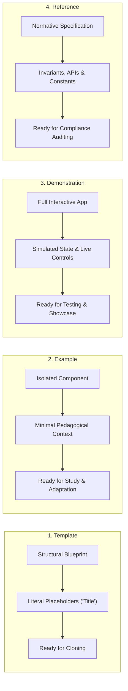

# Reference Specification: Deliverable Taxonomy (Template vs. Example vs. Demonstration vs. Reference)

> **Parent Skill:** `template-literal-skeleton` (Layer 4)  
> **Policy Binding:** Policy §12.4 (GEMINI.md)  
> **Author:** Elton Boehnen · boehnenelton2024@gmail.com · boehnenelton2024.pages.dev · github.com/boehnenelton  
> **Effective Date:** October 2026  
> **RELATIONAL_ID:** `7c3f81e9-2a4b-48d6-95e1-0c58a91df347`

---

## 1. Executive Summary

To maintain structural and semantic integrity across software scaffolds, documentation, and user interfaces, deliverables must never conflate **Templates**, **Examples**, **Demonstrations**, and **References**. Each serves a distinct lifecycle role, enforces different content boundaries, and requires a different consumption workflow.

---

## 2. Core Definitions & Behavioral Contracts

### 2.1 The Template (Scaffold / Blueprint)
* **Definition**: An uninstantiated structural skeleton. It defines the layout geometry, spatial grid, DOM hierarchy, and CSS class hooks, but is populated **exclusively** with literal placeholder labels (`Title`, `Content Body`, `Menu Header`, `Menu Item 1`, `Column 1`, `Cell 1-1`) or parameterized placeholder slots (`{{VAR:-default}}`).
* **Zero-Filler Law**: Absolutely no filler text, no "lorem ipsum", no fictional narrative, and no simulated business copy.
* **Role**: Primary starting baseline for new work. Cloned or instantiated directly by a developer or script, ready to receive real production data without requiring cleanup of dummy articles or fake stories.
* **Scope**: Complete artifact skeleton (e.g. `Template_Standard_Page.html`, `config.json`).
* **Interactivity**: Structural mechanics only (e.g., drawer open/close, basic tab switching). No simulated application telemetry or fake databases.

### 2.2 The Example (Pedagogical Pattern / Implementation Snippet)
* **Definition**: A focused, educational snippet or micro-implementation illustrating how a specific pattern, algorithm, syntax, or component works in isolation.
* **Content Rules**: Contains minimal, realistic sample context strictly necessary to teach the technical mechanism (e.g., a code snippet illustrating `<button class="btn btn--danger">Delete</button>` or a Python snippet demonstrating an O(1) `_FieldMap` lookup).
* **Role**: Learning and pattern reference. Answers: *"How do I implement or invoke pattern X?"*
* **Scope**: Atomic and localized (a single function, an isolated button component, or a single table row). Never masquerades as a full production application.
* **Interactivity**: None or minimal (code snippet or isolated component sandbox).

### 2.3 The Demonstration (Operational Showcase / Test Harness)
* **Definition**: A fully operational, end-to-end artifact showcasing multiple integrated subsystems, styles, and dynamic states working together in a live environment.
* **Content Rules**: Fully populated with coherent, realistic or simulated test fixtures (e.g. active coordinate readouts, live telemetry charts, layer depth sliders, dev grid overlays, working filter triggers).
* **Role**: Capability verification, visual proof of concept, and regression testing. Answers: *"What does the system look like and how does it behave when all constraints and components work together?"*
* **Scope**: Complete, multi-feature running application or interactive view (e.g. `BEHTML Dashboard Demonstration.html`).
* **Interactivity**: Fully functional and interactive under live conditions.

### 2.4 The Reference (Normative Contract / Specification / Lookup)
* **Definition**: An authoritative, non-executable technical specification, invariant sheet, cheat sheet, or API/token contract documenting definitions, constants, tokens, data schemas, mathematical constraints, and error codes.
* **Content Rules**: Fact-dense, declarative, and normative. Contains exact dimension formulas ($R_y = 32\text{px}$, 16-sublane coordinate geometry, Z-plane $layer \times 32$), token palettes (`#000000`, `#FFFFFF`, `#DE2626`), AST signatures, exit code rosters (0, 10, 20, 30), and error registries (E01-E12, E90-E95, 430-433).
* **Role**: Ground truth and auditing standard. Answers: *"What are the exact mathematical bounds, rules, and APIs governing this system?"*
* **Scope**: Comprehensive system documentation or lookup dictionary.
* **Interactivity**: Non-executable. Static reference documentation.

---

## 3. Comparison Matrix

| Property | Template | Example | Demonstration | Reference |
| :--- | :--- | :--- | :--- | :--- |
| **Primary Intent** | Production Scaffolding / Cloning | Education / Pattern Learning | Capability Showcase / Test Harness | Normative Authority / Auditing |
| **Content State** | Literal Placeholders (`Title`, `Menu Item 1`) | Minimal pedagogical sample snippet | Coherent simulated fixtures & active telemetry | Formal contracts, tables, formulas & APIs |
| **Filler / Lorem Ipsum** | ❌ **Strictly Forbidden** (Zero Filler) | Permitted only as required to teach | Active simulated state & test telemetry | ❌ Irrelevant (pure specification) |
| **Completeness** | Full structural skeleton, zero domain data | Atomic snippet, partial component | Complete, interactive, integrated system | Exhaustive declarative contract / lookup |
| **Lifecycle Role** | Cloned to start a new project | Studied to write code | Executed to inspect fidelity and behavior | Consulted to verify conformance |
| **Required Action** | Populate placeholders with real data | Adapt pattern into application logic | Test and observe live interactions | Audit code and validate schemas |
| **Auditor Gate** | Must pass `verify_zero_filler.py` | N/A (Code reference / documentation) | Must pass operational / regression tests | Must match source code & schemas |

---

Elton Boehnen · boehnenelton2024@gmail.com · boehnenelton2024.pages.dev · github.com/boehnenelton
