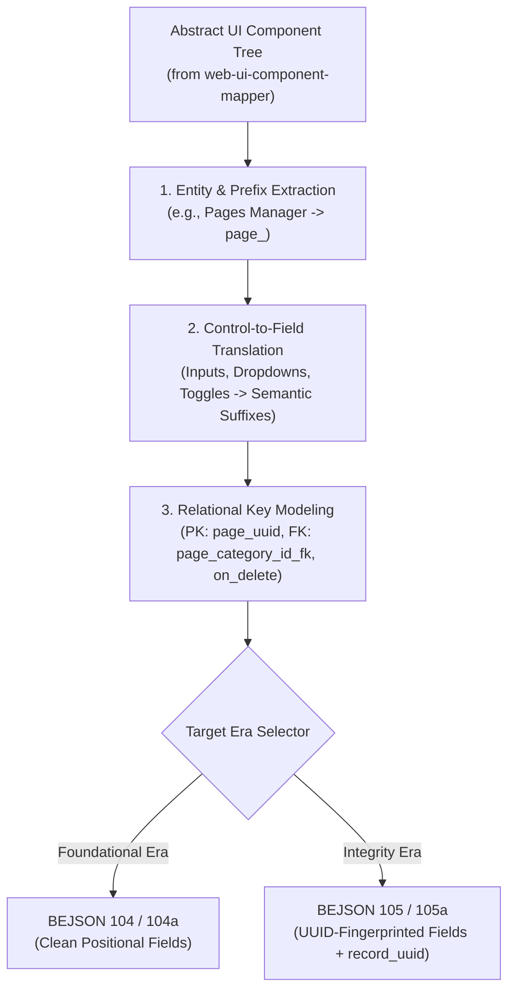

# Skill: `ui-component-taxonomy-architect` (Layer 5 - UI Component to Backend Taxonomy Synthesis)

- **Version**: `100`
- **Release_Version**: `300`
- **Architectural Layer**: `Layer 5 (L3_Use_Cases_Cross_Layer_Blueprinting)`
- **Era & Library Binding**: `Dual-Era (Foundational 104 & Integrity 105 Synthesis)`
- **Reference Specification**: `references/ui_to_schema_architecture_spec.md`
- **Synthesis Tool**: `scripts/derive_schema_from_ui.py`
- **Example Assets**:
  - `assets/derived_schema_example.104.bejson` (Foundational Era)
  - `assets/derived_schema_example.105.bejson` (Integrity Era)
- **Date Created**: `2026-10-19`
- **RELATIONAL_ID**: `9e3b4a20-5c1d-48e7-b6a9-0f2c8d7e1a3b`
- **Author Credit**: Elton Boehnen · boehnenelton2024@gmail.com · boehnenelton2024.pages.dev · github.com/boehnenelton

---

## 1. Summary & Architectural Scope

`ui-component-taxonomy-architect` operates at **Layer 5** as the deterministic compiler that translates abstract UI component tree maps (produced by `web-ui-component-mapper`) into comprehensive, optimized backend data taxonomies, entity schemas, and identifier specifications.

It applies `code-taxonomy-architect` standards to derive canonical entity prefixes (`<prefix>_`), synthetic UUID keys, declarative foreign keys (`_fk`, `fk_target_entity`, `fk_on_delete`), and self-describing field names with semantic suffixes (`_title`, `_desc`, `_metric`, `_timestamp`, `_url`, `_flag`).

### Dual-Era Support:
- **Foundational Era**: Emits clean BEJSON 104 entity tables or 104a metadata/config schemas.
- **Integrity Era**: Emits BEJSON 105/105a documents with pre-compiled `field_uuid` definitions, reserved `record_uuid` tracking, and declarative foreign key contracts.

---

## 2. Ingestion & Mapping Architecture



---

## 3. Semantic Translation Table

| UI Element in Component Tree | Inferred Column Identifier | Data Type | Semantic Role |
| :--- | :--- | :--- | :--- |
| `Title Input Box` / `Header Input` | `<prefix>_title` | `string` | Primary human-readable title |
| `Name Input Box` | `<prefix>_name` | `string` | Unique label |
| `Body Textarea Editor` / `Canvas` | `<prefix>_content_body` | `string` | Long-form content body |
| `Summary Input` / `Excerpt` | `<prefix>_summary` | `string` | Short description |
| `<Target> Dropdown Selector` | `<prefix>_<target>_id_fk` | `string` | Foreign key referencing target PK |
| `Asset Picker Modal Overlay` | `<prefix>_asset_id_fk` | `string` | Heavy relational foreign key |
| `Active Checkbox Toggle` | `<prefix>_is_active` | `boolean` | Binary state |
| `Status Badge` / `Status Dropdown` | `<prefix>_status` | `string` | State/Workflow enum |
| `Metric Readout Display` | `<prefix>_metric_count` | `integer` | Quantitative metric |
| `URL Input Box` | `<prefix>_url` | `string` | Web address link |
| `Date / Timestamp Readout` | `<prefix>_created_at` | `string` | UTC ISO-8601 timestamp |

---

## 4. Automated Synthesis CLI

Execute [`scripts/derive_schema_from_ui.py`](file:///data/data/com.termux/files/home/.gemini/config/skills/ui-component-taxonomy-architect/scripts/derive_schema_from_ui.py) to compile schemas from UI component maps:

```bash
# 1. Synthesize Foundational Era BEJSON 104 schema:
python3 scripts/derive_schema_from_ui.py <component_map.txt> --format 104 --output schema.104.bejson

# 2. Synthesize Integrity Era BEJSON 105 schema with field_uuid & record_uuid:
python3 scripts/derive_schema_from_ui.py <component_map.txt> --format 105 --output schema.105.bejson

# 3. Synthesize canonical schema_registry.104a.bejson:
python3 scripts/derive_schema_from_ui.py <component_map.txt> --format registry --output schema_registry.104a.bejson
```

---

## 5. Boundary Rules & Negative Guardrails

- **Do NOT** perform raw UI component mapping without a backend schema target $\rightarrow$ Use [`web-ui-component-mapper`](file:///data/data/com.termux/files/home/.gemini/config/skills/web-ui-component-mapper/SKILL.md).
- **Do NOT** audit general code identifiers or module signatures without UI trees $\rightarrow$ Use [`code-taxonomy-architect`](file:///data/data/com.termux/files/home/.gemini/config/skills/code-taxonomy-architect/SKILL.md).
- **Do NOT** quantize visual elements into 8-lane Ry=32px coordinate grids $\rightarrow$ Use [`behtml-design-preferences`](file:///data/data/com.termux/files/home/.gemini/config/skills/behtml-design-preferences/SKILL.md).

---

Elton Boehnen · boehnenelton2024@gmail.com · boehnenelton2024.pages.dev · github.com/boehnenelton
