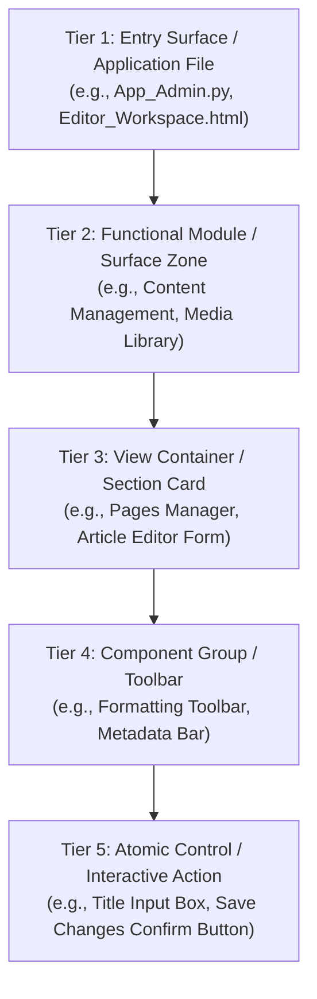

# Specification: Web UI Component Mapping Architecture

> **Parent Skill:** `web-ui-component-mapper` (Layer 4)  
> **Architectural Layer:** `Layer 4 (L4_Presentation_Transport)`  
> **Author:** Elton Boehnen · boehnenelton2024@gmail.com · boehnenelton2024.pages.dev · github.com/boehnenelton  
> **Effective Date:** October 2026  
> **RELATIONAL_ID:** `9a8b7c6d-5e4f-3a2b-1c0d-9e8f7a6b5c4d`

---

## 1. Executive Summary

`web-ui-component-mapper` establishes a deterministic analytical framework for extracting, structuring, and mapping the complete component-level interface hierarchy of web applications, content management systems (CMS), admin portals, and interactive dashboards.

It produces clean, database-agnostic tree maps capturing functional UI composition from the top-level application entry point down to atomic interactive controls, intentionally decoupling visual structure from backend schemas, API endpoints, or database storage specifics.

---

## 2. Core Five-Tier Architectural Hierarchy

1. **Tier 1: Entry Surface / Application File**
   - The primary host file, view blueprint, or route module that initializes the interface.
   - Examples: `App_Admin.py`, `Editor_Workspace.html`, `Dashboard_View.jsx`.
2. **Tier 2: Functional Module / Surface Zone**
   - The high-level functional domain or workspace within the application.
   - Examples: `Content Management`, `Media Library`, `Site Configuration`, `Publisher Engine`.
3. **Tier 3: View Container / Section Card**
   - Specific screens, view panels, tabbed switchers, modals, or distinct visual cards.
   - Examples: `Pages Manager`, `Article Editor Form`, `Bulk Action Drawer`, `Asset Picker Modal`.
4. **Tier 4: Component Group / Toolbar**
   - Functional clusters of related controls.
   - Examples: `Metadata Bar`, `Formatting Toolbar`, `Filter Bar`, `Table Header Row`.
5. **Tier 5: Atomic Control / Interactive Action**
   - Individual leaf elements possessing defined interaction roles.
   - Examples: `Title Input Box`, `Category Dropdown Selector`, `Upload File Button`, `Save Changes Confirm Button`.

---

## 3. Standard Component Nomenclature

All tree nodes must use consistent, descriptive, non-technical terminology:

| Component Category | Normalized Structural Label | Canonical Examples |
| :--- | :--- | :--- |
| **Containers** | `[SECTION]`, `[PANEL]`, `[CARD]`, `[DRAWER]` | System Overview Card, Edit Panel, Details Drawer |
| **Toolbars** | `[TOOLBAR]`, `[ACTION BAR]` | Editor Formatting Toolbar, Bulk Operations Bar |
| **Inputs** | `Input Box`, `Textarea Editor`, `Search Input` | Title Input Box, Body Textarea, Filter Input Box |
| **Selectors** | `Dropdown Selector`, `Radio Group`, `Checkbox Toggle` | Category Dropdown Selector, Status Toggle |
| **Modals** | `Modal Overlay`, `Dialog Window` | Asset Picker Modal, Embed Media Dialog |
| **Tables / Lists** | `Data Table`, `Card Grid`, `Collapsible List` | Pages Data Table, Media Grid, Asset Row Item |
| **Actions** | `Button`, `Confirm Action`, `Shortcut Link` | Save Changes Confirm Button, Delete Action Button |

---

## 4. Tree Mapping Invariants

1. **Backend Leak Prohibition**:
   - Never reference SQL tables, database foreign keys, primary key fields, JSON keys, or API schemas.
   - Describe what the user sees and touches (`Category Dropdown Selector`, not `category_id_fk`).
2. **Exhaustive Leaf Coverage**:
   - Never stop at high-level navigation links. Tree maps must descend all the way to atomic buttons, inputs, and selectors.
3. **Top-Down Hierarchy**:
   - Structure must follow a strict top-to-bottom, left-to-right user reading order.
4. **Clean ASCII Formatting**:
   - Maps use standard ASCII branch markers (`|`, `+--`, `\--`) for maximum terminal and documentation portability.

---

Elton Boehnen · boehnenelton2024@gmail.com · boehnenelton2024.pages.dev · github.com/boehnenelton
